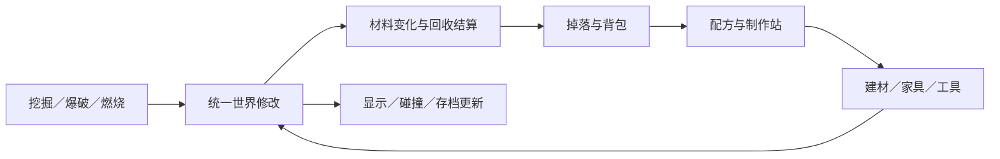

# Noita＋泰拉瑞亚融合 Demo 内容方案

> [!abstract] 已确定的方向
> **草原建家 → 洞穴采矿 → 回家制作与改杖 → 建造战场 → 在草原召唤并击败史莱姆王。**
>
> 探索建造为主，保留世界与基地，用 Noita 式材料和法术影响采集、建造与战斗。草原、洞穴、史莱姆王为用户确定目标；下述网格比例、配方、回收和死亡规则为设计提案。

## 1. Demo 内容围绕这一条成长线

| 范围 | 第一版内容与作用 |
|---|---|
| 草原 | 树木、草地、普通史莱姆；提供木材与凝胶，承载营地和玩家自建战场。 |
| 洞穴 | 石材、铁矿、金矿、红宝石、积水、落沙和少量油区；提供制作与召唤材料。 |
| 建造 | 木/石前景块、背景墙、平台、门、火把、工作台、熔炉、铁砧、箱子。 |
| 成长 | 初始采集工具与基础法杖，随后制作工具、基础防护和法杖升级。 |
| 阶段目标 | 制作召唤物，返回草原布置战场，击败史莱姆王；世界仍可继续建设。 |

首次完整流程暂以 20～30 分钟为目标。关键矿点与红宝石先保证可获得，局部布置再随机，避免首次体验被稀有材料搜索拖住。

工程骨架、石墙闭环和独立材料实验场已建立；人物、家具、制作与完整探索流程仍未实现。以下集中说明后续建造、破坏、采集和制作怎样连接。当前实现、长期架构与性能安排见 [[技术框架与性能]]，搭建阶段记录见 [[工程验证]]。

## 2. 世界结构：建造按格，材料与碰撞按实际形状

建议使用两种尺度，但每类事实只有一份权威数据：

| 数据 | 负责什么 | 具体规则 |
|---|---|---|
| **材料网格** | 前景实体材料及其流动、燃烧、破损。 | 记录实际材料；剩余形状决定人物碰撞、弹体遮挡和液体阻挡。 |
| **建造与背景网格** | 操作对齐、背景墙、家具占位。 | 前景完整度从材料网格推导；背景墙独立保存。 |
| **功能实体** | 工作台、熔炉、箱子、门、平台等。 | 保存唯一 ID、占地、支撑条件、功能和内部物品；按对象规则交互。 |

比例可先用 **1 个建造格＝8×8 个材料单元**试验；这个 8 是本项目原型参数，之后根据角色比例和性能调整。

这不是让一份完整方块碰撞覆盖另一份破损像素图。格子只提供操作坐标，前景是否被挖穿要查询真实材料。小洞是否能通过，还取决于角色身体尺寸。

前景、背景和功能的分离可以参考 tModLoader 的 Tile 公开接口；该接口本身经过 tModLoader 改造，不能当成 Terraria 原版底层存储的复刻。[^tile]

## 3. 建造与破坏：先区分对象，再统一修改入口

### 不同建造物承担不同作用

| 对象 | 放置与破坏规则提案 |
|---|---|
| 木块、石块 | 按格放入材料网格，可以被局部挖掉；木材能烧，实体石块墙能挡水。 |
| 背景墙 | 按格独立放置与拆除，不阻挡人物或液体；回收按背景墙配方处理。 |
| 平台 | 用专门的单向站立规则；人物可从下方穿过，水可流过，木平台仍能燃烧损坏。 |
| 门与家具 | 按完整对象放置；门的开关改变阻挡状态，家具完整性控制功能。 |
| 草皮与树 | 草皮作为泥土表面覆盖，树带采集身份；树叶视觉与可回收树干分开。 |

平台不能只画一条普通实心木带，否则它会同时变成挡水坝。背景墙也不能替代前景墙封住水。

放置前统一检查：**操作距离与可触及性、空间占用、支撑条件、背包材料和人物重叠**。普通实心块允许从已有相邻块延伸；功能家具再检查自己的支撑要求。

有液体时，先查找附近可容纳空间，再挤出液体并放置；空间不足则放置失败。成功提交时才扣材料，不能靠放方块直接删除水。整栋建筑受力坍塌留到后续，首版实心建材保持固定地形。

### 工具与法术改变同一份材料

- **镐**：持续挖掘一个选中格，完成后移除其中工具能处理的材料，按实际数量回收。破损格只处理剩余部分。
- **斧**：负责树木。整树采集也按尚未烧毁、尚未采出的树干预算结算，树叶不额外提供木材。
- **挖掘法术与爆炸**：按圆形、射线等范围修改像素，可留下半块和裂口；同样检查材料硬度与破坏能力。
- **火焰**：将可燃材料转化为火、烟等结果，消耗掉的木材不再同时掉出原量木材。

操作手感不同，材料修改、回收和存档走同一入口。挖矿速度、伤害和破坏硬度分别配置。

家具先按整件对象处理：正常拆卸返还家具与内容物；烧毁或炸毁时停用功能、移除占位，内容物散落，本体是否回收由对象规则决定。失去必要支撑也只结算一次。箱子不会因为分成多个占地格而重复掉物。

## 4. 采集：内部按实际量记账，界面保持物品操作

以实心石块为例，假设 **64 单位石材＝1 个可放置石块**：

| 情况 | 回收与消耗 |
|---|---|
| 完整挖掉 64 个材料单元 | 产生共 64 单位石材的掉落，拾取后可显示为 1 块。 |
| 爆破移除了 24，留下 40 | 可采出的部分最多转移 24 单位，剩余 40 仍在世界中；整块总量不会变成 128。 |
| 再挖掉剩余 40 | 两次合计最多回收原来的 64 单位；若有转化或损失，回收更少。 |
| 新建一个实心石块 | 消耗 64 单位并写入 64 个材料单元。 |
| 修补缺失 24 的同类石块 | 填补空缺并消耗 24 单位，仍要检查液体与其他占用。 |

资源用整数小单位保存，避免浮点累计误差；不足一块的余量可作为资源条显示并保留，凑足后自然形成完整数量。武器、家具、法术卡等独立物品仍按件计数。

**64 只适用于上面定义的实心石块示例。** 平台、背景墙、砖块等产品有各自的输入、产量与回收定义，不能一律按贴图面积换算原料。

同一份可回收材料只能处在一种位置：世界材料、可回收颗粒、掉落包、容器或背包。移动沙粒不产生新资源；把材料转成掉落包时要同步移除原世界材料。普通挖掘的飞散碎屑可用纯视觉粒子，减少掉落实体数量。

附近同类掉落合并成资源包。拾取是数量转移，未能装入的部分仍保留。树木采集、箱子拆卸、史莱姆掉凝胶都按各自唯一对象结算，不能同时再按相同像素生成一份奖励。

## 5. 制作：材料、制作站和产物组成配方

首版建议按下表连接草原、洞穴与史莱姆王，具体数量待试玩调整；这是本项目提案，不是 Terraria 原版配方表。

| 原料与条件 | 制作结果 | 作用 |
|---|---|---|
| 木材，徒手 | 工作台、基础建材 | 建起第一处营地。 |
| 木材＋凝胶 | 火把 | 草原击杀收益支持洞穴探索。 |
| 石材＋木材＋火把，在工作台附近 | 熔炉 | 打开矿石加工路线。 |
| 铁矿/金矿，在熔炉附近 | 铁锭/金锭 | 连接地下资源与设备成长。 |
| 铁锭，在工作台附近 | 铁砧 | 打开金属装备与召唤物制作。 |
| 木材＋铁锭，在铁砧附近 | 工具、基础装备或法杖升级 | 改善采集效率、生存或施法能力。 |
| 金锭＋红宝石＋凝胶，在铁砧附近 | 史莱姆王召唤冠 | 让草原战斗与洞穴探索共同推进阶段目标。 |

召唤冠的制作站先采用本 Demo 的铁砧；召唤物在草原使用，由玩家自行选择和建设战场。

配方数据保存：**ID、输入与数量、输出与数量、所需制作站、可选进度条件**。这一结构可参考 tModLoader 的 Recipe API，物品消耗与制作站条件分别声明。[^recipe]

功能家具提供制作站标记，例如 `workbench`、`furnace`、`anvil`。玩家靠近仍有效的实体即可制作，家具被破坏后停止提供条件。首版加工在满足条件时即时完成，暂不引入燃料、生产队列与离线加工。

制作时先核对材料、站点与输出空间，再一次性扣料并添加产物。输出放不下则本次不制作；配方判断先只读取玩家背包。不同金属、木材变体以后可以通过材料组接入，不把它们硬编码到制作逻辑。

## 6. 在 Godot 中的实现组织

材料定义、物品定义、建造定义和配方分别配置，由 ID 关联。石材是世界材料，石块是可放置物品，二者通过数量规则连接；红宝石资源和凝胶掉落也无需自动变成新的液体模拟。

材料网格使用分块数组组织，前景按变化区块更新画面；角色碰撞查询真实材料与功能对象，功能家具使用独立实体。若为物理体生成地形碰撞轮廓，也只重建变化区域。

`TileMapLayer` 可以承担背景墙与规则格显示。它是按 TileSet 组织的格子地图，更新默认在帧尾批处理；像素前景仍由自己的材料数据管理，须安排好画面与碰撞更新的时序。[^godot]

每次世界修改提交时重新核对目标状态，记录实际改变的材料和回收量，再通知显示、碰撞、家具支撑与存档。输入、工具、法术各自提出修改请求，避免分别操作地形却各算一次掉落。

必须保存：前景材料与破损、背景墙、功能实体及箱内物品、掉落包、背包资源余量、制作进度和首领状态。远处区域先暂停模拟，回来继续；死亡回营地、保留物品与世界的规则仍为首版提案。

## 7. 最先做出的三个场景

1. **一面石墙**：放置整块→炸掉一角→按剩余量回收或补齐→保存再进入，形状和资源保持一致。
2. **一间带水槽的小屋**：比较实体墙、背景墙、平台与门怎样影响人物和水；烧毁木结构后，功能和内部物品正确变化。
3. **一次采矿制作**：洞穴取得铁矿→回家冶炼→建铁砧并升级工具→草原用平台搭战场，接上召唤冠成长线。

先把这三段做顺，再加入完整洞穴与史莱姆王战斗。网格比例、洞穴规模与同时活动材料量以原型结果确定；Windows PC 普通游玩接近 60 FPS 仍为暂定目标，需要记录测试机器与负载。

参考原版分析：[[世界基础系统]]、[[材料、地形与物理]]、[[角色与环境]]、[[战斗与能力组合]]、[[物品、资源与成长]]、[[敌人与世界生态]]。

[^tile]: [tModLoader Tile 文档](https://docs.tmodloader.net/docs/stable/struct_tile.html)：公开接口分别提供前景、背景墙、液体等信息，并明确提示 tModLoader 改造过 Tile 实现。本文的双尺度与功能实体方案是本项目设计。
[^recipe]: [tModLoader Recipe 文档](https://docs.tmodloader.net/docs/stable/class_recipe.html)、[项目维护者的 Basic Recipes](https://github.com/tModLoader/tModLoader/wiki/Basic-Recipes)：输入、制作站、产物与附加条件可以分别配置。本文配方及结算流程为本项目提案。
[^godot]: [Godot TileMapLayer 文档](https://docs.godotengine.org/en/stable/classes/class_tilemaplayer.html)：按 TileSet 组织地图，更新在帧末批处理。这里只用于确认节点职责与时序，不代表已经验证像素模拟性能。
