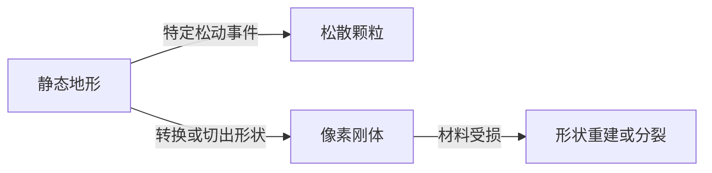
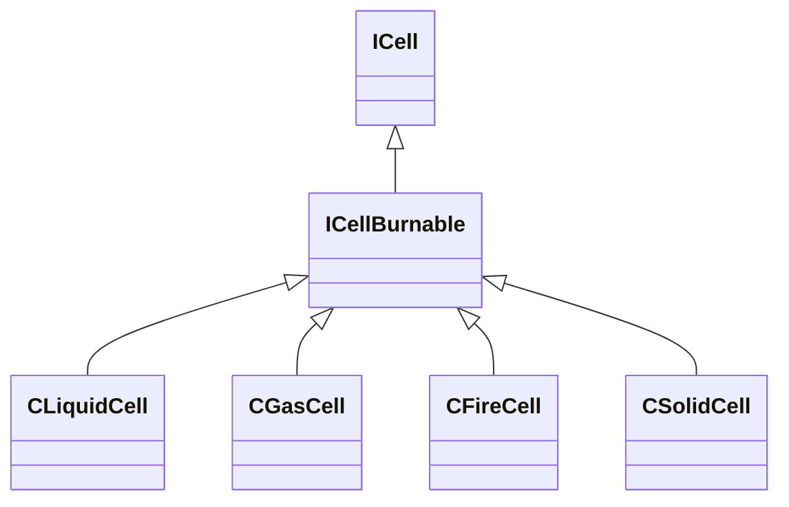
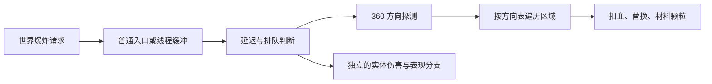
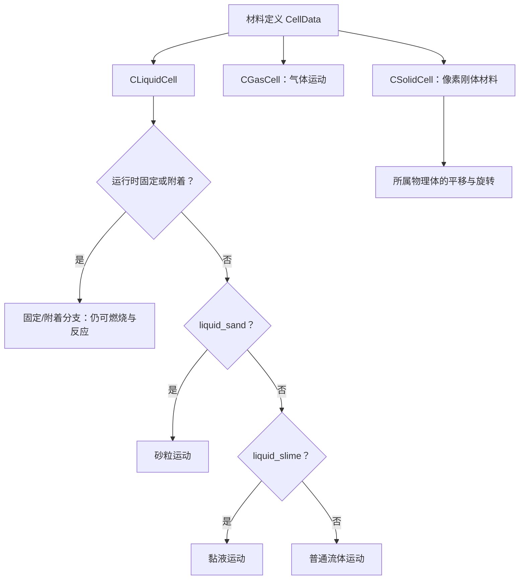

# Noita 材料、地形与物理

> [!abstract] 先抓住五点
> **材料定义决定行为 → 网格模拟处理颗粒、液体和气体 → 反应改写材料 → 攻击按不同路径破坏地形 → 刚体与角色各自处理运动和碰撞。**

| 核心问题 | 原版规则 |
|---|---|
| 石头、水、木箱用同一种物理吗？ | 静态网格、可流动材料和像素刚体有不同处理路径。 |
| 看到 `liquid` 就代表会流动吗？ | 不一定。岩壁也可归在此类别，再由沙粒与静态标记固定。 |
| 挖掘能力由伤害数值决定吗？ | 要分别看材料耐久门槛、破坏能量、范围和具体破坏机制。 |
| 挖掉支撑就会整体坍塌吗？ | 没有适用于全部地形的统一承重规则；部分坍塌由材料或事件触发。 |
| 炸掉的材料会自动变成物品吗？ | 材料移除、颗粒生成、容器收集和物品掉落是不同处理。 |

本文沿用 [[世界基础系统]] 的坐标与分块背景，集中解释材料怎样运动、反应、破坏并参与物理。主依据为本地配置和随游戏附带文档；开发者历史说明、社区解释与未确认部分分别标注。未进行运行时取样。

## 1. 材料是什么：定义、标签与物理状态

`data/materials.xml` 定义材料类型；它不是逐像素运行时内存结构的声明。一份定义可以包含运动参数、耐久、燃烧、反应标签、外观和音效。`CellDataChild` 通过 `_parent` 派生变体，反应继承另有 `_inherit_reactions` 配置。[^materials]

**同一种物质可以有多个材料 ID，分别承担固定地形、松散颗粒或刚体用途。** 不能只按游戏中的显示名称合并材料。

| 材料 ID | 本地关键配置 | 在系统中的角色 |
|---|---|---|
| `water` | `cell_type=liquid`、`liquid_sand=0` | 流动液体。 |
| `sand` | `cell_type=liquid`、`liquid_sand=1` | 松散粉末。 |
| `sand_static` | 在沙粒模式上设置 `liquid_static=1` | 固定砂土地形。 |
| `rock_static` | `liquid_sand=1`、`liquid_static=1` | 固定岩壁。 |
| `wood_static` | 静态沙粒模式、`burnable=1` | 可燃的固定木质地形。 |
| `wood_prop` | 继承 `wood`；`cell_type=solid`、`solid_static_type=0` | 木箱等物体使用的动态刚体材料。 |
| `steam` | `cell_type=gas` | 气体。 |
| `fire` | `cell_type=fire`、`on_fire=1` | 火焰材料。 |

这里的 `solid` 属于刚体材料分支，具体是否固定、怎样断裂，还要看 `solid_static_type` 等字段。原文件注释列出了动态、固定、可断裂、树式断裂、冰式断裂等模式；不能把所有 `solid` 都解释成自由掉落物。[^materials]

标签同样有独立用途。例如 `[corrodible]` 可以参与酸反应匹配；标签与 `cell_type`、`liquid_static` 不是同一个维度。

## 2. 材料怎样运动：局部移动与密度交换

开发者公开的基础模型是落沙式元胞自动机：液体尝试下落，受阻后向侧面移动；密度差可通过交换相邻材料表现。气体的基本趋势相反，优先向上。2026-10-28 已从本机二进制继续恢复砂、普通流体、黏液与气体的局部运动和交换分支，集中见第 16 节；全世界的调度与所有外力路径仍未恢复。[^developer][^motion_native]

本地配置提供进一步区分：

| 参数 | 控制方向 | 读取时的边界 |
|---|---|---|
| `liquid_sand` / `liquid_static` | 粉末模式、是否固定 | 需要结合 `cell_type` 判断。 |
| `density` | 密度与材料交换相关 | 不是“所有东西只比较密度就交换”的通用规则。 |
| `liquid_gravity` | 下落相关参数 | 不是已经确认的现实重力单位。 |
| `liquid_damping` | 普通流体侧移后乘到横向累计值；胶水显式为 0.9。 | 通用构造值为 0.8；不同运动分支不保证消费同样的字段。见 16.1。 |
| `liquid_viscosity` / `liquid_flow_speed` | 砂与黏液的概率分支；普通流体的横向累计 | 已恢复的具体比较、默认值与侧移公式见 16.1、16.4，不能只按名称解释。 |
| `liquid_sticks_to_ceiling` | 黏附相关行为 | 不能直接当结构承重强度。 |
| `liquid_slime` | 黏液运动分支 | 与 `[slime]` 反应标签分别判断。 |

本地水显式 `liquid_gravity=1.5`、油为 0.5、沙为 0.9；这些是配置数值，尚不能当作已验证的位移单位。第三方 NoitaPatcher 的直接内存绑定还记录了 `CLiquidCell.is_static`、若干未知浮点字段及更新区域结构；它没有给出液体更新函数，不能把 `is_static` 直接认定为普通水的休眠标记。[^liquid_binding]

例如水的 `density=4`、油为 1、沙为 6；`soil` 还设置了黏滞和顶部黏附参数。固定地形则通过静态配置维持位置。它们共享材料系统，但没有共用一套完全相同的移动规则。[^materials]

胶水 `glue` 的原定义使用粉末标记 `liquid_sand=1`、重力 0.2、流速 0.1、洞顶黏附参数 100；普通黏液 `slime` 使用 `liquid_sand=0`、`liquid_slime=1`、重力 0.1、洞顶黏附参数 40。`cloud_slime` 则是重力 0、寿命 10 的 liquid，虽然带 `[slime]` 标签，却没有启用 `liquid_slime`。第 15、16 节分别给出附着与黏液运动的二进制证据；配置中存在某个参数，不代表实际选中的运动分支必然使用它。[^materials]

**显示出来的粒子也分两类。** `ParticleEmitterComponent` 的 `create_real_particles` 创建网格材料；`emit_cosmetic_particles` 创建视觉粒子。后者可以有视觉碰撞，但没有同等的世界物理交互，且会在摄像机范围外裁减。[^components]

## 3. 材料怎样反应：接触配方与状态转化

### 接触反应会直接改写材料

原配置的 `Reaction` 使用 `input_cell1/2/3` 描述输入，`output_cell1/2/3` 描述输出。输入可以指定材料，也可以匹配标签。部分反应还带区域半径、寿命条件和快速处理标记。[^reactions]

本机配置共有 325 条 `Reaction`，其中 32 条显式设置第三输入。例如 `[fire] + water_salt + water_salt` 的输出是原火、`salt` 与 `steam`；铜、黄铜和水的三输入配方生成银与烟。配置与算法分开核对：2026-10-28 已恢复一条接触反应路径的邻域、概率缩放及第三输入检查，见第 10 节；不据此假定全部调用者行为相同。[^reactions]

| 原配置中的组合 | 对应输出 | 说明 |
|---|---|---|
| `[fire]` + `water` | 火焰输入保留，水变为 `steam` | 接触反应直接生成蒸汽。 |
| `[lava]` + `water` | `rock_static` + `steam` | 可以产生固定地形；还配置了局部反应半径。 |
| `[acid]` + `[corrodible]` | 酸输入保留，被腐蚀材料变为 `acid_gas` | 反应按标签匹配，不是一次普通爆炸挖洞。 |
| `water` + `cement` | `concrete_static` + `air` | 流动材料可以转成固定结构。 |

本地熔岩＋普通水和熔岩＋盐水的 `blob_radius1/2` 都为 6/3，但后者输出 `rock_static_glow`；熔岩＋泥为 4/4，输出 `sand_static` 和蒸汽；熔岩＋血为 4/4，输出 `lavarock_static` 和蒸汽。这些组合都显式设置两个 `blob_restrict_to_input_material` 开关。`water_ice + ice_static + air` 则有 4/4 区域字段，只显式限制第一输入。**第 11 节已恢复直接世界入口的圆内遍历与受限径向采样两分支，并确认线程包装先追加请求；未声明开关的完整默认规则、缓冲消费与重叠冲突仍需追踪。** 项目实现见 [[技术框架与性能]]，不能由字段名称推导完整算法。[^reactions]

这是具体配方的简写，不代表输入材料只有这些反应。`probability` 数值也不能直接解释为“每个像素每帧发生该百分比的反应”，还取决于引擎如何选取和检查材料。

原配置还使用 `[meltable_metal]_molten` 和 `[meltable]_molten` 等表达式。实际定义有 `copper/copper_molten`、`brass/brass_molten`、`silver/silver_molten`、`gold/gold_molten`、`wax/wax_molten`。铜/黄铜/银/金熔体遇 `[water]` 分别回对应金属并产蒸汽；遇 `[frozen]` 保留后者。固定钢材带 `[meltable_metal_generic]`，其熔化输出是通用 `metal_sand_molten`；单独的 `steel_molten` 淬冷输出 `steel_sand`，不能把这些名字合并成同一种固定钢墙。熔蜡还有接触空气回蜡的表达式。[^reactions]

熔体显式 `on_fire=1`、`burnable=1`、`fire_hp=90000`；`liquid_fire` 是带 `[fire_strong]` 的 liquid，`fire_hp=1000000`，不属于气态 fire 类型。配置可以证明初始标记和数值，不能单独证明燃料单位、每步消耗、产生视觉火焰的频率或未写燃尽产物时的引擎缺省行为。[^materials]

### 燃烧、冷热与导电另有参数

| 行为 | 本地字段与例子 |
|---|---|
| 燃烧 | `burnable`、`fire_hp`、`autoignition_temperature`、`temperature_of_fire` 等；木头与油均有相应配置。 |
| 冷热转化 | 水配置 `warmth_melts_to_material=steam`、`cold_freezes_to_material=ice_static`。 |
| 导电 | `electrical_conductivity`；固定钢材显式为 1，油为 0。 |

这些字段能证明相应行为入口存在，不能据此推导完整热传导、电路算法，或把温度数值当成摄氏度。材料的 `hp`、燃烧相关 `fire_hp`、实体生命值也是不同参数。[^materials]

随附组件文档另列出 `ElectricityComponent` 的能量、速度、分叉次数/能量及加热概率；列出的默认能量为 1000、速度为 32。`data/entities/misc/electricity.xml` 显式设置 `probability_to_heat=0.1`。`ElectricitySourceComponent` 与 `ElectricityReceiverComponent` 分别提供发射周期和接收范围/有效时间，`ElectricChargeComponent` 还有实体充电时间和发射间隔。因此不能把导电材料开关、实体电能传播、视觉火花和角色触电合并成一个材料标签。`spark_electric` 是带 `[fire]` 的火焰类材料，粒子实体也会使用同名精灵；它的名字本身不证明材料会产生电能。精确路径选择、分叉、损耗、缺省导电性和加热公式仍未验证。[^electricity]

## 4. 地形怎样被破坏：门槛、消耗与不同路径

### 爆炸挖掘有不止一个限制

本地材料有 `durability`、`hp`；爆炸配置另有 `max_durability_to_destroy`、`ray_energy` 和 `explosion_radius`。社区技术记录曾提供射线消耗 HP 的解释；第 13 节已进一步从本机二进制确认 **360 方向探测 → 区域遍历 → 按硬度判断并扣单元 HP** 的路径。探测时扣的是局部能量，后续才改写单元，不能把两步合成同一个逐射线删除循环。[^hardness][^explosion_native]

普通 `gunpowder` 没有独立 `ExplosionConfig`；`gunpowder_explosive` 则含 `ray_energy=400000`、`cell_explosion_radius_min=8`、`cell_explosion_power=40` 与 `cell_explosion_damage_required=20`。这只能确认两者有不同配置，不能由此推出每粒对应一次完整爆炸、半径增长、引信时间、默认破坏上限或压力触发的单位。[^materials]

本地 `tnt` 则是独立的 `solid`：密度 8、耐久 11、材料 HP 10000、`fire_hp=600`；其 `ExplosionConfig` 显式为 `ray_energy=50000`、`cell_explosion_radius_min=5`、`cell_explosion_power=40`、`cell_explosion_damage_required=30`。这些原始数值不直接给出引信时长、残留材料或刚体压力公式，也不能与炸药箱实体的生命值和死亡爆炸规则混用。[^materials]

| 材料 | `durability` 门槛 | 材料 `hp` |
|---|---:|---:|
| 松散沙 `sand` | 4 | 800 |
| 木箱材料 `wood_prop` | 8 | 5,000 |
| 固定木头 `wood_static` | 10 | 2,000 |
| 固定砂土 `sand_static` | 10 | 19,000 |
| 岩石 `rock_static` | 10 | 100,000 |
| 湿岩变体 `rock_static_wet` | 10 | 200,000 |
| 固定钢材 `steel_static` | 12 | 130,000 |
| 神殿砖 `templebrick_static` | 14 | 1,000,000 |

以上按父材料属性解析，未填值不等于零。**固定砂土、岩石和湿岩门槛相同，但穿透消耗不同；门槛高低与挖掘深浅是两个问题。** 第 13.4 已确认爆炸路径会减写单元当前 HP，HP 仍大于零时保留该单元；这不能外推为所有攻击共用相同的累计损伤机制。[^materials][^explosion_native]

### 不同攻击使用不同破坏入口

| 路径 | 原版例子 | 本地能够确认的参数 |
|---|---|---|
| 爆炸挖洞 | 普通炸弹 | 半径 60、`ray_energy=6000000`、耐久上限 11。 |
| 弹丸穿透 | 光钻 `luminous_drill` | `ground_penetration_coeff=4`、穿透耐久上限 14；组件文档说明穿透深度还与质量有关。 |
| 范围移除材料 | 黑洞 `black_hole` | `CellEaterComponent` 半径 12，可处理动态物理体，并排除 `[indestructible]` 标签。 |
| 接触转化 | 酸、熔岩等 | 依照匹配配方和材料属性转化，不由同一个爆炸参数统一控制。 |

黑洞自身设为不与世界地形碰撞，移除能力由 CellEater 承担。因此“弹丸是否撞墙”与“它能否改变墙体”也需要分开理解。[^attacks]

爆炸对实体的伤害、是否挖洞、是否移除液体、是否推动刚体，都有独立配置。材料 `hp` 与 `DamageModelComponent.hp` 不能混用；例如木箱形状使用 `wood_prop`，实体又拥有自身生命值。[^attacks][^bodies]

## 5. 静态地形怎样变成刚体，以及怎样破碎

**原版没有对所有岩壁统一执行“失去支撑就坍塌”。** 开发者说明，大爆炸可以挑选合适材料转成坍塌颗粒，或切出形状创建刚体。当前配置也能找到对应的事件和转换入口：[^developer][^collapse]

- 普通炸弹会加载 `loose_ground.xml`。其中的 `LooseGroundComponent` 用概率触发松动；组件文档还定义了耐久限制，以及生成顶部刚体块的参数。
- `ice_static` 指定 `convert_to_box2d_material=ice_glass`；入口处可碎岩石也定义了对应的刚体材料。
- 刚体材料可以指定 `solid_break_to_type` 和 `solid_on_sleep_convert`。例如 `ice_glass` 的转换目标为 `ice_static`；具体触发时机不能仅凭字段名定死。



刚体可以由 `PhysicsImageShapeComponent` 的图片形状与材料创建，再交给 `PhysicsBodyComponent` 或 `PhysicsBody2Component` 处理。普通木箱明确使用 `wood_prop`；Box2D 接口负责位置、角度、受力和速度等。[^bodies]

开发者公开的桥接方式是：刚体像素知道所属刚体及局部位置；像素被破坏后重新计算形状，必要时拆成多个物体。当前组件文档也有像素计数、砂层交互和地形桥接字段。**轮廓提取、分裂判定及重建调度的完整实现仍未确认。**[^developer][^bodies]

实体与刚体的生命周期还可分开：`on_death_leave_physics_body` 允许实体死亡后保留物理体；Body2 也有独立的销毁关联配置。因此，实体消失、材料被移除和刚体消失并非同一个事件。

## 6. 碰撞怎样区分地形、液体、角色与刚体

公开 API 本身就提供不同目的的空间查询：[^queries]

| 查询 | 游戏附带文档中的含义 |
|---|---|
| `Raytrace` | 遇到材料单元时停止。 |
| `RaytraceSurfaces` | 排除流体、气体和火焰，查询表面。 |
| `RaytraceSurfacesAndLiquiform` | 排除气体和火焰，保留液态材料。 |
| `RaytracePlatforms` | 查询角色可以站立的材料。 |
| `PhysicsBodyIDQueryBodies` | 查询区域内的 Box2D 物理体。 |

这里的查询类别不能直接等同于 XML 的 `cell_type`。**某处有材料、会挡住攻击、能够站立、能让角色游动，是不同判断。**

角色通过 CharacterData、CharacterPlatforming、PlayerCollision 等组件处理身体范围、着地和移动；刚体则有自己的物理组件。角色参数还包含液体对速度的影响，刚体参数包含浮力、是否穿过沙层、是否接入网格世界等设置。[^components]

材料还提供 `solid_friction`：木材及继承后的 `wood_prop` 为 0.9，`steel_static` 为 0.75，冰为 0.05。它们是实际配置值，尚未运行原版来验证具体接触混合公式。`wood_prop` 材料密度为 6、水为 4，不能仅凭这两个数字就断言原版木箱必然沉底。[^materials]

本机组件文档另列 `PhysicsBodyComponent/PhysicsBody2Component.buoyancy` 默认 0.7；`PhysicsImageShapeComponent` 指定图像和材料，另一种 `PhysicsShapeComponent` 则自有 `density=0.75`、`friction=0.75` 等形状参数。木箱实体引用图像形状与 `wood_prop`。[^box_shapes] 这些不同入口不足以还原通用质量换算或浮力公式。缺省值、材料配置和实际求解应分别确认。[^components]

原版 API 的材料区域转换还带 `trim_box2d` 参数，用于尝试减少与物理体重叠造成的问题；部分物理 API 则明确要求在世界坐标与 Box2D 单位间转换。这说明网格世界与刚体之间有专门的衔接处理，但尚不能由接口还原全部碰撞顺序。[^queries]

## 7. 一次挖掘之后，材料去了哪里

一次爆炸可以分别产生地形空洞、实体伤害、刚体冲量和粒子效果。普通炸弹还会额外生成松动地形的实体，所以连锁坍塌可以来自后续过程，而不只是爆炸瞬间直接删掉一个圆。[^attacks][^collapse]

资源接收又是另一条明确路径：挖掘弹 `digger.xml` 开启了 `collect_materials_to_shooter=1`。组件文档说明，这会找到施法者的 `MaterialInventoryComponent`，依据爆炸移除的材料更新容器中的数量。**前提是有相应容器；这不等于自动生成背包里的方块物品。**[^collection]

`MaterialInventoryComponent` 本身按材料类型保存数量，可配置容量、死亡时洒出、内部反应等；粒子发射器也能选择从材料库存取料。由此可以确认：原版同时存在网格中的材料、刚体材料、容器中的材料计数，以及独立物品实体。它们之间的转移由具体组件控制。[^collection]

## 8. 本机二进制静态分析：材料类、世界类与字段入口

2026-10-27 对安装目录中的 `noita.exe` 和 `noita_dev.exe` 做只读 PE/RTTI 分析，并使用已安装的 MSVC `dumpbin` 对少量函数反汇编。没有启动游戏、注入、修改 EXE、修改安装配置或接触玩家存档。本节是二进制静态证据，不是已经恢复原版引擎源码或完成运行时验证。

复现脚本为 [inspect_noita_binary.py](../../tools/inspect_noita_binary.py)，只依赖 Python 标准库：

```powershell
python tools/inspect_noita_binary.py --source 'E:/SteamLibrary/steamapps/common/Noita'
```

默认报告位于 [audit.json](../../build/evidence/noita-static/audit.json)，包含 EXE SHA-256、PE 节区、导入函数、RTTI 字符串、经过层级描述符交叉核验的继承关系，以及虚表候选地址。输出必须在安装目录之外。脚本按本机 x86 PE32/MSVC RTTI 格式解析，拒绝直接套用到 x64 文件；字段依据 PE 格式与 LLVM 的 Microsoft ABI 实现，不把原始字符串命中直接当成类继承证明。[^binary_formats]

### 已直接确认的结构

两个 EXE 均为 x86 PE32，首选 ImageBase 为 `0x400000`，COFF 符号数为 0。CodeView 中有 `falling_everything.pdb` 名称，但不能由此认定安装包提供完整符号或源代码。安装目录的代码与文档资源不能等同于引擎 C++ 源码。

| 文件 | SHA-256 |
|---|---|
| `noita.exe` | `808d2a0ab51ea0b46e9ad2aeb3327a4b0ce3feae04f32ba26326bf585b5779bd` |
| `noita_dev.exe` | `d2f7dbeff72b785bdadd068870343d2821cf4bd2f6c58125fe6a90a1b0900285` |

两者均可从 Complete Object Locator、Class Hierarchy Descriptor 和 Base Class Descriptor 恢复以下单元继承关系：



这确认了原版存在按材料处理类别划分的多态单元结构；并不证明每种木头、水或沙都有自己的 C++ 子类。共享 `ICellBurnable` 也不等于所有材料配置都可燃，仍需检查实际材料属性。当前尚未追踪工厂调用，因此不能仅凭 `wood_static.cell_type=liquid` 和类名，就宣布已确认它的实例分配及全部更新分支。

世界侧，两个二进制均确认 `IGridWorld` 派生自 `GridRandomUtility`；`GridWorld` 与 `GridWorldThreaded` 分别派生自 `IGridWorld`，不是依据名称把后者认定为前者的子类。开发版还包含 `CAutoList<GridWorldThreaded>` 基类条目。具体分配哪种世界实例、何时调度线程，尚需函数调用和运行时证据。

当前普通版主虚表候选入口如下；RVA 是相对映像基址的位置，不能跨版本照抄为进程绝对地址：

| 类 | 主虚表 RVA |
|---|---|
| `CLiquidCell` | `0xC0BB90` |
| `CGasCell` | `0xC07BCC` |
| `CFireCell` | `0xC096E0` |
| `CSolidCell` | `0xBF8A6C` |
| `GridWorld` | `0xC013BC` |
| `GridWorldThreaded` | `0xC17B24` |

候选表项的目标均检查为可执行节区内地址，但连续函数指针扫描不是对表长或函数名的完整证明。程序还保留部分 `GridParticles` 更新、粒子顶点生成、世界绘制和世界保存任务的修饰类型字符串；这些能提供后续入口，不能直接证明调用顺序、线程数量或性能。

### 实际反汇编的小例子

对本机普通版 `CLiquidCell` 的虚表候选表项，已观察到：

| 函数 RVA | 指令中可确认的读写 | 尚不能确认的含义 |
|---|---|---|
| `0x1B01C0` | `movsx eax, byte ptr [ecx+20h]`，读取并符号扩展一字节槽 | 不能直接命名为静态标记或材料类型 |
| `0x1B01D0` | `mov eax, dword ptr [ecx+30h]`，读取 32 位槽 | 不能直接命名为速度、温度或寿命 |
| `0x1B01E0` | 将一个参数写入 `[ecx+30h]` | 需检查调用者和写入值来源 |
| `0x1B01F0` | 将同一个参数同时写入 `[ecx+34h]` 与 `[ecx+30h]` | 两字段的关联不能仅凭这个赋值确定 |
| `0x1B0200` | 读取 `[ecx+34h]` | 还不能确认字段的语言类型与单位 |

在该 MSVC x86 成员函数解释下，可以把第二项写成“读取 `this+0x30` 的 32 位原始值”的学习伪代码；这是行为描述，不是恢复了原函数名和 C++ 声明。原始反汇编保存于 [liquid-accessors.txt](../../build/evidence/noita-static/liquid-accessors.txt)，复现命令为：

```powershell
& 'D:/Visual Studio/18/Community/VC/Tools/MSVC/14.44.35207/bin/Hostx64/x64/dumpbin.exe' /nologo /disasm /range:0x5B01C0,0x5B020F 'E:/SteamLibrary/steamapps/common/Noita/noita.exe'
```

后续学习按问题推进：先从 `CellFactory` 的配置读取追到单元创建，再核对这些字段的初始化和调用点；随后选择一个液体或气体更新函数，恢复控制流、邻居访问与标记更新；最后用隔离的小场景验证位移、停止条件和跨块行为。分块调度与刚体衔接在确定单元更新入口后继续追踪。第三方逆向绑定可作对照，但必须先匹配二进制版本并独立验证，不能替代本机证据。

## 9. 原版燃烧：功能清单与关键算法

本节分析本机原版，日期为 **2026-10-28**。已恢复的核心包括点燃概率、随机邻居传播、火焰与烟的生成、依赖生成结果的缺氧熄灭、两种不同的燃尽路径及变色。**不能把原版概括为“温度达到阈值，每帧扣燃料，烧完变灰”。** 角色着火、材料燃烧、独立火焰单元有不同入口；本节没有修改本项目规则，也没有运行原版验证持续时间。[^burning_native]

证据标记：**【配置】** 原始 XML/Lua；**【接口】** 随游戏附带的组件说明；**【二进制】** 本机指令直接支持；**【推断】** 对字段用途或视觉含义的解释；**【未确认】** 尚未恢复的行为。下文函数名均为分析用名称，不声称恢复了原始 C++ 符号。缺省属性不按零处理。

### 9.1 功能边界：哪些路径都属于燃烧

| 功能 | 已找到的入口及证据 | 恢复程度 |
|---|---|---|
| 可燃性、初始着火、点燃难度 | 材料属性解析、基类构造与点燃函数 | 配置与局部算法已确认 |
| 普通点燃、强制点燃、点燃时换材 | 基类两个入口、液体类覆盖入口 | 已确认，世界换材函数内部未完全展开 |
| 邻居引燃、受火变色 | 随机四邻居、目标可燃与着火检查、颜色函数 | 已确认局部算法 |
| 火焰和烟 | 独立概率、独立材料、向上三个候选位置 | 已确认局部算法 |
| 缺氧衰减、直接熄灭 | 火焰放置成功反馈；清除燃烧标记 | 已确认局部算法 |
| 网格材料燃尽、刚体像素烧损 | `CLiquidCell` 概率路径、`CSolidCell` 计数路径 | 已确认主要分支，存在未解释条件 |
| 独立火、火花、燃烧气体 | `CFireCell`、`CGasCell` 各自更新 | 入口及部分逻辑确认，完整寿命未恢复 |
| 燃烧引爆、爆炸/电击点火 | 材料 ExplosionConfig、相关实体组件 | 配置及部分调用确认，完整引爆算法未恢复 |
| 沸腾、融化、可燃物接触转化 | 材料 Reaction 与冷热转化入口 | 配方已提取，反应调度未恢复 |
| 角色着火、沾染保护、火焰伤害 | DamageModel、GameEffect、状态表 | 沾染保护、点燃候选时长及部分计时分支已恢复，见角色专题；内建伤害公式未恢复 |
| 法术灭火、助燃、火把窒息、表现 | MagicConvertMaterial、Torch、ParticleEmitter、音效 | 配置/接口确认，不冒充完整系统反汇编 |

### 9.2 材料字段：完整提取的 14 个相关属性名

对当前资源的 466 个材料定义按父级解析属性，名称包含 `fire/burn/ignit/oxygen/smoke/flame` 的字段共 14 个。这个数量描述检索范围，不能证明所有内部状态只有这些字段。子节点中的 ExplosionConfig、Stains 等另存原文。[^burning_data]

| 字段 | 原版用途与证据 |
|---|---|
| `burnable` | 【配置/二进制】可燃性，传播时检查目标；不等于“当前着火”。 |
| `on_fire` | 【配置/二进制】构造时的初始燃烧状态。 |
| `fire_hp` | 【二进制】网格类与固体类使用方式不同，见 9.7；不是统一的剩余燃料。 |
| `autoignition_temperature` | 【二进制】派生 `100 - 此值` 参与普通点燃概率；不能仅按字段名当成温度比较。 |
| `temperature_of_fire` | 【二进制】初始化和恢复燃烧相关字节；不证明是摄氏温度。 |
| `generates_flames` | 【二进制】火焰生成尝试的概率门槛，缺省值未恢复。 |
| `generates_smoke` | 【二进制】烟生成尝试的概率门槛，与火焰分开。 |
| `requires_oxygen` | 【二进制】启用依赖火焰放置成功与否的强度恢复/衰减。 |
| `on_fire_convert_to_material` | 【配置/二进制】点燃入口就有换材分支，不能一律解释为燃尽产物。 |
| `on_fire_flame_material` | 【配置/二进制】火焰生成所用材料；液体类燃尽分支也使用对应材料 ID。 |
| `on_fire_smoke_material` | 【配置/二进制】烟生成所用材料。 |
| `danger_fire` | 【配置】火危险性标识；本轮未恢复全部消费者。 |
| `always_ignites_damagemodel` | 【配置】与实体伤害模型点燃有关；完整调用条件未恢复。 |
| `liquid_sprite_stain_ignited_drop_chance` | 【配置】附着于精灵的液体被点燃后的滴落相关概率；取样、消耗算法未恢复。 |

木头相关定义与对照如下。表内均为 XML 显式值或父级继承值，空缺不补默认值。

| 材料 | `burnable` | `fire_hp` | `autoignition_temperature` | `temperature_of_fire` | `requires_oxygen` | `generates_smoke` |
|---|---|---|---|---|---|---|
| `wood_static` | 1 | 600 | 85 | 90 | 1 | 0 |
| `wood` | 1 | 600 | 85 | 50 | 1 | 0 |
| `wood_prop` | 1 | 420 | 85 | 50 | 1 | 0 |
| `oil` | 1 | 500 | 10 | 95 | 1 | 0 |
| `coal` | 1 | 1000 | 94 | 95 | 1 | 0 |
| `fire` | 0 | 未声明 | 未声明 | 100 | 1 | 0 |
| `liquid_fire` | 1 | 1000000 | 10 | 150 | 0 | 0 |

`wood_static` 是固定地形木头；`wood_prop` 是木箱等物体使用的材料。不能从材料英文名称直接选择 C++ 类：地形静态标记、`cell_type` 与刚体像素的创建路径需要分别追踪。`wood_player` 单独配置点燃后变为 `wood_player_b2`；不代表全部木头都经过这个变体。当前没有证据支持“所有木头烧完必定变成灰”。

【配置】火焰和烟也可替换：传送药水使用 `fire_blue`、`blood_cold_vapour`，部分粉末把火焰材料改为 `swamp`。`spark`、`spark_electric` 虽为 fire 类型，却声明 `on_fire=0`、`temperature_of_fire=0`；不能让所有 fire 类型共享相同伤害和点燃逻辑。

### 9.3 二进制定位与运行时状态

以下地址只适用于本机普通版 `noita.exe`：SHA-256 为 `808d2a0ab51ea0b46e9ad2aeb3327a4b0ce3feae04f32ba26326bf585b5779bd`，首选映像基址 `0x400000`。表中统一写 **RVA**；反汇编文件打印的 VA 要减去该基址。版本变动后必须重定位。

【二进制】RTTI 显示 `ICell → ICellBurnable → CLiquidCell / CGasCell / CFireCell / CSolidCell`。共享状态中，`this+0x14` 为材料指针，`this+0x10` 为燃烧标记，`this+0x11` 为燃烧强度/温度相关的一字节槽。后一字段部分计算使用有符号扩展，不能擅自扩大成无界温度。`liquid_fire=150` 在相关路径中的字节截断、有符号解释及例外仍需追踪。

| RVA | 分析用名称/用途 | 对应证据文件 |
|---|---|---|
| `0x2FB010` 起 | 燃烧字段解析 | `material-fire-parser.asm.txt` |
| `0x2FE541` | 派生点燃门槛 | `ignition-derived-threshold.asm.txt` |
| `0x30F450` | 共享构造初始化 | `burnable-common.asm.txt` |
| `0x30F5E0` / `0x30F750` | 普通/强制点燃 | `burnable-common.asm.txt` |
| `0x30CDF0` | 液体类点燃覆盖入口 | `liquid-ignite-override.asm.txt` |
| `0x30F7F0` | 清除燃烧标记 | `burnable-common.asm.txt` |
| `0x30F800` / `0x30F8C0` | 烟/火焰放置 | `emissions-spread.asm.txt` |
| `0x30F9E0` | 随机邻居传播及变色 | `emissions-spread.asm.txt` |
| `0x30FB10` | 生成、缺氧、材料爆炸分支 | `emissions-spread.asm.txt` |
| `0x30C6E0` / `0x30E060` | 液体类/固体类更新 | `liquid-update.asm.txt` / `solid-update.asm.txt` |
| `0x30A670` / `0x309FC0` | 气体类/火单元更新 | `gas-update.asm.txt` / `fire-cell-update.asm.txt` |
| `0x0ABC40` / `0x0ABC70` / `0x0ABCA0` | 随机数与随机四邻居 | `random-neighbor.asm.txt` |
| `0x30E760` | RGB 变暗辅助函数 | `color-helper.asm.txt` |

材料结构中，解析器把 `burnable/on_fire` 写入 `+0x8E/+0x8F`，`fire_hp` 写入 `+0x90`，自燃参数写入 `+0x94`，派生门槛在 `+0x98`，火温/烟/火焰参数分别在 `+0x9C/+0xA0/+0xA4`，需氧标记在 `+0xA8`。换材、火焰、烟的字符串从 `+0xAC/+0xC8/+0xE4` 开始；使用端读取 `+0xC4/+0xE0/+0xFC` 的材料 ID，与这些字符串对应是【推断】，有解析布局和使用逻辑支持，但解析后的全部 ID 绑定流程未展开。

单元虚表字节偏移 `0x70/0x74/0x78/0x7C/0x80/0x84` 分别对应可燃检查、燃烧检查、普通点燃、强制点燃、相关字节读取、清除燃烧。它们是**单元虚表**的偏移；世界对象相同偏移不是相同功能。

### 9.4 随机数与普通点燃

【二进制】相关路径反复使用下列 32 位溢出算法；状态来自传入上下文的 `+4`，部分无上下文路径使用全局状态。这里用分析伪代码表达指令，不是完整原版函数。

```text
s = uint32(s * 214013 + 2531011)
r = (s >> 16) & 0x7fff
Random101() = r % 101                 // 0..100，包含两端
RandomInclusive(lo, hi) = lo + r % (hi - lo + 1)
```

点燃参数在加载后派生为 `gate = 100 - autoignition_temperature`。普通点燃入口的重要分支是：

```text
if material exists and Random101() < material.gate:
    burning = true
    intensity_byte = low8(argument)
    if world context exists:
        尝试按 on_fire_convert_to_material 对应 ID 换材
        通知世界更新相关位置及记账
```

因此木头 85 对应门槛 15，油 10 对应 90，煤 94 对应 6；这都是**每次进入该点燃尝试后的条件**，不是每帧概率，也不证明热量达到 85 才点燃。调用前还可能有传播抽样和可燃性检查。取模存在偏差，不能把 `<15` 精确称为 15%。

【二进制】强制点燃入口跳过此随机门槛，写入同样的燃烧/强度字节，并有换材和世界通知分支。普通入口自身没有统一的 `burnable` 检查，不能把调用者的条件搬成入口内部规则。

【二进制】液体类覆盖入口先调用普通点燃；若随后已着火且 `fire_hp==0`，立即用火焰材料 ID 调用转换入口。这与“点燃之后先等一帧再燃尽”不同。初始化还会读取 `on_fire`，直接建立初始燃烧状态。

### 9.5 如何把火传给邻居，以及如何变黑

【二进制】传播辅助函数 `0x30F9E0` 先比较 `Random101() <= int8(source.intensity_byte)`，通过后随机选择**一个四邻居**；方向来自新一次随机状态的 `(s >> 16) & 3`，不是遍历八邻域。目标必须存在并通过世界访问检查。

函数先根据目标的两个类型谓词决定是否调整颜色，再检查目标 `burnable && !burning`，通过目标的普通点燃虚函数传入源强度字节，并通知世界更新。所以传播至少包含“源传播抽样→随机方向→目标条件→目标点燃抽样”几层，不能用一个固定概率替代整个过程。

【二进制】受火变色辅助函数使用因子 `int8(source_byte) * (0.0045 + 0.001 * r / 32767)`，将 RGB 通道乘以 `1-factor` 后转为整数、限制到最低 19，并保留 alpha；当原 RGB 最大值低于 19 时直接返回原色。对应目标类型谓词尚未全部命名。【推断】这是受火/烧焦变色；这些指令不能证明热传导。

【二进制】`CFireCell` 更新入口开始连续调用两次传播辅助函数。这里的单位是**一次该更新函数调用**，尚未恢复世界调度，不能写成“所有燃烧像素每帧传播两次”。

### 9.6 火焰、烟与缺氧：共同更新函数

【二进制】共同函数 `0x30FB10` 被液体类、气体类、固体类更新调用。其核心顺序如下，省略世界访问、创建失败处理和后续爆炸条件；随机调用顺序影响后续结果。

```text
emitted_flame = false
if generates_flames > 0 and Random101() < generates_flames:
    value = trunc(int8(intensity_byte) * (0.75 + 0.54 * r / 32767))
    emitted_flame = 尝试放置火焰材料(value)

if requires_oxygen:
    if emitted_flame:
        intensity_byte = low8(temperature_of_fire)
    else:
        intensity_byte = low8(intensity_byte - 1)
    if int8(intensity_byte) <= 0:
        burning = false

if generates_smoke > 0 and Random101() < generates_smoke:
    value = 按新的随机数与此时的强度重复上述缩放
    尝试放置烟材料(value)
```

【二进制】两种放置辅助函数各自用一次 `r % 3` 选择左上、正上、右上中的一个位置；只有通过世界检查且目标没有材料时才创建，并返回成功与否。它们分别读取火焰和烟材料 ID，创建后通知世界；部分新建单元还会接收传入数值。没有证据证明每次会把三个位置逐个试完。

原版这一条需氧路径依赖的是**火焰放置成功反馈**：成功恢复强度，失败衰减。它既受概率门槛影响，也受上方空间占用和创建条件影响。这比“检查旁边有没有空气”具体，但不能据此声称原版完整氧气系统只有这一条逻辑。无须氧气的材料跳过该衰减分支。`generates_flames` 的缺省值没有恢复，不能把未声明这个属性的木头按零代入，推导成必然熄灭。

烟生成位于需氧处理之后，具有独立门槛；这条函数不是“有火就一定出烟”。共同函数后部还读取材料的爆炸配置并有触发分支，完整条件见 9.9 的边界。

### 9.7 燃尽分成两种算法，不能统一解释 fire_hp

**液体类主要分支【二进制】**：`0x30CA98–0x30CAE2` 检查已着火，调用共同更新；若 `fire_hp>=0`，执行 `RandomInclusive(0, fire_hp)`，结果为零时以火焰材料 ID 调用转换入口。这里读取的是材料定义中的 `fire_hp`，该分支没有逐帧递减一个剩余燃料槽。

在门槛较小、忽略取模偏差时，这类似每次检查约 `1/(fire_hp+1)` 的随机燃尽机会。例如 600 对应约 1/601；不是必定烧 600 次。随机源只有 15 位，对 90000、1000000 等大值不能直接套均匀概率公式。该函数另有带附加随机数和世界邻域条件的转换分支；因此这段主要分支不等于整个函数的唯一燃尽规则。负值在上述分支跳过检查；零值还有 9.4 的立即转换入口。

**固体类主要分支【二进制】**：`0x30E060` 在已着火路径调用共同更新，通知世界，然后对实例的 `uint16(this+0x5E)` 计数加一；不是递减材料 `fire_hp`。

```text
counter16 += 1
if (counter16 & 7) == 0:
    RGB 各非零通道减一
if (某全局计数读取结果 & 31) == 0:
    if fire_hp != -1 and uint16(counter16) > fire_hp:
        按实例标记走世界移除/结束路径
    检查材料爆炸配置及其他条件
```

【二进制】普通实例标记为零时调用世界的移除处理，另一标记值走其他结束路径。计数槽为 16 位，有回绕；全局计数来源及调用频率未恢复，不能把条件直接翻译成“每 32 帧检查，420 帧必定烧掉”。上面的渐变变黑与 9.5 的受火颜色函数也不是同一种算法。

因此 `wood_static.fire_hp=600` 与 `wood_prop.fire_hp=420` 不能直接用同一秒数单位比较；还须确认各实例的工厂分配和实际调度。更不能据这两个值为本项目定义统一燃料消耗公式。

### 9.8 独立火焰、燃烧气体与灭火入口

【二进制】火单元 `0x309FC0` 有自己的传播和移动分支：开头两次传播之后，存在随机尝试向上空位移动、侧向处理和删除路径。完整存活条件没有恢复，不能设想所有火焰具有一个已知的固定寿命。

【二进制】气体更新 `0x30A670` 中存在实例 `+0x2C` 为正时减去 `r%3`、把相关值的低字节写入燃烧强度槽，以及概率调用传播的分支。该槽的完整初始化与含义未恢复；不能将这个计数冒称所有火焰的寿命，也不能把它与材料 `fire_hp` 混为一谈。

【二进制】共享直接灭火函数 `0x30F7F0` 只把燃烧字节写零。在这个函数内部没有重置强度、换材或清空固体计数；上层灭火调用者可以另做处理。

【接口】`MagicConvertMaterialComponent` 提供 `extinguish_fire`、`fan_the_flames`、`ignite_materials`、`temperature_reaction_temp`。文档明确助燃值大于零时调用相应次数的 `UpdateFire`，点燃值大于零时调用 `Ignite`，非零温度参数触发冷热转化。该接口文档的参数措辞不能未经追踪就与上面的字节参数直接画等号。资源中可见冰冻场、水石的灭火及太阳、火球、火焰陷阱等点燃/助燃配置；具体命中见检索结果。[^burning_components]

【接口】`TorchComponent` 另有点燃尝试概率 15、窒息检测纵向偏移 -2、窒息后熄灭计数 5、可灭火开关及音频权重等默认参数。它是火把组件规则，不是所有木头的“缺氧五帧熄灭”算法。

### 9.9 接触反应、引爆与角色桥接

【配置】原始反应表包含 325 条 Reaction。已完整保留；按输入字段含 `fire/burn/lava` 检索得到 100 条，检索会包含标签和变体，不等于已经证明的 100 种运行时燃烧行为。相关类别包括火与水形成蒸汽、火与冰雪的融化、熔岩接触可燃物、快速燃烧标签、煤转化、酒精气体相关反应、盐水的多输入反应，以及火与肉/油组合的烹饪。具体输入输出与概率应查原始条目，不能把文字类别替代配方。

2026-10-28 继续恢复了 Reaction 的一条概率检查路径、第三输入采样及冷热分支，见第 10 节。【未确认】这些路径与普通点燃在世界更新中的完整调度顺序、标签展开和全部特殊调用者。水既可能参与换材，也可能通过占据发焰位置影响需氧路径；不能把所有灭火效果归结为一条 `water → burning=false`。

【配置/部分二进制】可燃爆炸材料还包含嵌套 ExplosionConfig；共同更新函数和固体更新函数读取对应配置并存在引爆处理，固体路径还把燃烧计数与配置浮点字段比较。已定位到分支不代表完整恢复导火时间、连锁爆炸、半径/伤害计算。爆炸实体的材料生成、电击的 `probability_to_heat` 与 `hack_is_set_fire` 是其他点火入口；没有证据支持给全部炸药套固定几步引爆。

角色侧的详细字段与默认值见 [[角色与环境#燃烧怎样接入角色与沾染]]。这里要保留三条边界：

- 【配置/接口】`DamageModelComponent` 自己维护点燃概率、着火时长和缓冲伤害，材料燃烧标记不等于角色着火状态。
- 【配置＋二进制】保护谓词检查单项沾染强度 `>=0.15` 与 `protects_from_fire`；后续油污、酒精等分支仍会覆盖点燃候选时长。附着像素覆盖、脱落与计时算法集中在 [[角色与环境#沾染的原生数据与更新节奏]] 及该篇后续小节；完整火伤害与全部干燥路径仍未恢复。
- 【接口】粒子发射器区分真实材料粒子与表现粒子，并有 `fire_cells_dont_ignite_damagemodel` 开关；火焰画面不必然意味着会引燃角色的真实火单元。

### 9.10 可复查证据与尚缺算法

提取器为 [inspect_noita_burning.py](../../tools/inspect_noita_burning.py)，仅使用 Python 标准库，只读原版安装目录，将结果写到项目 `build/evidence/noita-burning/`。材料继承只解析 XML 已提供属性；子节点保留原文，不冒充已实现全部继承语义。复现命令：

```powershell
python tools/inspect_noita_burning.py --dumpbin 'D:/Visual Studio/18/Community/VC/Tools/MSVC/14.44.35207/bin/Hostx64/x64/dumpbin.exe'
```

不传 `--dumpbin` 也能提取资源；反汇编步骤会核验上述 EXE 哈希，版本不同拒绝复用地址。证据包括：

| 文件 | 内容与限制 |
|---|---|
| [material-combustion.json](../../build/evidence/noita-burning/material-combustion.json) | 466 材料的相关属性、父级来源、直接子节点；全部 325 配方及 100 条检索索引。 |
| [entity-script-references.json](../../build/evidence/noita-burning/entity-script-references.json) | 388 个命中显式燃烧控制字段的 XML/Lua，附路径、SHA-256、规范化行号；可能命中注释，不证明全部可达，也不覆盖没有这些关键字的隐藏调用。 |
| [component-sections.json](../../build/evidence/noita-burning/component-sections.json) | 12 类相关组件的原版完整说明节与行号，包含沾染分析补充的 Velocity。 |
| [selected-original-resources.json](../../build/evidence/noita-burning/selected-original-resources.json) | 状态表及注册桥接脚本、着火/湿润/油污效果、玩家、木箱、电击、炸弹原文。 |
| [source-hashes.json](../../build/evidence/noita-burning/source-hashes.json) | 原版 EXE、开发版 EXE、WAK、组件说明哈希。 |
| [disassembly-ranges.json](../../build/evidence/noita-burning/disassembly-ranges.json) | 版本限定 VA 区间；对应 `.asm.txt` 与 9.3 表相互索引。 |

**本轮没有恢复完整私有引擎源码。** 仍缺：材料未声明字段的所有默认值、材料 ID 绑定及全部工厂分支、火单元完整移动/存活条件、燃烧各入口实际调用频率、调度与跨块顺序、完整热传导、角色火伤害及沾染的全部特殊消耗路径、全部引爆条件，以及静态结果的隔离运行验证。现有伪代码只覆盖明确列出的分支，不能作为完整原版实现直接复制。

## 10. 其他材料互动：接触反应、冷热转化与外部入口

**当前已经从配方追到“选邻居→查材料对→选候选→检查条件→转换材料”的原生路径。** 接触化学、环境冷热转化、强制换材与容器炼金使用相关数据，但入口并不相同。下面只复原已检查的局部分支，不把它们提升为整个引擎的唯一更新规则。证据标记沿用第 9 节，二进制哈希和基址也相同。[^interaction_native]

### 10.1 接触反应如何抽样与查表

【二进制】普通分支位于 RVA `0x30E8C0`。材料存在时先从上下文随机状态取得 `p = r % 10001`，范围 **0..10000，含两端**。环境冷热和另一类必要反应有优先分支；未进入冷热分支且必要反应未提前结束时，若 `p > material[+0x228]` 就返回。加载反应的代码 `0x306B1D` 起会用较大的反应门槛更新这个材料槽；它是提前过滤所用的最大门槛，不是统一材料温度。

通过后随机选一个四邻居，通过世界边界/访问检查，取得该处单元及材料 ID；空位置使用 ID 0。查表函数 RVA `0x306CC0` 使用以下布局：

```text
entry = table[own_material_id + material_count * neighbor_material_id]
// 每个材料对表项为 12 字节，包含候选数组地址和数量等信息
if entry.count == 0: return null
if entry.count == 1: return entry.records
return entry.records + 68 * (p % entry.count)
```

【二进制】被选择的反应记录大小为 **68 字节**；随后检查 `p <= record[+4]`，通过才调用执行函数 RVA `0x30EBF0`。同一个 `p` 被复用于材料门槛、候选选择及记录门槛；这条路径没有对全部候选依次尝试，也没有为候选选择和概率检查分别抽独立随机数。

【二进制】记录解析器在 VA `0x702464–0x70247C` 将 XML `probability` 读取为浮点数，乘以常量 `100.0`，向零截断后写入记录 `+4`。所以配置 20 对应门槛 2000、80 对应 8000；比较是 `<=`。这是已定位路径中的数值单位，不能再笼统说分母完全未知，但仍不能说“每像素每帧 20%”。

取模也不是严格均匀采样。例如若把 15 位 `r` 视为均匀分布，`r%10001<=2000` 命中 8004/32768，约 24.43%；这是对指令的数学分析，不是原版运行实测。实际事件还受入口频率、提前过滤、邻居、候选数量和附加条件影响。同一材料对有多条候选时，共用 `p` 还会使选中记录与门槛相关，不能将两项概率直接相乘。

【二进制】另一个入口 RVA `0x30EAF0` 使用材料 `+0x22C` 和另一套查表函数 `0x306D30`；它同样抽 `r%10001`、随机选四邻居、检查记录 `+4` 后调用相同执行函数。加载阶段根据记录首字节分流更新 `+0x228/+0x22C`，与 `fast_reaction` 的普通/快速分类相对应。【未确认】两入口各自的实际调用频率，不能把 fast 解释为每帧额外固定几次。

### 10.2 反应执行：方向、寿命与第三输入

执行函数 `0x30EBF0` 不是简单地无条件写两个输出。

| 顺序 | 已确认的检查或处理 |
|---|---|
| 1 | 记录 `+0x28` 大于零时，调用源单元虚表 `+0x40` 并与门槛比较，不足则返回。解析字段对应 `req_lifetime`；气体类读取单元 `+0x34`，构造与移动计数见 14.5，其余类型与完整调度仍待追踪。 |
| 2 | 记录 `+0x38` 非 -1 时限制邻居方向，解析器编码 top=0、bottom=1、left=2、right=3。 |
| 3 | 若存在第三输入，另外选择并验证第三位置；不匹配则返回。 |
| 4 | 如第三输出存在，先处理第三位置，再处理第二位置、第一位置；每项还分单元转换、区域调用及其他分支。 |
| 5 | 检查爆炸配置、实体生成与反应音效的后续分支。 |

【二进制】第三输入位置的计算可以明确写出：

```text
pos3 = RandomCardinalNeighbor(pos1)
if pos3 == pos2:
    pos3 = 2 * pos1 - pos2    // 改为第一位置相对第二位置的另一侧
if pos3 不可访问: return
if material_id_at(pos3) != record.input3_id: return
```

它是在第一位置的四邻域内补一个与第二位置不同的位置，**不是任意半径搜索，也不是把整片材料数量凑齐**。所抽位置为空时按 ID 0 比较，因此第三输入可以是 air。第三输出为负值的路径不进行对应转换；不能把未声明第三输出一律解释为“第三材料必被消耗”。

【二进制】方向限制比较第二位置相对第一位置的 x/y：左、右、上、下分别允许对应方向；与配置方向不符就提前返回。`destroy_horizontally_lonely_pixels` 分支还检查第一位置的左右相邻单元是否都不存在，都空时可将该次输出改为 ID 0。具体配置例子包括水泥凝固和部分生长反应。

【二进制】第一、第二输出各自的 blob 参数非零时转而调用世界的区域接口，并传入输出材料、输入材料、限制开关和表现参数；第三输出有单独的处理分支。区域几何及直接/线程世界的差别见第 11 节。这里确认的是执行函数按顺序发出多个调用；有些调用只追加请求记录，**不能直接据调用先后声称实际换材按相同顺序立即完成，或整套过程具有原子提交保证**。

### 10.3 原配置中的互动类别及例子

全部 325 条 Reaction 连同嵌套子节点已保存，以下列出不同机制的代表。序号是提取时按 XML 顺序生成的索引，不是原版运行时反应 ID。`probability` 保留配置值；不将它当作最终事件率。

| 配方索引 | 输入 → 输出 | 配置及机制 |
|---|---|---|
| 8 | `steam + [static] → water + 原静态材料` | probability=3；凝结由显式接触配方提供。 |
| 10 | `[fire] + water → 原火 + steam` | probability=20；不能仅凭这一条宣称火必被水消耗。 |
| 14 | `[fire] + ice_static → 原火 + water` | probability=40；与独立冷热入口并存。 |
| 20 | `[fire_strong] + [meltable_metal] → 原火 + [meltable_metal]_molten` | probability=30；输出含标签替换表达式，完整展开算法未恢复。 |
| 53 | `[acid] + [corrodible] → 原酸 + acid_gas` | probability=50、fast=1，blob 半径 2/2；腐蚀走反应和区域接口，缺省材料限制及具体范围见第 14 节。 |
| 66 | `[lava] + water → rock_static + steam` | probability=80，半径 6/3、两个输入限制开关、蒸汽表现和音效参数。 |
| 123/124 | `fungi + air → fungi + fungi` | 向上/向下分别有 probability=8/30，体现方向限制。 |
| 180 | `mud + soil + mud → soil + mud` | probability=3、方向 bottom；配置有第三输入但未声明第三输出。 |

当前配置字段还包含 `cosmetic_particle`、`entity`、`audio_fx_volume_1`、`blob_restrict_to_input_material1/2`、`convert_all` 的原生解析入口等。不是所有字段都在当前 XML 中显式出现：例如能定位 `convert_all` 的解析与执行分支，不代表 325 个当前配置条目都使用它。

### 10.4 冷冻、融化与沸腾不必经过一条 Reaction

**原版已确认三条相关路径：环境参数驱动的自发相变、区域组件发出的冷热转换、显式接触配方。它们可使用相同材料目标，却有不同的概率、邻居与状态条件。** 下面区分材料声明、原生内存写入和最终运行时目标；不把带 temperature 名称的参数直接当作摄氏温度。[^phase_native]

#### 10.4.1 材料目标与概率参数：构造缺省值已经定位

【配置＋二进制】材料解析和后处理确认了以下映射：

| 字段 | 材料结构位置/用途 |
|---|---|
| `cold_freezes_to_material` | 字符串 `+0x114`，后处理解析为材料 ID `+0x148`。 |
| `warmth_melts_to_material` | 字符串 `+0x12C`，后处理解析为材料 ID `+0x144`。 |
| `cold_freezes_chance_rev` | 有符号 16 位参数 `+0x14C`，通用构造默认值 100。 |
| `warmth_melts_chance_rev` | 有符号 16 位参数 `+0x14E`，通用构造默认值 100。 |
| `cold_freezes_to_dont_do_reverse_reaction` | 字节 `+0x150`；阻止加载阶段写回反向融化目标。 |

新增定位的材料构造函数 `0x0AC7E0` 在 `0x0ACA07` 将 `+0x14C` 起四字节写为 `64 00 64 00`，即两个 16 位 100；冷/暖目标 ID 初始为 0，禁止反向标记初始为 0。这是实际构造写入，不再把缺省概率留成“可能为零”。后续父级、XML 和材料后处理仍可覆盖，不能用通用默认值抹掉材料自己的值。

【配置】按父级已声明属性解析，当前有 26 项冷目标、23 项暖目标；没有材料显式写 `cold_freezes_chance_rev`，8 项继承或声明 `warmth_melts_chance_rev=500`。原始声明中的冷目标分组如下，完整源材料名和来源保存在本节 JSON 中：

| 冷目标 | 源材料例子 | 已解析材料项数 |
|---|---|---:|
| `ice_static` | water、盐水、部分水变体等 | 9 |
| `ice_blood_static` | blood 及两个 fading 变体 | 3 |
| `ice_cold_static` | blood_cold | 1 |
| `ice_radioactive_static` | radioactive_liquid、cursed_liquid 等 | 3 |
| `ice_poison_static` | poison | 1 |
| `ice_slime_static` | slime、pea_soup、vomit、endslime 等 | 7 |
| `ice_acid_static` | acid | 1 |
| `lavarock_static` | lava | 1 |

暖目标的声明例子为 `water→steam`、`snow→water`、`water_ice→water`、`ice_blood_static→blood`、`ice_slime_glass→slime`。这份属性表不等于所有后处理完成后的运行时 ID 表。

#### 10.4.2 加载时自动建立反向目标，也可能发生覆盖

【二进制】加载后处理 `0x307B47` 起先解析冻结目标 ID。该 ID 大于零且禁止反向标记未设置时，会取得冻结产物记录，把源材料 ID 写入产物的 `+0x144` 暖目标。随后还解析当前材料自己的暖目标字符串；没有字符串的分支则将当前暖目标置零。

因此可以确认两种写入来源：显式暖目标解析，以及其他材料冻结关系带来的反向写入。例如 water 声明冻结为 ice_static，会在此路径写入 ice_static 的暖目标；lava 则明确设置禁止反向标记 1，不作这一反向写入。

多个源材料共用同一冷目标时，都有写入同一产物槽的机会；该产物自己的后处理也可能改写暖目标。完整遍历、父级复制、反应继承和覆盖顺序尚未全部追通，**不能把“最后一个 XML 名字”直接宣布为最终融化产物**，也不能仅按水→冰关系补齐所有冰变体的最终目标。

#### 10.4.3 环境参数已与世界中的两个字节对应

【二进制】现在已经核对 `BiomeModifiers` RTTI、字段读取、构造和复制路径：

- `reaction_freeze_chance` 对应结构 `+0x12`，`reaction_unfreeze_chance` 对应 `+0x13`，都以字节保存；通用构造将这两字节置零。
- 世界构造在 `this+0x440` 调用 `BiomeModifiers` 构造；因此反应函数读到的世界 `+0x452/+0x453` 就是上述两字段。
- 已找到把环境配置复制到 `world+0x440` 的调用点，复制函数明确包含 `+0x12/+0x13`。这建立了字段对应关系，但不是对全部环境切换时机的恢复。

【配置】`data/scripts/biome_modifiers.lua` 的冷环境修改写 `reaction_freeze_chance=5`，热环境修改写 `reaction_unfreeze_chance=12`。这些是环境相变门槛，不是该处每个材料像素的温度记录。字段元数据有 0–100 范围说明，不能据此假定所有原生写入都经过同样的输入限制。

#### 10.4.4 环境相变：先抽候选，再看一个邻居

【二进制整理】普通反应入口 `0x30E8C0` 的环境路径可写成以下骨架。`Next15` 使用该世界/上下文的随机状态；省略世界访问、必要反应的详细分支：

```text
p = Next15(world) % 10001                  // 普通反应所用随机值先生成
freeze = world.freeze_chance > 0 and cold_target > 0
         and Next15(world) % (int16(cold_rev) + 1) < world.freeze_chance
         and not SourceFreezeBlocker(source)
melt = world.unfreeze_chance > 0 and warm_target > 0
       and Next15(world) % (int16(warm_rev) + 1) < world.unfreeze_chance

if neither candidate:
    尝试必要反应及普通材料门槛过滤
neighbor = 随机选择一个四邻居；若该位置不可访问则结束
if freeze:
    if neighbor is a liquid cell and not sand: return
    请求把源位置转换为 cold_target
    return
if melt:
    if neighbor exists and neighbor.material_pointer == source.material_pointer: return
    请求把源位置转换为 warm_target
    return
继续普通接触配方的材料对查表
```

两项候选各自按前置条件推进随机状态；即使冻结候选已成立，代码仍会评估暖候选。最终处理时冻结优先。**候选已成立但邻居检查阻止转换时，会返回；此轮不再回退尝试暖候选或普通接触配方。** 因此不能把几条路线视为彼此独立、必定都执行的事件。

新增检查的 `0x0AC0F0` 组合谓词，结合单元虚表可识别为“液体类且不是砂标志”。它用于冻结的邻居排除条件；空气、固体或其他类别不会仅凭这项排除而阻止转换。暖候选的邻居限制则比较材料指针是否相同，规则并不对称。

源单元的 `+0xA0` 谓词也已经展开：液体实现 `0x30B1D0` 仅在单元状态字节 `+0x20=3`、浮点槽 `+0x24` 有序且等于 0 时返回 false；否则阻止本处环境冻结。已检查的基础实现 `0x0AC040` 返回 false。尚未完整恢复液体这两槽的所有写入与状态命名，故保留原始条件，不擅自把它们统一命名为物理速度或温度。

#### 10.4.5 区域冷热入口：有符号随机门槛，不累积温度

【二进制】`MagicConvertMaterialComponent.temperature_reaction_temp` 对应组件 `+0x84`。单格处理 `0x7AAC80` 在参数非零时调用世界函数 `0x31AA60`，传入当前单元、带符号参数 T 和值为 1 的附加开关。该世界函数的核心为：

```text
if T > 0:
    if warm_target > 0 and Next15(world) % (int16(warm_rev) + 1) < T:
        请求转换为 warm_target
        return null
else:
    if cold_target > 0 and Next15(world) % (int16(cold_rev) + 1) < -T:
        if SourceFreezeBlocker(cell) and not bypass_blocker: return cell
        请求转换为 cold_target
        return null
return cell
```

正常配置下，T 为正选择暖目标，为负选择冷目标；T=0 不会通过负向门槛，区域组件也会直接跳过该调用。**该函数没有把 T 加到单元状态，没有求温差、潜热或热传导，也没有先找邻居。** 附加开关为 1 只绕过源单元谓词，不绕过目标有效性和随机比较，因此不能把它解释为必定冻结。

相同 T 对不同材料也不同：water 的暖参数为 500，T=10 时检查 `r%501<10`；沿通用默认值的材料则检查 `r%101<10`。`*_chance_rev` 越大，此比较通常越难通过；这些仍只是进入此函数后的门槛，不是每像素每帧概率。15 位随机数取模存在第 10.1 所述偏差。

函数在**发出转换调用之后**返回空，而不是重新验证最终材料已经改变。区域调用者见空即提前结束当前单格处理。因此这一返回值也不能当作独立的“材料确实被改变”统计证明。

#### 10.4.6 区域采样与燃烧、灭火的执行顺序

【二进制】`MagicConvertMaterialSystem` 的组件更新 `0x7AB8C0` 已由调用点和 RTTI 对上。它读取 `mRadius`，结合 `steps_per_frame` 计算本轮半径推进终点；圆形分支调用整数误差项和对称点采样函数，其他分支调用行/列遍历函数。这里限制的是半径推进，**`steps_per_frame=1` 不等于只检查一个像素**。某些对称位置可重复被调用，本轮没有将它简化为每格只访问一次的理想圆。

`loop` 开启且到达范围时，会把半径进度写回 `min_radius`；未循环且 `kill_when_finished` 开启时，走实体结束请求。完整任务调度、额外实体转换与音效分支不在本轮全部恢复。

单格处理函数对存在的单元按下面的顺序检查开关，过程中可提前结束：

1. 若 `fan_the_flames>0` 且正在燃烧，重复调用燃烧更新，并重新取得单元；单元消失或不再燃烧时可提前结束。
2. 执行上述冷热请求；返回空即提前结束，不继续处理该位置的产物。
3. `ignite_materials>0` 时把参数低字节传给普通点燃虚表槽 `+0x78`，随后重取单元；不能只根据这个字段名将其数字认定为精确点燃百分比。
4. 处理 `clean_stains` 和 `stain_frozen` 的颜色/表现分支。
5. `extinguish_fire` 开启时调用灭火虚表槽 `+0x84`。
6. 才进行普通换材的 `from_material`、`from_any_material`、标签或数组匹配等过滤，并可能生成替代材料。

所以温度作用与普通 from/to 换材过滤并不等价；在这个已选中位置的单格函数里，温度分支位于这些过滤之前。也不能假定“加热、点燃、灭火、换材”所有开关在一次调用中都会完整执行。

【配置】本次按冷热字段检索 WAK 的 XML/Lua，除环境脚本外，显式温度参数的命中为 `data/entities/misc/custom_cards/torch.xml`：T=10、`steps_per_frame=1`、circle=1、radius=7、loop=1。这只是该资源的配置证据，不代表所有火把都使用此资源，也不能仅凭它证明当前关卡已实例化该组件。

#### 10.4.7 蒸发、凝结、熔化与凝固的显式配方

【配置】上述冷热目标之外，原始接触规则还包括下列代表；序号是源 XML 索引，probability 是原始门槛：

| 索引 | 输入 → 输出 | probability / 特点 |
|---|---|---|
| 8 | steam + `[static]` → water + 原静态材料 | 3；凝结由显式材料对规则提供。 |
| 10 | `[fire]` + water → 原火 + steam | 20；与 water 自己的暖目标入口并存。 |
| 11/12 | `[fire]` + snow / snow_static → 原火 + steam | 20；可以直接从雪到蒸汽。 |
| 17–19 | `[fire]` + 不同融化标签 → water / blood / slime | 60 / 40 / 40；产物由配方选择。 |
| 20 | `[fire_strong]` + `[meltable_metal]` → 原火 + 对应 `_molten` | 30；材料名称由加载时标签替换得到。 |
| 46 | `[fire]` + 两个 water_salt → 原火 + salt + steam | 20；显式三输入，不能拿单个水格直接替代整条过程。 |
| 56–60 | `[meltable]` 的熔化、遇空气凝固、遇水凝固及熔岩作用 | 配置分别为 20、10、20、80、80；部分输入使用金属标签。 |
| 61–64 | 塑料的熔化与凝固 | 凝固输出固定为 plastic_grey，并非总还原为最初塑料。 |
| 66 | `[lava]` + water → rock_static + steam | 80；两个区域半径 6/3，另有表现蒸汽。 |
| 254–259 | 特定熔融材料 + `[cold]` → 固态产物 + 原冷材料 | 50；如 copper_molten→copper、steel_molten→steel_sand。 |
| 261–267 | 特定熔融材料或 `[molten_metal]` + `[water]` → 固态产物 + steam | 50；通用熔融金属分支输出 metal_sand。 |
| 268–273 | 特定熔融材料 + `[frozen]` → 固态产物 + 原冻结材料 | 50；不能自动假定必消耗冰或先转成水。 |

因此水循环、冰融化和金属凝固都可能由多种入口驱动；不能只建立一套“达到冰点/沸点就换状态”的解释。真实蒸汽输出与 `cosmetic_particle=steam` 也应分别检查，不能用看到的烟雾反推实际产物。

#### 10.4.8 可复查证据与剩余边界

复现继续使用第 9.10 命令。[phase-change-evidence.json](../../build/evidence/noita-burning/phase-change-evidence.json) 保存相变字段、父级声明来源、冷目标分组，以及包含 meltable、steam 或 `_molten` 的 83 条检索记录；这 83 条也包含炼金等非热学互动，不是 83 种相变算法。[temperature-script-references.json](../../build/evidence/noita-burning/temperature-script-references.json) 保存两个命中文件的原文、行号和哈希。

| 新增/复用反汇编 | RVA / 已确认内容 |
|---|---|
| `material-phase-defaults.asm.txt` | `0x0AC7E0` 起的材料构造片段；两个参数默认 100，目标 ID 和禁止反向标记初始值。 |
| 已有 `thermal-field-parser.asm.txt`、`thermal-id-resolve.asm.txt` | 声明字段解析、目标 ID 与反向写入。 |
| `biome-modifiers-constructor.asm.txt`、`biome-temperature-field-parser.asm.txt`、`biome-modifiers-copy.asm.txt` | `0x0871C0`、`0x0883B9` 起、`0x088870`；环境字段的构造、读取与复制。 |
| `world-biome-member-init.asm.txt`、`world-biome-copy-site.asm.txt` | `0x317CA5`、`0x32A51B` 起，环境对象在世界中的偏移与一处赋值链。 |
| 已有 `cell-reaction-dispatch.asm.txt`，新增 `plain-liquid-predicate.asm.txt`、`liquid-freeze-blocker.asm.txt` | `0x30E8C0`、`0x0AC0F0`、`0x30B1D0`，环境概率、邻居与源单元谓词。 |
| `world-temperature-transform.asm.txt`、`temperature-component-layout.asm.txt` | `0x31AA60`、`0x348870` 起；带符号参数的转换与组件字段读取。 |
| `magic-convert-single-cell.asm.txt`、`magic-convert-component-update.asm.txt` | `0x7AAC80`、`0x7AB8C0`；单格操作顺序与区域进度。 |
| `magic-convert-circle-sampling.asm.txt`、`magic-convert-row-sampling.asm.txt`、`magic-convert-column-sampling.asm.txt` | `0x7AB0F0`、`0x7AB4A0`、`0x7AB560`，采样分支；圆周全部重复点和最终离散轮廓未作运行验证。 |
| `magic-convert-update-callsite.asm.txt` | `0x88DB87` 调用组件更新；结合 [temperature-rtti.json](../../build/evidence/noita-burning/temperature-rtti.json) 核对系统与组件归属。 |

[temperature-native-checkpoints.json](../../build/evidence/noita-burning/temperature-native-checkpoints.json) 保留构造默认值、字段偏移和源谓词零常数；完整范围仍见 [反汇编索引](../../build/evidence/noita-burning/disassembly-ranges.json)。

**尚未恢复**：所有环境切换和跨块更新时机、液体状态槽的全部命名/写入、父级与反向目标覆盖的最终结果、完整区域调度和额外实体转换，以及全部独立冷热来源。没有进行原版冻结形状、反复冷热循环、蒸发速度或性能运行实验；也没有据这些局部分支宣称原引擎其他地方不存在额外热学状态。

### 10.5 换材会保留原单元，还是重建

【二进制】共享转换入口 RVA `0x30F360` 接收世界上下文与目标材料 ID。当前材料 ID 已等于目标时直接返回；否则取目标材料记录，步长为 `0x290`，并取得原单元坐标。

目标 ID 为零/没有目标材料记录的分支调用世界替换接口。目标存在时，还比较源单元类型返回值与目标材料 `+0x38` 类型槽：类型不符，或源正在燃烧但目标不可燃时，也走世界替换；其余分支调用源单元的材料重绑定虚函数，再写入目标材料的一项缓存值。

这说明转换存在**世界替换与原单元重绑定两条路径**。但替换接口和各类重绑定函数未全部展开，不能据此保证速度、颜色、计数、燃烧状态在每种换材中都保留或都重置；该入口也不能仅按调用情境命名为专用的“温度转换函数”。

### 10.6 灭火、电击、爆炸与瓶内反应的边界

这一部分主要达到【配置/接口】确认程度，**没有将组件字段冒充完整原生算法**。

| 外部互动 | 已核实的配置/接口与未确认部分 |
|---|---|
| 区域灭火与冷热转换 | MagicConvertMaterial 的 `extinguish_fire` 与 `temperature_reaction_temp` 分开配置；水石、冰法师、冰冻场具有显式灭火设置。第 10.4 已追通该组件的冷热门槛、单格操作顺序与主要采样分支；完整调度及额外实体转换仍未恢复。 |
| 电击加热、直接点火 | Electricity 有 `probability_to_heat` 和 `hack_is_set_fire`。普通/中等电击资源分别设加热概率 0.1/0.2；`data/entities/misc/fire.xml`、蜡烛等用同一组件的 set-fire 开关。第 12 节已恢复加热调用普通点燃、直接点火调用强制点燃的区别。 |
| 导电、持续带电、发电与接收 | 材料有 `electrical_conductivity`；ElectricCharge、ElectricitySource、ElectricityReceiver 分别公开带电/放电时序、源范围/间隔、接收范围/激活及消息时序。第 12 节恢复了电弧移动、分叉、能量消耗和像素时序标记的主要分支；完整伤害与渲染消费者仍待追踪。 |
| 爆炸引发反应、反应引爆 | Reaction 执行函数在换材后检查记录 `+0x3C` 的配置指针；有世界条件和独立浮点随机门槛，通过后调用世界爆炸入口。记录 `+0x34` 有实体生成分支。后续网格方向探测、硬度判断与扣血见第 13 节，完整连锁调度仍未恢复。 |
| 容器内炼金与摇瓶 | MaterialInventory 的 `do_reactions` 默认 0，接口说明 100 表示每帧尝试；药水瓶模板设 20，并开启反应爆炸与实体生成。`reaction_speed` 默认 5，用于单次转换量；`reactions_shaking_speeds_up` 默认 1。它处理材料数量，不能把网格四邻居算法直接套入瓶内。摇动幅度怎样换算加速仍未知。 |

独立火苗、腐蚀气体、烟和电火花还可能带表现、伤害或状态作用，具体实体入口继续分别放在角色与战斗专题；本节的材料对查表不覆盖这些系统的全部交互。

### 10.7 本轮证据与复现范围

复用 [inspect_noita_burning.py](../../tools/inspect_noita_burning.py)，第 9.10 的命令现在同时生成以下补充证据。没有启动、注入或修改 Noita，也没有改本项目玩法；地址只匹配第 9.3 的 EXE 哈希。

| 证据 | 内容 |
|---|---|
| [material-interactions.json](../../build/evidence/noita-burning/material-interactions.json) | 466 个材料的全部已声明/继承属性及来源、直接子节点，325 条反应的属性与嵌套子节点，以及 ReqReaction 原文；未实现完整引擎继承和标签展开。 |
| [interaction-script-references.json](../../build/evidence/noita-burning/interaction-script-references.json) | 54 个匹配冷热、灭火、电组件、瓶内反应显式字段的 XML/Lua，附原文、哈希和规范化行号；包括调试资源和注释，不证明全部运行可达。 |
| [interaction-component-sections.json](../../build/evidence/noita-burning/interaction-component-sections.json) | 10 类相关组件的完整原版说明节。 |
| [disassembly-ranges.json](../../build/evidence/noita-burning/disassembly-ranges.json) | 本轮新增的版本限定反汇编范围，见下表。 |

| 反汇编文件 | 本轮分析入口 RVA |
|---|---|
| `reaction-record-parser.asm.txt` | `0x3022D8` 起，概率缩放、方向、条件与参数解析。 |
| `reaction-fast-flag-parser.asm.txt` | `0x301D60` 起，记录的 `fast_reaction` 标记解析。 |
| `reaction-table-build.asm.txt` | `0x306B1D` 起，按普通/快速分类更新材料最大门槛。 |
| `reaction-lookup.asm.txt` | `0x306CC0` / `0x306D30`，材料对索引及候选选择。 |
| `cell-reaction-dispatch.asm.txt` | `0x30E8C0` / `0x30EAF0`，冷热/普通与快速反应抽样。 |
| `reaction-execute.asm.txt` | `0x30EBF0`，附加条件、第三输入、换材、爆炸/实体/音效分支。 |
| `burning-reaction-dispatch.asm.txt` | `0x30F160`，按是否已燃烧分流；有另一条材料对查表路径，尚未完整解释。 |
| `thermal-field-parser.asm.txt` / `thermal-id-resolve.asm.txt` | `0x2FCA6C` / `0x307B47` 起，冷热字段与冻结反向目标建立。 |
| `cell-material-conversion.asm.txt` | `0x30F360`，世界替换或原单元重绑定。 |

第 11 节继续恢复标签替换与递归展开、必要反应的邻域退化路径，以及直接世界的区域几何；第 12 节补充电流传播与能量分叉。**仍缺的关键算法**：继承冲突与全部注册例外、区域请求消费和重叠冲突处理、世界调度及真实频率、全部冷热调用者、完整电伤害与渲染消费者、爆炸网格采样、瓶内数量反应与摇动公式。当前已恢复内容不应直接宣称与原版全行为等价。

## 11. 区域反应、标签展开与缺失邻居导致的退化

**区域反应不是统一的圆形填充；`ReqReaction` 也不是另一种三输入配方。** 本轮继续把这两条路径和标签配方的加载过程追到指令。下面的算法适用于第 9.3 节哈希对应的普通版；函数名依然是分析命名，地址统一为 RVA。没有运行原版作行为验证。[^interaction_area]

### 11.1 blob 关闭材料限制：严格圆内坐标遍历

【二进制】`GridWorld` 的单元虚调用目标已按 RTTI 虚表区分：世界虚表偏移 `+0x30` 指向 RVA `0x31AB50`。其参数从栈上依次取得中心 x/y、输出材料、半径 R、材料限制开关、输入材料、表现材料。

限制开关为零时进入 `0x31AEA9`，计算 R²，按 y、x 两层循环处理：

```text
for dy = -R .. R:
    for dx = -R .. R:
        if dx*dx + dy*dy < R*R:
            SetMaterial(center.x + dx, center.y + dy, output, replace=true)
            如有表现材料，走独立粒子生成路径
```

判定是严格 `< R²`，圆周等号不包含。R=1 时只尝试中心；R=0 时没有坐标满足条件。这个分支没有按输入材料逐点过滤，也没有在当前函数里计算洪泛连通性；但底层设置函数仍检查世界可访问范围和区块存在性，不能说能写入所有未加载位置。

【二进制】被调用的设置函数 RVA `0x31B140` 在 `replace=true` 且目标有单元时，先经世界接口处理旧单元；目标材料为空时结束，因此也能承担清空位置的路径。目标存在时按类型分流：其中一种类型走专门创建入口，其他类型经 CellFactory 创建、写回网格并通知更新。本轮未完全展开专门创建入口，不据此保证所有输出都直接建立同一种单元对象。

### 11.2 blob 开启材料限制：沿径向推进，遇异材质停止

【二进制】同一函数的受限分支先检查输出与输入是否相同、半径是否合法，以及中心是否存在且材料 ID 等于输入 ID；不符合就返回。符合时先转换中心，R=0 则到此结束。

R>0 时采用下面的几何骨架，省略换材失败、表现粒子及世界访问细节：

```text
N = trunc(float(R) * 6.2831854820251465 + 0.5)
angle = 0
step_angle = 6.2831854820251465 / N
repeat N times:
    direction = (cos(angle), sin(angle))
    pos = center + direction
    angle += step_angle
    repeat R times:
        q = (trunc(pos.x), trunc(pos.y))
        id = material_id_at(q)    // 无单元使用 0
        if id == input_id:
            转换 q，并按配置处理表现粒子
        else if id != output_id:
            break                // 只终止当前方向
        pos += direction
```

常数 2π、0.5 直接从二进制读取；三角调用已追到 MSVCR120 的 `_libm_sse2_cos_precise`、`_libm_sse2_sin_precise` 导入。【二进制】坐标用 SSE 向零截断转整数，不能自行改写成 floor。方向上遇到已经是输出材料的像素会继续推进，遇到其他材料会停止，因此输出区域可能越过既有输出材料。

这条算法没有建立邻居队列或 visited 集合，**不是从中心做四邻域/八邻域洪泛**，也不保证覆盖所有经弯曲通道连通的输入材料。不同射线可能采到同一位置，输出结果又参与后续射线判断；不能用“把圆内全部同材质像素一次替换”概括它。它的几何循环没有加入随机角扰动；表现粒子分支会另外推进随机状态。

半径开关还改变边界情况：受限 R=0 会先处理中心，无限制 R=0 则不处理任何位置。这是入口的差异，不等于当前所有配方都会实际传入零半径；反应执行函数通常在 blob 字段非零时才走区域入口。

### 11.3 线程世界先写请求，convert_all 也有独立缓冲

【二进制】`GridWorldThreaded` 同一个虚表偏移 `+0x30` 指向 RVA `0x32B250`。它把 x/y、输出 ID、半径、输入 ID、表现 ID 和限制字节打包，追加到 `this+0x4B4` 的容器。辅助函数 `0x4A6B60` 直接复制 **28 字节**记录并推进尾指针，容量不足时扩展；这个包装函数内部没有执行上面的坐标遍历。

`convert_all` 所经世界虚表 `+0x34` 又不同：`GridWorld` 的 `0x31A970` 把 x/y、输入 ID、输出 ID 和一个字节标记追加到 `this+0x590`；记录 **20 字节**。线程世界的 `0x32B2B0` 也会把相同形态的数据追加到另一容器。

因此已经确认三种不同层次：普通单元转换、直接世界的 blob 几何、包装入口的缓冲请求。**尚未恢复这些缓冲的完整消费函数、跨块转交、失败重试和重叠冲突顺序。** 不能从 `convert_all` 名称声称它立即换掉全世界同材质，也不能因为 blob 的直接实现没有队列，就认为线程世界一定同步执行。

### 11.4 标签与后缀在加载阶段展开成具体材料

【二进制】材料标签注册片段 `0x305F44` 起遍历材料的标签集合，维护工厂 `+0x90` 的标签到成员映射；`0x305D10` 查询成员列表，未找到时返回一个空列表。反应展开入口 `0x303790` 同时处理输入与输出字符串列表。

已确认的流程为：

1. 若当前递归层接收到待替换标签和具体成员名，在输入、输出字符串中查找该标签，并用同一成员名替换其出现位置。
2. 扫描已注册标签，找到字符串中仍然出现的一个标签，取得该标签的成员列表。
3. 对每个成员复制反应配置及输入输出字符串，再递归调用 `0x303790`，逐层消除标签。
4. 没有待展开标签后，经 `0x304C20` 把具体材料名解析成 ID；执行必要的 ID 检查后，注册到普通/快速反应表，或 ReqReaction 表。查找失败存在警告路径，不会凭后缀自动创造材料。

【二进制】字符串替换函数 `0x9DF780` 循环查找并替换，替换后从新字符串的后续位置继续搜索。由此确认这条路径是在做字符串替换，而不是每次像素接触时重新解析一段配方语言；不同标签继续递归，同一标签在输入与输出中的出现使用同一个当前成员替换。

【配置/二进制解释】第 20 条配方的 `[meltable_metal]` 可以在某次展开中绑定 `copper`，于是输出 `[meltable_metal]_molten` 变成 `copper_molten`。第 58 条反过来可从 `copper_molten + water` 得到 `copper + steam`。这是标签名替换加既有材料名查找，不是自动从 copper 的物理参数计算出一种新的液态材料。

多个不同标签会逐层展开成具体组合，但完整去重、冲突覆盖、父材料反应继承和禁用自身反应的全部例外尚未恢复。也不能把 325 条源配方数量当作展开后的原生反应记录数量。

### 11.5 ReqReaction：满足邻居条件则移除候选，缺失时退化

原始 XML 有 **5 条 ReqReaction**，不同于 325 条普通 Reaction：

| 输入材料 | 必需邻居 | 源材料退化输出 | probability | 方向 |
|---|---|---|---|---|
| `[requires_air]` | air | soil | 10 | 未声明 |
| `ceiling_plant_material` | air | soil | 10 | bottom |
| `mushroom_seed` | air | soil | 1 | 未声明 |
| `mushroom_giant_red` | air | soil | 1 | 未声明 |
| `mushroom_giant_blue` | air | soil | 1 | 未声明 |

上表是源配置；所有条目第二输出都为 air。标签仍经加载展开，本轮不把缺省方向写成假定数值。

【二进制】注册函数 `0x306DA0` 把记录放入按源材料索引的容器，并以较大概率门槛更新材料 `+0x230`。普通分派 `0x30E8C0` 在未选择冷热分支时先检查 `p < material[+0x230]`，可能调用单元虚表 `+0x94`，对应执行函数 `0x30EF90`；执行返回已转换后，本次分派直接结束。

候选收集函数 `0x309D90` 遍历该源材料的 ReqReaction，保留 `record.probability_gate >= p` 的记录指针。之后执行函数扫描一个**固定四方向表**，映像初值依次为上、下、左、右，而非另抽一个随机邻居。

```text
pending = collect_required_records(source_id, p)
for direction in [top, bottom, left, right]:
    if neighbor 不可访问: continue
    neighbor_id = 单元材料 ID；空位置为 0
    按当前 pending 顺序检查候选：
        若候选指定其他方向：结束本方向的候选扫描
        若 neighbor_id 等于该候选要求的 input2_id：
            用末项覆盖此候选并缩短 pending
            结束本方向的候选扫描
        否则检查下一候选
if pending 非空:
    chosen = 剩余候选中 probability_gate 最大者
    若 chosen.output1_id 不等于当前源材料：转换源位置，返回 true
return false
```

【二进制】一次邻居检查最多移除一个候选；方向不匹配的跳转会提前结束该方向的候选扫描，不能擅自改成遍历所有剩余候选。候选移除采用末项覆盖，因而会改变后续检查顺序。这个函数的尾部只转换源位置，没有调用普通反应的双输出执行函数，也没有把满足条件的 air 邻居一起消耗。

这能解释为什么该机制用于“材料需要接触空气，否则退化为土”，而不是“接触空气后立刻反应成土”。`ceiling_plant_material` 的 bottom 限制对应需要下方的空气；它不是要求在整个半径范围搜到任意空气。

【推断，非运行结果】`mushroom_giant_red/blue` 同时声明 `[requires_air]` 标签，又有各自的 ReqReaction。若两条均进入当前候选集合，一个空气邻居只能移除其中一条，第二条仍需后续邻居满足。这个局部分支不能简化成“只要四邻居中有任意一个 air，所有空气需求都满足”；最终注册后的重复记录处理和运行场景仍需核对。

### 11.6 可复现入口与剩余边界

仍使用 [inspect_noita_burning.py](../../tools/inspect_noita_burning.py) 和第 9.10 的命令。新增资料没有改变游戏规则或原版安装文件：

| 原始证据文件 | 入口 RVA/内容 |
|---|---|
| `world-blob-entry.asm.txt` | `0x31AB50`：受限径向采样与无限制圆内遍历。 |
| `world-set-material.asm.txt` | `0x31B140`：范围/区块检查、旧单元处理与新材料创建分流。 |
| `threaded-blob-entry.asm.txt`、`threaded-blob-buffer-append.asm.txt` | `0x32B250`、`0x4A6B60`：28 字节区域请求的构造和追加。 |
| `world-convert-all-entry.asm.txt`、`world-convert-buffer-append.asm.txt` | `0x31A970`、`0x49D220`：20 字节转换请求的构造和追加。 |
| `reaction-label-expand.asm.txt`、`string-substitution.asm.txt` | `0x303790`、`0x9DF780`：递归展开及字符串替换。 |
| `reaction-tag-registration.asm.txt`、`reaction-tag-members.asm.txt`、`material-name-id-lookup.asm.txt` | `0x305F44`、`0x305D10`、`0x304C20`：标签成员注册、查询、具体名称到 ID。 |
| `required-reaction-binding.asm.txt`、`required-reaction-select.asm.txt`、`required-reaction-execute.asm.txt` | `0x306DA0`、`0x309D90`、`0x30EF90`：必要邻居规则的注册、筛选和缺失退化。 |

文件均在 [版本限定反汇编索引](../../build/evidence/noita-burning/disassembly-ranges.json) 所在目录。[interaction-native-checkpoints.json](../../build/evidence/noita-burning/interaction-native-checkpoints.json) 记录本轮从 EXE 读取的浮点常数、四方向表映像初值和三角函数导入；[material-interactions.json](../../build/evidence/noita-burning/material-interactions.json) 补充了 5 条必要反应的结构化属性，保留全部源反应及材料定义。

本轮仍属静态证据：没有观测原版运行后的区域轮廓、缺邻居退化时刻或线程请求消费。**未恢复**区域缓冲的消费者与冲突处理、convert_all 的最终搜索范围、所有继承/去重规则、世界真实调度频率、完整电伤害与渲染消费者、爆炸采样与瓶内数量反应。电流移动本身的后续分析见第 12 节。这里的伪代码只表达列出的局部入口，不宣称可以直接替代原版。

## 12. 电互动：电弧移动、点火、分叉与带电接收

**已定位的电流传播由电实体移动、单元上的时序标记，以及带电/发电/接收组件共同驱动。** 核心更新有导电流体内的随机推进和寻找附近导体两条路径；加热会再次经过材料的点燃概率，直接点火则使用强制入口。本轮证据依然是同一本机 EXE 的只读静态分析，不包含游戏运行或伤害数值实测。[^electric_native]

### 12.1 定位与状态：导电标记、能量和方向分开

【二进制】原版 RTTI 中存在 `ElectricitySystem`、`ElectricityComponent`、`ElectricChargeSystem`、`ElectricitySourceSystem`、`ElectricityReceiverSystem`。已从 `ElectricitySystem` 主虚表的更新包装 RVA `0x86C790` 追到实际逐组件调用 RVA `0x6D0DE0`；初始化入口是 `0x6D0CA0`。这些类位于 grid 命名空间之外，不能套用单元类的虚表偏移含义。

材料解析器把 `electrical_conductivity` 写入材料记录的字节 `+0x10C`。当前电流路径按零/非零读取它，未在这条检查中把 XML 值当连续电阻系数使用。油显式配置为 0，钢、铜为 1；水和木头等未显式声明的值仍要追踪引擎默认初始化，不能拿本项目导入器的缺省映射作原版证据。

| Electricity 状态 | 已确认位置与用途 |
|---|---|
| `energy` | 组件 `+0x48`，正能量正常路径每次内部推进后减一。 |
| `probability_to_heat` | 浮点 `+0x4C`，邻域扫描中的点燃尝试门槛。 |
| `speed` | 整数 `+0x50`，一次更新内的推进次数上限。 |
| `splittings_min/max` | `+0x54/+0x58`，初始化抽取分叉剩余量。 |
| `splitting_energy_min/max` | `+0x5C/+0x60`，初始化抽取分叉能量门槛。 |
| 三个 hack 开关 | `+0x64/+0x65/+0x66`：材料裂纹、冰裂纹、直接点火；与普通电流入口分开。 |
| 剩余分叉量/分叉门槛 | 初始化分别写入 `+0x68/+0x6C`，与组件说明中的 `mSplittingsLeft/mSplittingEnergy` 职责吻合。 |
| 方向向量 | 浮点对 `+0x70/+0x74`，与 `mAvgDir` 职责吻合；不同移动分支有不同更新方式。 |

【二进制】初始化用原版 LCG 抽角度 `theta=(r/32767)*2π`，方向写为 `(cos(theta),sin(theta))`，再从两组 min/max 各抽一个包含两端的整数。辅助函数 `0x9DCC10` 会处理两端值顺序，端点相等时直接返回且不推进随机状态。这里的 energy、方向和单元材料 ID 是不同状态。

### 12.2 普通推进如何进入不同分支

【二进制】`0x6D0DE0` 开头先处理材料裂纹与直接点火开关；普通路径在 `speed>0` 时循环，遇到路径终止条件可提前结束。`speed=32` 因而表示一次该函数调用最多做相应数量的内部推进，不证明固定每帧走 32 像素，更不等于每秒速度。

当前单元存在、材料导电、单元类型谓词 `+0x58` 为真且 `+0x64` 为假时，进入随机推进。已核对 `CLiquidCell` 的两个谓词：前者返回真，后者读取材料 `+0x160` 的 `liquid_sand`，所以这条条件涉及导电的非砂类流体。另有一个环境字节能放宽分流条件，其公开名称与完整设置流程尚未恢复；不能将它擅自命名为空气导电开关。

当前不存在相应单元，或不满足上面的流体条件时，进入附近导体搜索。分支选择不仅取决于一个导电字段，固体导体和液体导体不能机械套用相同移动算法。

### 12.3 导电流体内：随机转角、有限重试与方向累计

【二进制】随机推进先规范化当前方向，用新随机数生成角度：

```text
theta = (r / 32767) * 4.71238899230957 - 2.356194496154785
step = 2.0 * rotate(normalize(avg_dir), theta)
delta = (trunc(step.x), trunc(step.y))
candidate = current_integer_position + delta
```

约为 -135° 到 +135°，常数、cos/sin 调用与旋转计算均已核对。浮点转整数使用向零截断；它不是四邻居方向表，也不是对整个流体连通域作遍历。

代码最多生成 **17 次候选**。前 16 次检查候选单元存在、位移不全为零，以及其时序/标记条件；这些候选的接受条件没有再统一检查 conductivity。第 17 次走放宽条件的结束分支：候选不存在，或不导电且环境例外未开启时，提交实体结束请求；否则可以接受。因此不能把这段描述为“只会在所有采样点都导电时移动”。

接受后在目标单元的 `+0x08` 写入当前时序计数；电实体位置增加整数 delta，方向槽增加浮点 step。整数位移和方向累计使用的数值并不完全相同。

### 12.4 附近导体搜索：先找近处，再比较方向与距离

【二进制】另一分支将搜索半径依次扩大为 1、2、3、4。每个半径遍历整个 `[-R,R]×[-R,R]` 方形，找到可接受候选后，完成当前方形的比较便停止扩大。这里没有射线遮挡或弯曲连通路径的检查；也没有只扫描新增外圈，所以相同位置可能在后一次扩围被再次访问。

材料导电且通过时序条件的候选，使用以下评分；默认最佳分数初始化为 -3，只接受严格更高的分数：

```text
u = normalize(avg_dir)
v = normalize(candidate_position - current_position)
distance = sqrt(dx*dx + dy*dy)
score = dot(u, v) - 0.5 * distance
```

距离计算已追到 `_libm_sse2_sqrt_precise`。这条公式是在当前搜索方形内比较局部候选，不是对整张地图求最短路径；相同分数不会覆盖先选中的候选。

选中后，代码先处理**旧位置周围 3×3** 中导电且通过时序条件的单元，给它们写入当前时序计数；然后把电实体移动到选中的位置，并把方向槽设为本次整数位移。这与 12.3 中“给目标写标记、累计浮点方向”不同，不能把两条路径压成同一个更新公式。

没有候选时会走结束请求。若候选在半径 1 已找到，就不会再到半径 4 比较一个可能分数更高的远处候选。

### 12.5 加热如何接回燃烧，直接点火又有什么不同

【二进制】附近搜索访问到现存的非导电材料时，可能走加热分支。它抽 `u=r/32767`，检查 `probability_to_heat > u`，再检查目标可燃且尚未燃烧，然后调用单元普通点燃虚函数 `+0x78`：

```text
if heat_probability > random_float_0_1
   and target.burnable and not target.burning:
    argument = trunc(clamp(heat_probability * 100, 0, 100))
    target.OrdinaryIgnite(context, argument)
```

普通点燃内部还会经过第 9.4 的 `100-autoignition_temperature` 随机门槛。也就是说，电击的 0.1/0.2 参数控制外层尝试，并影响传入强度；不能说每次尝试通过就必然烧起来。搜索扩围还可能重复访问同一个非导电单元，实际发生率不是单独一个 0.1。

【二进制】`hack_is_set_fire` 则直接在实体当前位置取得单元，调用强制点燃虚函数 `+0x7C`，传入 **127**；在此调用点没有前述可燃性、已燃烧或热概率检查。正 energy 时每次这个更新扣一，扣到零时提交结束请求；它不执行普通路径的 speed 次循环。energy 非正时该分支跳过扣减，不能给所有自定义设置都套正能量寿命公式。

【配置】`data/entities/misc/fire.xml` 与 `fire_5_frames.xml` 都启用此开关，但另外分别声明 LifetimeComponent 的 lifetime 为 1、5；这两个资源的持续时间还由独立寿命组件限制，不能仅由 Electricity.energy 推导。

`hack_is_material_crack` 转往 `0x6D1A90` 的独立入口；冰裂纹开关还影响初始化等分支。本轮只确认其分流和入口，没有把裂纹路径中的全部选点与破坏行为恢复成算法。

### 12.6 能量与二叉分支

【二进制】普通路径的一次成功内部推进结束后先 `--energy`，结果等于零则提交实体结束请求。之后检查剩余分叉量大于零，且当前 energy **恰好等于** 初始化抽到的分叉门槛；不是每步额外掷一次固定分叉概率。

满足时执行一个次数为 2 的创建/复制循环。成功取得子 Electricity 组件后，写入：

```text
child.splittings_left = parent.splittings_left - 1
child.energy = trunc(parent.energy / 2)
child.splitting_energy = trunc(parent.splitting_energy / 2)
child.avg_dir = 30 * rotate(normalize(parent.avg_dir), random_angle)
random_angle = (r / 32767) * 0.2 - 0.1
```

随后为父实体提交结束请求。这里只确认两个创建尝试及成功分支的写入，不保证资源创建总会成功，也不能将结束请求等同于立即释放和立刻跳出所有外层循环。方向规范化辅助函数 `0x4970F0` 与旋转常数均已核对。

正能量情况下，以上整数除法向下取整；具体场景的总寿命还受选点失败、初始化门槛、组件是否继续更新和世界时序影响，不能仅靠 energy 换算成秒。沿途改变方向、像素时序标记、子分支数也没有自动等价为电压、电阻或角色伤害单位。

### 12.7 单元“最近带电”与组件的持续带电分开

【二进制】单元 `+0x08` 初始为 -1000，相关传播代码会将当前时序计数写入。多个消费者使用下式识别最近状态：

```text
recent(cell) = (t - cell[+0x08] < 10) and (cell[+0x0C] == 0)
```

传播选点通常避免 recent 为真的单元；电接收器反过来据此识别信号。第二个字节标记的完整设置者尚未恢复，不能丢掉它，把所有时间差小于 10 的单元都当成同一电状态。t 来自共享时序槽；结合公开组件的 Frame 字段，其帧语义有依据，但本轮没有完整追通计数源与每次固定步的关系，不换算实时秒数。

`ElectricCharge` 的更新入口 `0x6D09B0` 则采样实体当前位置。当单元类型谓词满足液体且非砂时，charge 未到 `charge_time_frames` 门槛就加一；已到门槛且当前计数满足发射间隔取模时，尝试生成电实体。离开这个条件后，正 charge 每次减 2。该减法可能跨过零，本函数没有统一将结果截断为零。

这条充电入口没有额外读取 conductivity，因此它与普通电弧的导电选点不是同一个条件。charge 是可增长的计数，不能因为组件说明的编辑范围写 `[0,1]` 就将其视为布尔值。相关开关与表现参数也随 charge 状态更新，但效果组件及电伤害消费者没有完整展开。

### 12.8 发电源与接收器：圆形发射搜索、方形信号采样

【二进制】发电源入口 `0x6D8920` 先比较当前计数与下一次允许发射计数；允许后扫描实体周围半径范围，使用距离 `<=radius` 的圆形条件。它寻找存在、导电或满足环境例外，且不属于 recent 状态的单元，再尝试在对应位置生成电实体；经过这条创建尝试路径后，更新下一次允许计数为 `t+emission_interval_frames`，不以成功创建作为统一前提。

创建分支会跳出当前内层行扫描，但外层仍继续下一行，不能简化为每次更新最多生成一个电实体。未找到目标时也不能假定已经推进了下一次发射计数。此圆包含边界，与第 11.1 中严格 `<R²` 的 blob 规则不同。

【二进制】接收器入口 `0x6D6240` 从实体整数坐标加上 offset，扫描 `[-radius,radius]²` 的方形位置；该扫描没有圆形距离过滤。遇到 recent 单元时刷新 `mLastFrameElectrified` 对应的槽，再按 `active_time_frames` 判断接收状态。

它还检查 `electrified_msg_interval_frames`、`switch_on_msg_interval_frames` 对应计数条件，并发出两类消息；从 RTTI 可识别为 ElectricityReceiverElectrified 与 ElectricityReceiverSwitched。周期带电消息要求当前激活、interval 非负且到达下次允许计数，负 interval 跳过此分支；开关状态变化消息另有正 interval 时的开启限流，不能把两种 interval 的负值语义混为一谈。具体机关收到消息后的动作属于其他组件，本轮没有继续逆向所有机关。

### 12.9 原始证据、工具与未恢复部分

复现仍使用第 9.10 的命令。提取器复用本地 PE32/RTTI 解析，并增加对完整 RTTI 名称的支持，以识别 grid 命名空间之外的系统；没有升级依赖或启动游戏。

| 证据文件 | 已检查的入口 RVA/内容 |
|---|---|
| [electricity-rtti.json](../../build/evidence/noita-burning/electricity-rtti.json) | Electricity 组件及四类电系统的 RTTI、虚表候选与基类偏移；候选表扫描不等于完整符号表。 |
| `material-conductivity-parser.asm.txt`、`material-sand-flag-parser.asm.txt` | `0x2FC82F`、`0x2FBDCC` 起，导电字节与砂标记字段对应。 |
| `electricity-component-layout.asm.txt` | `0x2524B1` 起，公开字段的读取位置；私有槽同时以初始化及使用流核对。 |
| `electricity-system-wrapper.asm.txt`、`electricity-init.asm.txt` | `0x86C790`、`0x6D0CA0`，逐组件调用与初始化。 |
| `electricity-update.asm.txt` | `0x6D0DE0–0x6D1A8F`，普通传播、评分、点火、能量与分叉。 |
| `electricity-crack-dispatch.asm.txt` | `0x6D1A90` 起，裂纹路径入口；仅保留局部范围。 |
| `electric-charge-update.asm.txt`、`electric-source-update.asm.txt`、`electric-receiver-update.asm.txt` | `0x6D09B0`、`0x6D8920`、`0x6D6240`，充电、发电源与接收器主要分支。 |
| `lcg-inclusive-helper.asm.txt`、`vector-normalize-helper.asm.txt` | `0x9DCC10`、`0x4970F0`，包含端点的随机整数与方向规范化。 |
| `sqrt-wrapper.asm.txt` | `0x04A410`，单精度输入转双精度调用 sqrt，再转回单精度。 |
| `electric-spark-audio.asm.txt`、`entity-end-request.asm.txt` | `0x0B1D90`、`0x04DF60`，火花音效入口及将实体结束标记至少提高到 1 的处理；后者不直接释放实体。 |

各反汇编文件位于 [范围索引](../../build/evidence/noita-burning/disassembly-ranges.json) 所在目录。[原生检查点](../../build/evidence/noita-burning/interaction-native-checkpoints.json) 补充了评分、转角、方向缩放常数与距离函数导入；[材料属性](../../build/evidence/noita-burning/material-interactions.json) 和 [电相关资源原文](../../build/evidence/noita-burning/interaction-script-references.json) 保留配置来源。

**未恢复**：全部材料的导电缺省初始化、环境例外开关、单元 `+0x0C` 所有写入者、时序计数的完整来源、裂纹模式全过程、所有带电标记的清理与保存、电伤害/免疫/沾染关系、完整电光渲染，以及实体复制和结束请求的全部调度。没有观察原版电流路线、触电伤害或机关响应；数学公式和静态分支确认不替代这些运行验证。

## 13. 爆炸与材料破坏：方向探测、实际扣血与材料生成

本节继续分析同一普通版 `noita.exe`，只读安装文件；地址仍为 **RVA**，反汇编输出为 **VA = RVA + 0x400000**。`ProbeGridRay`、`DispatchExplosion`、`ExecuteExplosion` 等为本文分析名。以下恢复的是已检查的爆炸路径，不代表完整原版爆炸、刚体破碎或伤害系统源码。[^explosion_native]

### 13.1 从世界入口到执行：还有排队与延迟

【二进制】`GridWorld` 的虚表槽 `+0x80` 指向 `0x321350`，转入 `DispatchExplosion`（`0x257410`）；实际大型执行函数为 `0x257960`。`GridWorldThreaded` 同一槽指向 `0x32B3D0`：把配置追加到 `this+0x4FC` 的缓冲区，记录步长 `0x174`，再写入记录 `+0x168/+0x16C` 的位置，并用 `lock xadd` 增加请求计数。它没有在此直接遍历地形。



`DispatchExplosion` 从配置 `delay` 的两个整数槽 `+0x148/+0x14C` 取包含端点的随机延迟。`explosion_delay_id>=0` 时还使用一个按 ID 索引的时间表，因此不能把所有爆炸简单解释为“请求后等固定几帧”。延迟为正的分支复制配置、写入目标计数再入队；另有根据全局计数槽及 `never_cache` 决定立即执行或缓存的分支。该计数槽的完整重置周期和队列消费时机尚未恢复，不能据此宣称每帧固定只执行一次爆炸。

【接口＋二进制】`ExplosionComponent.timeout_frames/timeout_frames_random` 是另一层计时。在 `ExplosionSystem` 的 `0x6E7A30`，`trigger=2` 且计时槽仍为 `-1` 时，写入 `当前计数 + timeout_frames + Random15 % (timeout_frames_random+1)`；`trigger=0` 走立即触发调用，另一回调 `0x6E7AB0` 对 `trigger=1` 触发。这里保留数字分支，不以尚未核对的枚举名称或回调语义补齐整个生命周期。`ExplodeOnDamageComponent` 的死亡、受伤与物理体损坏概率属于另外的触发入口，本节只收录接口和 RTTI，没有恢复全部消息消费者。

### 13.2 配置字段、材料属性与通用默认值

【二进制】`ConfigExplosion` 的 RTTI 和虚表、构造函数 `0x0B2780`、字段读取函数 `0x0B6060` 可以相互核对。材料解析另外确认 `CellData+0x104` 为 `durability`、`+0x158` 为 `hp`。**这些偏移都是本版本布局，不能拿去访问其他版本。**

| 字段 | 相对 ConfigExplosion 的偏移 | 已核对的用途或构造默认值 |
|---|---|---|
| `never_cache` | `+0x04` | 通用构造值 1；参与立即执行/缓存分支。 |
| `explosion_radius` | `+0x08` | 通用构造值 20；用于方向探测和挖洞半径。 |
| `load_this_entity` | `+0x48` | 额外实体资源字符串，与直接生成网格材料分开。 |
| `hole_enabled` | `+0x78` | 通用构造值 1；控制此处区域挖洞大分支。 |
| `destroy_non_platform_solid_enabled` | `+0x79` | 通用构造值 1；关闭时还有固体/平台类型过滤。 |
| `hole_destroy_liquid` | `+0x8C` | 通用构造值 0；实际移除时有液体例外。 |
| `hole_destroy_physics_dynamic` | `+0x8D` | 通用构造值 1；另有材料标记例外。 |
| `create_cell_material` / `create_cell_probability` | `+0x90` / `+0xA8` | 通用构造值 `fire` / 5；原生分支使用离散随机比较。 |
| `material_sparks_min_hp` / `material_sparks_probability` | `+0xC8` / `+0xCC` | 材料颗粒生成的 HP 门槛及随机门槛。 |
| `material_sparks_count_min/max` | `+0xD0/+0xD4` | 颗粒数范围；还受下面的缩放分支影响。 |
| `material_sparks_enabled/real/scale_with_hp` | `+0xD8/+0xD9/+0xDA` | 分别控制启用、颗粒生成路径及 HP 缩放。 |
| `stains_enabled` / `stains_radius` | `+0xE8` / `+0xEC` | 染色与外围处理，范围可超出挖洞半径。 |
| `ray_energy` | `+0xF0` | 通用构造值 20000。 |
| `max_durability_to_destroy` | `+0xF4` | 通用构造值 10；是整数硬度上限。 |
| `damage_mortals` / `physics_throw_enabled` | `+0xFD/+0xFE` | 角色伤害与物理推动分别受控。 |
| `cell_explosion_*` | `+0x10C–+0x124` | 材料爆炸功率、范围、速度/损伤条件、概率与 ragdoll 系数；不等于已恢复其全部计算。 |
| `pixel_sprites_enabled` / `is_digger` | `+0x128/+0x129` | 额外像素形状探测开关与传给范围收集的标志。 |
| `delay` / `explosion_delay_id` | `+0x148/+0x150` | 通用构造为 `[0,0]` / `-1`；见 13.1。 |

这些是**通用构造函数实际写入值**。拥有者初始化、父实体及 XML 仍可能覆盖；材料的 `ExplosionConfig` 和实体的 `config_explosion` 也不能只因字段相似便假定初始化过程相同。不能把 XML 中省略字段直接填成这里的默认值。

例如炸弹 `bomb.xml` 明确设置 `never_cache=0`、半径 60、`ray_energy=6000000`、硬度上限 11、`hole_destroy_liquid=0`、`create_cell_probability=40`，并加载爆炸颗粒、松动地形及标记实体。火光/烟雾实体、染色、网格材料生成和真实挖洞是相互关联的分支，各自需要检查。

### 13.3 360 方向探测：能量怎样被材料消耗

【二进制】`ExecuteExplosion` 在 `0x258741–0x2588B0` 循环 `i=0…359`，用 `i/360 × 2π` 的 sin/cos 构造从中心到半径边缘的端点，并把 `ray_energy`、硬度上限传给 `ProbeGridRay`（`0x256B10`）。本处端点方向带负号，整体仍覆盖一周。360 和 `2π≈6.283185482` 已直接从 PE 常数核对。

这条网格探测的关键步骤为：

1. 计算起终点距离平方 `L²`，将步进方向规范化为单位向量。距离平方上限取 `min(trunc(L²+0.5), 0x400000)`，另设最多 2048 次步进处理的限制。
2. **先沿方向前进一步，再查单元**；此循环不会先消耗中心起点所在格。坐标由浮点向零截断转为整数；连续两次落在同一整数格时跳过重复材料处理。
3. 空格不消耗能量。只对“固体谓词成立，或液体的砂标志成立”的单元做本处材料阻挡计算；不是所有液体和气体都使用同样的 HP 阻挡。
4. 读取单元 `+0x04` 的当前 HP，取 `spent=min(remaining_energy, cell_hp)`；从局部剩余能量扣除，并维护本方向的 `max_spent=max(max_spent, spent)`。
5. 材料存在且 `durability > max_durability_to_destroy`，或能量恰好为零时停止。**指令顺序是先计算消耗，再判断此处的硬度阻挡**；后续实际扣血还有独立硬度检查。
6. 遇到阻挡/耗尽时返回当前位置到起点的距离平方，再随机加 0 或 1；正常到达距离/步数上限时返回当前距离平方。

以下为【二进制整理】伪代码，省略世界查找、物理关联输出和异常清理；仅表达非负能量、有效 HP 与普通有限坐标下的主路径，不是可直接替代原引擎的代码：

```text
remaining = ray_energy
max_spent = 0
p = start
previous_cell = trunc_toward_zero(start)
limit2 = min(trunc(length2(end - start) + 0.5), 0x400000)
if limit2 <= 0: return 0
direction = normalize(end - start)
for step in 1..2048 while length2(p - start) < limit2:
    p += direction
    q = trunc_toward_zero(p)
    if q != previous_cell:
        cell = lookup(q)
        if cell exists and (cell.is_solid or cell.is_sand):
            spent = min(remaining, cell.current_hp)
            max_spent = max(max_spent, spent)
            remaining -= spent
            if cell.material.durability > max_durability or remaining == 0:
                return length2(p - start) + (Random15 % 2 == 0 ? 1 : 0)
        previous_cell = q
return length2(p - start)
```

**输出至少包括方向距离平方和 `max_spent`，不是只给一个“撞到/没撞到”布尔值。此函数没有写回单元 HP，也没有逐射线删除单元。** 它读取的是当前单元槽，而不是每次重新从 `materials.xml` 取初始 HP。已有材料转换函数 `0x30F360` 在 `0x30F416` 附近会把目标材料 `+0x158` 复制到单元 `+0x04`，进一步支持该槽的 HP 用途；本轮没有恢复所有创建和重置位置。

当 `pixel_sprites_enabled` 开启时，另调用 `0x256E80`，针对额外收集的像素形状生成第二组方向结果。该函数也读取材料硬度/HP，但使用形状局部坐标与额外容器；不能把网格探测伪代码当作完整刚体探测算法。

### 13.4 真正破坏发生在区域遍历：HP 可以被保留到后续处理

【二进制】方向表生成后，执行函数在 `0x2595BB` 检查 `hole_enabled`，随后对覆盖爆炸及外围处理的整数区域逐位置遍历。它根据位置方向选择 `0…359` 的表项，并比较该位置到中心的距离平方。网格表还存在受全局开关和爆炸尺度控制的正弦平方边界修饰，不能把实际边缘简化为完全不变的 360 条线段。

对已有普通网格单元，进入主要破坏分支要求位置**严格位于 `explosion_radius²` 内**，且满足方向表边界。然后有三组独立判断：

- `destroy_non_platform_solid_enabled` 关闭时，先检查固体/平台类型；具体类型过滤不能省成“所有 solid 都能挖”。
- 从该方向读取 `max_spent` 作为本处损伤候选。有特定物理/实体关联时另乘 `cell_explosion_power_ragdoll_coeff` 并截断，不能把每个位置的扣血都写死为整个 `ray_energy`。
- `0x25A627–0x25A644` 比较材料硬度；硬度合格才执行 `cell.current_hp -= damage`。结果 **`>0` 就保留单元**，`<=0` 才进入后续移除/替换处理。

因此这里已经有“单元当前 HP 被改变但单元仍存活”的直接指令证据；若中间没有其他路径重置，该槽能影响后续探测。还没有实测 HP 的跨帧、区块卸载或存档持久性，也没有证明其他攻击入口采用同一规则。

HP 耗尽也不代表立即无条件删除：后续继续区分液体/砂、`hole_destroy_liquid`、动态物理配置和材料例外。部分液体会走位置调整/运动处理，另一些分支生成替代材料、颜色或残留；`hole_destroy_physics_dynamic=0` 也存在额外材料标记检查。这里保留分支事实，尚未给所有材料标记、虚调用与物理所属状态命名。

额外像素形状的处理会读取另一组方向表，并考察邻近 `±1/±2` 方向。它有自己的形状查询/移除调用，不能由网格单元扣血公式推出整个 Box2D 轮廓分裂过程。

### 13.5 破坏如何衔接材料颗粒、生成火与燃烧

【二进制】`material_sparks_enabled` 分支位于上述主要硬度扣血判断**之前**，还读取当前 HP、最小 HP、概率、数量和缩放字段；`material_sparks_real` 分出两类颗粒创建调用。因此，爆炸中出现材料碎屑或亮点，本身不证明对应地形单元已被移除。完整数量曲线与两类颗粒消费者尚未恢复。

空网格位置的一个已确认生成分支位于 `0x259B9A–0x259C02`：还在相应范围内、材料 ID 有效且方向边界允许时，生成 `Random15 % 101`，按 **`random < create_cell_probability`** 尝试创建 `create_cell_material`。部分已有单元耗尽后的替换分支也读取相同材料与概率。这里的 40 是离散比较门槛，不能直接写成连续均匀随机的精确 40%；随机取模还存在离散分布偏差。

通用构造函数把 `create_cell_material` 初始化为 `fire`，这提供了爆炸生成火材料的直接入口；具体爆炸可能覆盖成其他材料或走不同初始化。生成火单元之后，其火材料更新、接触反应和周围可燃材料点燃由第 9–10 节的路径继续承担。**本轮没有在这条网格生成分支发现“对全部覆盖单元直接调用强制点燃”的统一循环**，也不能把 `cell_explosion_*` 一概解释成火焰蔓延。

【配置】炸弹额外加载的 `main_gunpowder_large.xml` 又会创建 flare、烟雾、烟尾与 ember 实体。它们的视觉、真实材料与伤害作用需沿各自组件继续检查；爆炸显示成火球，不等于每个显示像素都是可参与材料反应的火单元。

### 13.6 证据文件与尚未恢复的部分

复现命令继续使用第 9.10；提取器仍只依赖 Python 标准库及本机 `dumpbin`，在匹配普通版 EXE 的 SHA-256 后才使用这些地址。新增 [爆炸字段与常数](../../build/evidence/noita-burning/explosion-native-checkpoints.json)、[爆炸 RTTI 与单元虚表](../../build/evidence/noita-burning/explosion-rtti.json)，并另收录 **530 个**匹配爆炸配置/组件/字段的 XML 或 Lua 文件路径、哈希和命中行。这个数量是检索文件数，不是爆炸种类数或已逆向的功能数。

| 原始证据文件 | 对应内容 / 入口 RVA |
|---|---|
| `material-durability-parser.asm.txt`、`material-hp-parser.asm.txt` | `0x2FB92A`、`0x2FDCE6` 起，材料字段和内存槽对应。 |
| `explosion-config-constructor.asm.txt`、`explosion-config-layout.asm.txt` | `0x0B2780`、`0x0B6060` 起；只截取本节所用构造写入/字段读取范围。 |
| `world-explosion-entry.asm.txt`、`threaded-explosion-entry.asm.txt` | `0x321350`、`0x32B3D0`，直接请求与线程缓冲。 |
| `explosion-dispatch.asm.txt`、`explosion-execute.asm.txt` | `0x257410–0x257661`、`0x257960–0x25C126`，分发函数与实际执行函数。文件覆盖不等于全部分支都已解释。 |
| `explosion-ray-probe.asm.txt`、`explosion-body-ray-probe.asm.txt` | `0x256B10`、`0x256E80`，网格方向探测与额外像素形状探测。后者尚未完整语义化。 |
| `cell-solid-predicate.asm.txt`、已有 `liquid-flags-heat.asm.txt` | `0x0ADAA0`、`0x30B110`；结合 RTTI 核对固体谓词和砂标志入口。 |
| `explosion-system-callbacks.asm.txt` | `0x6E7A30`、`0x6E7AB0`，部分触发与计时分支。 |
| [explosion-script-references.json](../../build/evidence/noita-burning/explosion-script-references.json) | WAK 内 XML/Lua 的爆炸相关检索结果，不包含注释即有效规则之类的假设。 |
| [selected-original-resources.json](../../build/evidence/noita-burning/selected-original-resources.json) | 含炸弹及 `main_gunpowder_large.xml` 原文和哈希。 |

反汇编范围统一记录在 [disassembly-ranges.json](../../build/evidence/noita-burning/disassembly-ranges.json)。本轮重新提取仍得到 466 材料、325 条 Reaction、原有 54 个互动引用文件；没有因新增爆炸检索改变此前分类口径。

**未恢复**：各拥有者覆盖通用默认值的完整过程、全部爆炸队列的消费与计数重置、额外像素形状探测的全部语义、单元 HP 的所有创建/重置/保存路径、液体与动态物理材料例外的完整含义、所有碎屑与 `cell_explosion_*` 公式、裂纹/松动/轮廓重建及其跨帧调度、全部角色伤害和保护规则。没有启动原版做爆炸形状、连续损伤、火焰扩散或性能实测；以上静态证据不代替这些运行验证。

## 14. 酸腐蚀与法力药水溶解：标签配方、受限区域与酸气寿命

**酸腐蚀的已确认材料路径是“按标签展开配方 → 接触抽样 → 把目标材料转换为酸气”。此路径没有使用爆炸的材料硬度门槛或逐格扣 HP。** 酸本身另有遇空气转为酸气的配方；酸气也有独立寿命、燃烧和其他转化入口，不能把腐蚀速度、酸消耗和烟气消散合成一个参数。本节继续使用同一本机 EXE/WAK，只做静态分析。[^corrosion_native]

### 14.1 材料能否被这条酸配方选中，由标签决定

【配置】对 466 个材料逐项解析父级已声明属性后，`[acid]` 只匹配 `acid`，`[corrodible]` 匹配 279 项，`[meltable_to_acid]` 匹配酸冰的两个材料。这是原始属性解析结果，**不是最终运行时反应表的转储**；完整反应继承与去重例外仍沿用第 11.4 的边界。

| 材料 | 已声明/继承标签中的 `[corrodible]` | 原始 HP / durability | 对本条酸配方的意义 |
|---|---|---|---|
| 固定木头 `wood_static` | 有 | 2000 / 10 | 属于标签输入。 |
| 木箱材料 `wood_prop` | 有 | 5000 / 8 | 属于标签输入，不因此使用实体生命值。 |
| 岩石 `rock_static` | 有 | 100000 / 10 | 属于标签输入。 |
| 钢材 `steel_static` | 有 | 130000 / 12 | 高硬度没有把它排除出此配方。 |
| 神殿砖 `templebrick_static` | 有 | 1000000 / 14 | 高 HP 同样没有把它排除出此配方。 |
| 水 `water` | 有 | 两项均未显式声明 | 水也属于可转换输入，不能假定遇水必定中和酸。 |
| 玻璃 `glass`、脆玻璃 `glass_brittle` | 无 | 200 / 未声明；10000 / 未声明 | 不属于此 `[corrodible]` 输入。 |
| 钻石 `diamond` | 无 | 200000 / 未声明 | 不属于此标签输入，不能由此推出对全部破坏路径免疫。 |

第 53 条原配方为 `[acid] + [corrodible] → [acid] + acid_gas`。加载阶段把标签替换成具体材料名，再绑定 ID；因此木头、岩石和钢材可以共用一条源配方，**不需要运行时按名称写三套腐蚀算法**。本路径也没有从 HP、密度或“是否金属”自动计算酸抗性。

### 14.2 原始文件中全部 13 条酸相关源配方

下面按输入、输出或表现字段包含酸相关材料/标签检索；索引仍是 XML 顺序，不是运行时反应 ID。`probability` 是原始门槛配置，`fast` 一列只列显式值；`—` 表示源条目省略。它们不能直接读成每帧百分比。

| 索引 | 输入 → 输出 | probability / 显式 fast | 额外含义 |
|---|---|---|---|
| 53 | `[acid] + [corrodible] → 原酸 + acid_gas` | 50 / 1 | 两端 blob 半径均为 2；目标是转换为气体，不是直接写 air。 |
| 54 | `[acid] + air → acid_gas + air` | 10 / 1 | 原酸位置转为酸气，提供另一条酸消耗路径。 |
| 55 | `[acid] + acid_gas → acid_gas + air` | 12 / 1 | 两个位置分别发生转化，不能把邻近酸气当成完全不参与的视觉烟。 |
| 74 | `[lava] + pea_soup → 原熔岩 + liquid_fire` | 80 / — | `acid_gas` 只写在 `cosmetic_particle`；不是本条的真实材料输出。 |
| 93 | `[lava] + vomit → 原熔岩 + acid` | 50 / — | 生成酸的一条来源。 |
| 100 | `[lava] + [meltable_to_acid] → 原熔岩 + acid` | 80 / — | 酸冰的接触融化路径。 |
| 101 | `[fire] + [meltable_to_acid] → 原火 + acid` | 90 / — | 与独立冷热映射分开。 |
| 190 | `acid_gas_static + air → acid_gas_static + acid_gas` | 70 / 1 | 保留源位置并向空邻居生成酸气。 |
| 239 | `magic_liquid_weakness + acid_gas → 两格 weakness` | 100 / — | 将酸气转换为另一材料；不是单纯删除。 |
| 240 | `magic_liquid_weakness + acid_gas_static → 两格 weakness` | 100 / — | 同时存在对静态酸气的显式规则。 |
| 241 | `magic_liquid_weakness + magic_liquid_protection_all → smoke + acid` | 80 / — | 另一种酸生成组合。 |
| 253 | `wizardstone + magic_liquid_mana_regeneration → smoke + acid` | 50 / — | 法力药水也可参与生成酸的特殊配方。 |
| 280 | `acid_gas_static + air → acid_gas + air` | 10 / — | 源位置自身转为普通酸气。 |

【配置＋二进制解释】190 和 280 的材料对相同，但显式 fast 分类不同，不能简单合并成同一候选表里的“70 对 10 权重”。普通、快速入口的实际调度频率尚未完整恢复。

`acid_gas` 的标签为 `[gas],[burnable_fast]`，没有 `[acid]`；当前源配方没有用它代替液态酸执行第 53 条腐蚀。这不回答其对角色的伤害或点燃后的作用：这些是其他消费者。`acid` 的吞食子配置还声明 `POISONED`，也不能据此把地形腐蚀实现成角色中毒。

### 14.3 两端半径都是 2，为何不等于同时无差别清空两个圆

【二进制】新增定位的 68 字节反应记录构造/重置函数 `0x0AC6F0/0x0AC770`，将 `+0x2C` 起四个字节初始化为 **`00 00 01 01`**：两个 blob 半径默认 0，两个 `blob_restrict_to_input_material1/2` 默认 1。字段解析器只有在 XML 对应属性存在时才写入这两个限制槽；省略并不等于 false。配置包装构造函数 `0x308F40` 也调用上述记录构造。

第 53 条只覆盖半径为 2，没有显式关闭限制。沿此默认初始化路径进入第 11.2 的受限区域算法时：

- 目标端的 `[corrodible]` 已绑定为一个具体材料 ID，例如 `wood_static`；限制检查针对 **`wood_static` 这个 ID**，不是针对所有仍带 `[corrodible]` 的材料。
- 先把目标中心转为 `acid_gas`，再沿径向采样原输入或已有输出材料。半径 2 对应 `N=trunc(2×2π+0.5)=13` 个方向、每方向最多 2 次推进；有重复取样和向零截断，不能替换成固定四邻域、洪泛，或圆内每格一次的遍历。
- 遇到另一个输入 ID 以外、也不是 `acid_gas` 的材料，就停止当前方向。因此木头旁的岩石虽然同属 `[corrodible]`，仍需要自己的材料对反应；这一次木头区域转换不会只因它也可腐蚀就越过去。
- 酸端的具体输入和输出 ID 相同。受限 blob 入口首先比较两者，**相同时直接返回**；因此该端半径 2 不代表向周围凭空补出一片酸。

原生执行函数先发出第二端处理，再处理第一端；线程世界可能只是缓冲请求，因此不保证两端立即完成或具有事务原子性。这里已核对通用默认写入、缺省属性保留和区域分支；尚未转储原版运行中全部最终展开记录。

### 14.4 腐蚀强度、酸消耗与酸气来源是不同规则

【二进制整理】第 53 条适用的材料路径可写成下面的流程；接触入口的完整前置条件仍见第 10 节：

```text
加载：把 [acid] 与 [corrodible] 展开成具体材料对，并绑定输出 ID
运行：在相应反应入口抽样一个四邻居，选择该材料对的候选记录
若共用随机值未通过记录门槛，或附加条件不满足：结束
目标端：按记录的半径和材料限制发出转换为 acid_gas 的请求
酸端：输出仍为原酸；受限 blob 因输入输出相同而跳过
后续：按执行函数检查表现、实体、爆炸和音效配置
```

此处没有 `target.hp -= acid_damage`，也没有酸浓度、化学计量或每腐蚀一格必消耗一格酸的计算。第 53 条保留酸输入，第 54/55 条再提供接触条件下的酸消耗；最终持续时间还取决于暴露边界、邻居和调度，不能从一个 probability 推出每滴酸可腐蚀多少格。

【配置】液态酸本身声明 `cold_freezes_to_material=ice_acid_static`；酸冰另有 `[meltable_to_acid]` 接触配方。`ice_acid_glass` 的已解析父级属性还包含 `warmth_melts_to_material=water`，并启用反应继承；由于后处理存在反向目标写入，不能仅凭“酸冰”的名字或一条继承属性决定它在所有相变入口的最终产物。

### 14.5 酸气的 450 是寿命参数，不能直接换算成固定秒数

【配置】`acid_gas` 为 gas，`lifetime=450`；`acid_gas_static` 为 gas，`lifetime=0`，并显式设置 `liquid_static=1`。两者均可燃，`fire_hp=1000`、`requires_oxygen=0`、`autoignition_temperature=1`。酸气生成、气体燃烧和酸本体的不可燃配置各自独立。

【二进制】材料解析确认 `lifetime` 存在 `CellData+0x154`。气体构造函数 `0x30A4A0` 将单元 `+0x34` 计数初始化为 0；L>0 时又设置一个带正负号的初始偏移：

```text
D = max(1, trunc(float32(L) * float32(0.3)))
counter = Random15 % (2*D + 1) - D
```

系数从 PE 常数 VA `0x1053578` 直接读取为 `0.30000001192092896`。L=450 时 D=135，该构造分支会得到 `[-135,135]` 的离散初始计数。它没有为每个气体对象都设置相同的零起点，也不是把 L 本身改成随机材料参数。

气体更新 `0x30A670` 先按本次更新标识防止重复进入；随后仅在 L>0 时读取寿命虚表槽 `+0x40`，若返回值 `>=L`，就调用材料转换槽 `+0x98`，目标为 0，提前结束。气体的该读取函数 `0x30ABB0` 直接返回单元 `+0x34`。

**已发现的递增写入位于气体位置交换/移动入口 `0x30AAD0` 的 `0x30AB61`，不是上面每次寿命检查无条件自增。** 该入口交换网格位置、更新坐标，再将计数加一。纯坐标设置入口则另有函数。尚未检查所有调用者、所有计数写入及停滞气体的完整调度，不能将 450 除以 60 宣称酸气一定在 7.5 秒消失；也不能只凭这一写入就把全部气体寿命定义成移动距离。

L=0 跳过这项寿命淘汰，不代表静态酸气不可消失：190/280 等接触配方、燃烧和其他换材仍可改变它。已有共享转换还可能复用同类气体对象，因此上述构造随机偏移也不能外推成“每次 gas→gas 换材都重抽寿命”。

### 14.6 法力药水溶解金属：相同反应框架，不同输入集合

【配置】`magic_liquid_mana_regeneration` 有以下相关配方：

| 索引 | 输入 → 输出 | probability |
|---|---|---:|
| 208 | 法力药水 + water → 两格法力药水 | 25 |
| 209 | 法力药水 + `[meltable_metal]` → 原药水 + steam | 25 |
| 210/211 | 法力药水 + `gold_box2d` / `bloodgold_box2d` → 原药水 + steam | 25 |
| 212 | 法力药水 + `[meltable_metal_generic]` → 原药水 + steam | 25 |

这些条目没有显式设置 blob 半径；沿已确认的记录默认值保留为零时，走各位置的普通换材路径，不是复制酸的半径 2 径向腐蚀。相应标签的已解析成员分别为 16 和 17 项，显式的两种金块规则又补充了不依赖这两个标签的匹配。

例如 `glass` 带 `[meltable_metal]`，却没有 `[corrodible]`；钢材带 `[meltable_metal_generic]`。这说明两套配方的目标集合可以交叠、也可以不同，“耐酸”不能直接转换成“耐法力药水”。这里的溶解结果为真实材料 `steam`，不必先把金属变成对应熔融材料，也没有在此分支求解潜热或溶液浓度。

### 14.7 本轮证据与未恢复部分

复现继续使用第 9.10 的提取命令。新增 [corrosion-evidence.json](../../build/evidence/noita-burning/corrosion-evidence.json) 保存全部 13 条酸相关配方、9 条以法力药水为输入的配方、标签成员和所选材料的完整已声明属性/父级来源；9 条中还包含非溶解互动，不等于 9 种溶解算法。[corrosion-native-checkpoints.json](../../build/evidence/noita-burning/corrosion-native-checkpoints.json) 保存默认写入字节、槽位和气体构造系数。

| 反汇编证据 | RVA / 已检查内容 |
|---|---|
| `reaction-record-defaults.asm.txt`、`reaction-config-constructor.asm.txt` | `0x0AC6F0/0x0AC770`、`0x308F40`；半径 0/0、材料限制 1/1 的默认写入。 |
| 已有 `reaction-record-parser.asm.txt`、`reaction-execute.asm.txt` | 省略限制属性时保留槽值；按第二端、第一端发出 blob 或单格转换。 |
| 已有 `world-blob-entry.asm.txt` | `0x31AB50`；受限分支的输入输出相同检查与径向采样。 |
| `material-lifetime-parser.asm.txt` | `0x2FB9F8` 起，lifetime 与材料 `+0x154` 对应。 |
| `gas-cell-constructor.asm.txt`、`gas-lifetime-accessors.asm.txt` | `0x30A4A0`、`0x30ABA0/0x30ABB0`；随机初始计数和访问槽位。 |
| `gas-lifetime-guard.asm.txt`、`gas-cell-move.asm.txt` | `0x30A670`、`0x30AAD0`；到期转换及位置交换分支中的计数递增。 |
| `gas-reaction-dispatch-tail.asm.txt` | `0x30AA3A` 起，普通/快速分支使用不同的单元虚调用入口。 |

这些文件与前轮结果共用 [反汇编范围索引](../../build/evidence/noita-burning/disassembly-ranges.json)。仍未恢复：最终运行时配方继承/冲突的全部结果、腐蚀实际更新频率与跨块顺序、气体计数的所有调用和重置者、全部材料浓度或混合消费者、酸/酸气对角色的伤害和免疫、物理形状受腐蚀后的完整重建。没有做原版酸蚀范围、玻璃对比、酸气持续时间或性能运行实验；配置和静态算法确认不替代这些观察。

## 15. 液体与砂类的附着：支撑方向、状态分类与随机脱落

**`liquid_sticks_to_ceiling` 不是“保持多少帧”或一个连续黏附力。已恢复分支把它作为附着能力开关及脱落随机门槛，支撑位置可以在上方或侧面。** 以下为 2026-10-28 对同一本机普通版 EXE 的静态分析；函数为分析命名，地址使用 RVA，不是原始 C++ 符号。

### 15.1 材料参数与单元状态分开

【配置＋二进制】材料读取器 `0x2FC48D–0x2FC53E` 将 `liquid_sticks_to_ceiling` 读到 `CellData +0x164`；通用构造器 `0x0ACA40` 把它初始化为 0。读取器保存原整数，没有乘 8、乘 6 或换算成长度。

| 材料 | 源门槛 | `liquid_sand` | `liquid_slime` 显式声明 |
|---|---|---|---|
| `glue` | 100 | 1 | 无 |
| `soil` / `mud` | 50 | 1 | 无 |
| `cement` | 100 | 0 | 无 |
| `slime` | 40 | 0 | 1 |
| `liquid_fire` | 90 | 0 | 无 |

“无”只指没有该显式声明，不在此用零补齐未知字段。可复查的继承属性记录共 41 项，筛选条件为存在附着门槛或声明 `liquid_slime=1`；不是 41 种已证明的运行行为。

【二进制】`CLiquidCell` 构造入口 `0x30AE10` 将 `+0x20` 方向初始化为 3，`+0x21` 计数与 `+0x22` 标志初始化为零；材料的 `liquid_static` 又可以设置 `+0x22=1`。附着获取也会写同一标志。因此 **`+0x22` 既有静态材料入口，又有动态附着入口**，不能仅按某次写入给它命名为唯一的“胶水状态”。

### 15.2 获取附着时先选方向，不遍历所有可用支撑

【二进制】砂类运动入口 `0x30B2D0` 先检查材料 `+0x164 > 0`，再调用坐标函数 `0x30ACC0`。函数不消费世界随机流，其 32 位运算可写成：

```text
s = uint32(x + 0x67577458 + 91*y)
s ^= arithmetic_shift_right(int32(s), 13)
s = uint32(s*214013 + 2531011)
s ^= arithmetic_shift_right(int32(s), (uint32(x)&15)+1)
v = (s & 32767) % 3
raw = y 为偶数 ? 7+v : 5-v
```

`raw=5` 时只检查右邻居，`raw=7` 时只检查左邻居，其余结果检查上邻居并保存方向 6。通过后写 `+0x22=1` 与 `+0x20=方向`，返回；**所选侧面不满足时，不会在这段路径回退尝试上方**。负坐标的算术右移与整数回绕必须保留。

【二进制】获取阶段的支撑助手 `0x30AC50` 要求邻居存在、虚表 `+0x64` 的砂类谓词为真，且虚表 `+0x6c` 的状态分类返回 1。它不是检查“邻居与我同一种黏液”，也不是沿竖直方向搜索固定长度的同材质链。

### 15.3 已附着单元的检查：先抽门，再判断支撑与下方空位

【二进制】`0x30C70B` 起先检查单元 `+0x22`。标志为真时，以下分支还要求调用者传入的完整更新许可为真，并通过 `Random15 % 101 < 20`。未通过时不会在这里立即检查支撑是否已消失。

通过门槛后，如果材料附着门槛大于零：

1. 按保存的方向检查支撑；5 为右，7 为左，其余为上。
2. 支撑访问无效或支撑助手失败时，清除 `+0x22`，提前返回。
3. 支撑仍成立时，再抽 `Random15 % 101`。只有样本**小于材料门槛**，才检查下邻居。
4. 下邻居访问有效且为空时，清除 `+0x22`，提前返回；被其他材料占据则保留。

维持阶段的助手 `0x30AC80` 比获取阶段宽：邻居若为液体类且方向处于 5～7，可作为支撑；否则再接受状态分类恰为 1 的邻居。**获取支撑和维持支撑不是同一个谓词。**

这里两个样本均来自 `s=uint32(s*214013+2531011); r=(s>>16)&32767`，整数百分门槛助手为 `0x0ABC40`。门槛 100 仍可能抽到 100 而不脱落，不能解释为无限黏住，也不能解释成每个实际渲染帧必然脱落。模取样有离散偏差，完整更新许可和上层调度尚未恢复。

### 15.4 支撑状态分类包含静态、附着及砂的运动历史

【二进制】`CLiquidCell` 的虚表 `+0x6c` 对应 `0x30B160`。继续追踪运动写入者后，可整理为下列分类；`direction` 是单元 `+0x20`，`counter` 是 `+0x21`：

```text
if static_or_attached_flag: return 1
if material.liquid_sand_never_box2d: return 0
if not material.liquid_sand: return 0
if material.liquid_sticks_to_ceiling != 0:
    if 5 <= direction <= 7: return 1
    if direction == 3 and counter >= 20: return 1
if direction == 3 and counter >= 20: return 2
return 0
```

砂与黏液在进入运动函数前，方向为 3 时将计数加到最多 51，其他方向清零；普通流体另有将计数加到 5 的受阻路径。液体交换助手会把非零计数减一；`0x30D180` 还有将其压到最多 45 的通知入口。因此计数不是不受其他操作影响的墙钟帧数。

**普通停稳砂返回 2，带附着参数的相应砂状态可返回 1。** 获取附着要求分类恰为 1，不能把所有停稳砂都当成同样的锚点。分类 2 也出现在刚体接触代码中，但不能由“20”推断停稳 20 帧就必定生成刚体。

【未确认】`liquid_sand_never_box2d` 的所有消费者、完整计数生命周期、液体运动与两类更新许可的上层调度仍需继续恢复。黏液运动函数另见 16.4；当前没有证据把它解释为连续表面张力、弹簧凝聚或附着受力求解。

### 15.5 可复查证据与项目接入边界

| 内容 | 证据 |
|---|---|
| 材料继承与来源 | [adhesion-evidence.json](../../build/evidence/noita-burning/adhesion-evidence.json)。 |
| 版本、偏移、门槛与坐标样例 | [adhesion-native-checkpoints.json](../../build/evidence/noita-burning/adhesion-native-checkpoints.json)。 |
| 坐标选择 | [adhesion-coordinate-direction.asm.txt](../../build/evidence/noita-burning/adhesion-coordinate-direction.asm.txt)。 |
| 获取与维持支撑的不同谓词 | [adhesion-support-predicates.asm.txt](../../build/evidence/noita-burning/adhesion-support-predicates.asm.txt)、[adhesion-liquid-accessors.asm.txt](../../build/evidence/noita-burning/adhesion-liquid-accessors.asm.txt)。 |
| 获取、随机检查与清标志 | [adhesion-acquisition.asm.txt](../../build/evidence/noita-burning/adhesion-acquisition.asm.txt)、[adhesion-retention.asm.txt](../../build/evidence/noita-burning/adhesion-retention.asm.txt)。 |
| 构造默认值和 XML 读取 | [adhesion-cell-constructor.asm.txt](../../build/evidence/noita-burning/adhesion-cell-constructor.asm.txt)、[adhesion-material-default.asm.txt](../../build/evidence/noita-burning/adhesion-material-default.asm.txt)、[adhesion-material-parser.asm.txt](../../build/evidence/noita-burning/adhesion-material-parser.asm.txt)。 |

这些文件由第 9.10 的既有提取器生成，继续校验 EXE SHA-256 `808d2a0ab51ea0b46e9ad2aeb3327a4b0ce3feae04f32ba26326bf585b5779bd` 后使用固定地址。

**项目接入情况与原版证据分开理解：** 已接入原整数门槛、坐标选向、两次随机检查、支撑丢失、下方为空时释放，替换源预置的固定时长/竖直挂链近似。项目用单元字段保存附着方向，另保留“已释放、等待实际输运”的交接状态，防止连续流体尚未形成一格位移就再次附着；这项交接、每固定步许可和按单元派生的随机流是项目适配，不是原版新增算法。当前支撑适配覆盖静态液体类、已附着砂/流体的相应情况，未完整表示动态砂的全部分类状态。实现与实测见 [[技术框架与性能#源附着与作者黏附]]、[[工程验证#源附着与随机滴落：2026-10-28]]。没有在原版游戏内做逐帧附着对照实验。

## 16. 六类物理交互：运动、交换、碰撞、黏液、刚体与松动

**原版将这六类表现接在不同的实现层上：网格单元选择移动位置，交换谓词决定能否进入，状态分类提供支撑与接触信息，像素刚体由整体变换驱动，松动事件再改变单元状态或切出形状。** 本节只分析原版，不把结论接入项目模拟。以下均针对本机已固定 SHA-256 的普通版；地址是 **RVA，反汇编 VA 需加 `0x400000`**。名称如 `CanEnterLiquid`、`StepSand` 是分析名，不是恢复出来的原始符号。[^motion_native]

| 用户关心的交互 | 已恢复的主要内容 | 当前证据边界 |
|---|---|---|
| 下落、流动与堆积 | 砂、普通流体、黏液独立分支；浮点累计、概率斜落、气体三方向尝试。 | 世界更新许可、完整扫描顺序与外力粒子系统未全部恢复。 |
| 密度交换 | 液体类与气体类各自的候选谓词、随机门、类别例外；实际交换指针。 | 不是对所有实体、刚体都适用的统一浮沉公式。 |
| 阻挡与碰撞 | 单元候选与坐标有效性、四类公开射线、角色与弹体的独立入口。 | 完整角色扫掠、弹体窄相和刚体接触求解仍缺。 |
| 黏附与黏液运动 | 第 15 节的获取/保持/脱落，以及本节的黏液选向、横向累计和斜落门。 | 不据此宣称恢复了表面张力或连续黏弹模型。 |
| 刚体交互 | `CSolidCell` 创建、所属物理体与局部点、旋转变换、接触点速度。 | 浮力、流体推挤、砂接触力与轮廓重建尚未完整恢复。 |
| 松动、断裂与转换 | `LooseGround` 两个概率分支；清固定标记；图片掩膜切块和创建刚体入口。 | 一般刚体的完整断裂、连通域分裂与睡眠换材仍未恢复。 |

### 16.1 下落、流动与堆积：四种运动路径

【配置＋二进制】类名与日常物态不是一一对应。`water`、`sand`、`slime`、`wood_static` 都可创建为 `CLiquidCell`。更新入口 `0x30C6E0` 先分运行时固定/附着状态；可运动部分再依次判断 `liquid_sand`、`liquid_slime`，最后进入普通流体函数：



【二进制】运动相关材料槽已经通过属性字符串、读取器和消费者交叉核对。下表的默认值来自通用构造器，允许被 XML 和继承覆盖；它们不是所有实际材料的最终值：

| `CellData` 偏移 | 字段 | 通用构造值 | 已检查的用途 |
|---|---|---:|---|
| `+0x15c` | `density`，浮点 | 1 | 液体/气体候选交换比较。 |
| `+0x160 / +0x161 / +0x162` | `liquid_sand / liquid_slime / liquid_static` | 各 0 | 运动分派与初始固定状态。 |
| `+0x164` | `liquid_sticks_to_ceiling`，整数 | 0 | 第 15 节。 |
| `+0x168` | `liquid_gravity`，浮点 | 0.5 | 下落累计及砂的部分跳过门。 |
| `+0x16c` | `liquid_viscosity`，整数 | 50 | 砂与黏液的不同斜落分支。 |
| `+0x188` | `liquid_damping`，浮点 | 0.8 | 普通流体侧移后乘到横向累计值。 |
| `+0x18c` | `liquid_flow_speed`，浮点 | 0.9 | 普通流体部分横向累计的增量。 |
| `+0x190` | `liquid_sand_never_box2d` | 0 | 第 15.4 的砂状态分类；其他消费者未穷尽。 |
| `+0x194…+0x197` | `gas_speed / gas_upwards_speed / gas_horizontal_speed / gas_downwards_speed`，各一字节 | 50 / 100 / 100 / 90 | 气体活动门与上、横、下尝试门。 |

`CLiquidCell` 的 `+0x24`、`+0x28` 分别参与下落与横向运动，本文记为 `q_y`、`q_x`，不预先赋予现实单位。`+0x2c` 保存本轮更新编号，用来避免同一轮重复更新；`+0x20` 保存方向/运动状态。另一个字节 `+0x23` 在普通流体中参与下落历史和后续统计，不能与 `+0x21` 的受阻计数混用。

#### 16.1.1 砂粒：下方优先，概率斜落，保留下落历史

【二进制】`StepSand = 0x30B2D0` 的主体可以按以下顺序理解；附着获取先于这些步骤，见第 15 节：

1. 已处于方向 1 时，抽 `U = Random15 / 32767`。若 `U < (1 - gravity) * 0.5`，本次不继续执行移动，并向世界请求后续更新。这个门与 `q_y` 的累计是两件事。
2. 先检查 `(x, y+1)` 的坐标有效性与 `CanEnterLiquid`，允许时调用交换助手。
3. 先前不是方向 1 时，将 `q_y` 清零并置方向 1；连续下落时执行 `q_y += gravity * 0.25`，以局部变量 `remaining = q_y - 1` 尝试额外位移。每次额外成功下落让 `remaining -= 2`，不是将保存的 `q_y` 同样减二。
4. 额外下落允许带 `dx=-1/0/+1` 的随机偏移；砂分支有额外随机门，不能简单替换成每次左右等概率抖动。失败分支可能清零 `q_y`，也有依赖下邻居更新编号和运动值的退出路径，见 16.7。
5. 正下方最初就不能进入时，若 `viscosity < 100` 且 `Random15 % 101 < viscosity`，依次尝试左下、右下；成功后置方向 1。
6. 仍未移动且左右两个同高度邻格都非空时，置方向 3；随后更新中的计数与分类见 15.4。

**砂堆的坡度首先来自局部可达位置和斜落规则。** 已检查的这个函数没有计算整座砂堆的承重图。此处也有一个容易误读的条件：`viscosity` 在 0～99 时增大会提高进入斜落尝试的机会，而达到 100 时整个该分支跳过；不能把字段名直接翻译成单调的“越大越不流动”。

【配置】`sand` 使用重力 0.9，未声明黏度，通用黏度为 50；`soil` 使用重力 0.5、黏度 75、附着门槛 50；`glue` 使用砂分支、重力 0.2、黏度 0。**胶水声明了 `liquid_flow_speed=0.1`，但所检查的砂运动函数并不读取 `+0x18c`。** 不能据此把胶水解释成“普通水换一个较小流速”。

#### 16.1.2 普通流体：下落累计与横向累计共同决定流动

【二进制】`StepFluid = 0x30BDC0` 首先尝试正下方。成功后执行 `q_y += gravity * 0.25`，再根据 `q_y - 1` 尝试额外下落，局部预算每次成功减二；额外下落也可能带横向偏移，既读取随机数，也读取 `q_x`。它不局限于“每轮最多移动一个像素”。

横向阶段读取 `damping = material[+0x188]` 与 `flow_speed = material[+0x18c]`。一条明确恢复的受阻路径为：下方不能进入、右侧可以进入而左侧不能进入时，`q_x += flow_speed`；累计达到 1 后向右交换，并执行 `q_x *= damping`。反方向对应减去 `flow_speed`、与 -1 比较。另有按 `q_x` 符号继续侧移的循环，每次成功后乘阻尼，直到累计值不足或下一格不能进入。

左右候选并非都由“空/非空”决定：这里会再次调用带随机数的交换谓词，所以同一个占据邻居在不同检查中可能给出不同结果。两边都可走、已有横向运动，以及下落和侧移都失败时，还有独立分支；其中可看到随机先选一个斜下方，失败再试另一边，以及设置方向 2/3、请求后续更新。

【推断】“开缺口后流出”的局部过程可以由这些分支解释：邻居离开或被破坏后，先前受阻的候选位置可进入，单元重新下落、侧移并通知附近单元。**这里没有观察到全水池的液面搜索或压力矩阵求解。** 这只是已检查函数的结论，不排除原版另有流场、外力和高速材料粒子路径。

#### 16.1.3 气体：独立的上、横、下概率尝试

【二进制】`CGasCell` 主更新为 `0x30A670`，局部运动为 `0x30A810`。非静态气体在活动门通过后，运动函数依次处理：

```text
if Random15 % 101 < gas_upwards_speed:
    try (x, y-1); 成功则返回
if Random15 % 101 < gas_horizontal_speed:
    try (x+side, y)
    失败再 try (x-side, y)
    第二侧成功时翻转保存的 side
    任一成功则返回
if Random15 % 101 < gas_downwards_speed:
    try (x, y+1); 成功则返回
进入受阻计数与后续更新处理
```

每个 `try` 都包含世界坐标有效性、气体专用候选谓词和实际交换。**扩散不是把一格气体浓度平均分给周围格子，而是单元在离散位置之间移动或交换。** 在这个局部函数中，一次成功移动会直接返回。

主更新的 `gas_speed` 用于决定是否进入后续运动处理：可运动气体遇 `Random15 % 101 > gas_speed` 时走提前返回路径，可能请求后续更新但本次不执行位置交换。注意此处是 `>`，与三个方向门的 `<` 不同。`gas_speed=50` 不是直接的“每步走 50 像素”。气体还存在受阻计数 100 的跳过门；改变纵坐标的移动会清相应计数，寿命与实际移动累计另见 14.5。

### 16.2 密度交换：先过类别与随机门，再比较密度

【二进制】三个液体类运动函数共同调用 `CanEnterLiquid = 0x30B200`。按实际比较顺序整理如下：

```text
if target is null: return true
if target 是气体类: return true
if target.type == 4: return true       # CFireCell
if Random15(world) % 101 < 75: return false
if target 是液体类 and self.sand and target.sand: return false
if target 不是液体类: return false
return self.material.density > target.material.density
```

因此，普通非空液体交换要先抽到余数 75～100，约 25.7%；15 位随机数取模有轻微偏差，不能把它写成精确的均匀 `26/101`。这个比例也只对应**一次候选检查**，不是每个实际渲染帧的沉降概率。

空位、气体和火焰可以提前通过；砂与砂不通过这条密度交换路径，哪怕两者密度不同。严格比较也排除等密度的普通液体互换。`CSolidCell` 不通过最后的液体类检查，木箱不能用这个谓词当作一格重液体下沉。

【二进制】气体采用另一个 `CanEnterGas = 0x30A5A0`：空位直接允许；固体类与液体类拒绝；同材料气体拒绝；其余要先过同样的 75 门，再要求目标是气体，且 **目标密度大于自身密度**。这个比较不随“上、横、下”三个尝试方向重新翻转。气体不会因本谓词而直接与水交换；水向气体位置移动时则走前述液体谓词。

【二进制】真正的位置交换为 `0x30CC00`：读取目标单元指针，将自己写入目标格，将目标指针写回原格，再分别更新单元坐标。若被换回的单元不能接受新坐标，会清格并交给世界的移除入口。还会请求更新并递减自己的受阻计数；`q_y > 1` 时按砂/非砂分开累计世界中的运动统计。

这意味着普通交换保留的是完整单元对象，而不是只对调两个材料编号。**“质量、温度等所有状态都守恒”仍不能由此推导**：还需检查各类坐标设置、重建和移除分支。

### 16.3 阻挡与碰撞：移动候选、查询与实体求解分开

【二进制】网格单元运动的“碰撞”首先表现为：目的坐标是否可访问、目的单元是否满足对应的进入谓词。固定地形的运行时 `+0x22` 让自身进入固定处理分支，保持位置的同时仍可处理燃烧和反应。

有一处必须保留原始边界：**`CanEnterLiquid` 本身没有额外读取目标 `+0x22` 作为无条件拒绝。** 砂对砂的禁令、类别检查和严格密度比较已经会阻止很多置换；不能在分析伪代码里自行添加“只要固定就永远不可交换”。具体高密度材料对某种固定地形是否还受其他入口限制，需要逐路核对。

【接口】游戏附带 API 明确把空间查询分成不同用途：

| 查询 | 命中范围 | 对学习实现的含义 |
|---|---|---|
| `Raytrace` | 任意材料单元。 | 有内容就可能命中，不能直接当角色地面检测。 |
| `RaytraceSurfaces` | 排除 fluid、gas、fire 的表面。 | 与“是否为空”不同。 |
| `RaytraceSurfacesAndLiquiform` | 排除 gas、fire，保留液态材料。 | 可以查询液面。 |
| `RaytracePlatforms` | 角色可以站立的单元。 | 是否能站立有专门分类。 |

【配置＋接口】角色有 `CharacterDataComponent` 的碰撞 AABB、速度和地面状态，`CharacterPlatformingComponent` 又有游泳浮力系数与水中阻尼。附带文档将 `swim_drag` 明确说明为水中 `velocity *= swim_drag`，`swim_extra_horizontal_drag` 单独作用于横向。它们不能替代上面材料单元的进入谓词，也不能仅因 `PlayerCollisionComponent` 保存 `b2Body*` 就认定全部角色运动都使用普通木箱的求解方式。

弹体的世界碰撞、实体命中、穿透与实际挖掘是其他入口。黑洞关闭自身地形碰撞仍可经 `CellEaterComponent` 改写地形；光钻的穿透参数与耐久限制另见第 4 节。**本轮没有恢复完整角色扫掠、台阶攀爬、弹体连续碰撞或全部刚体接触顺序。**

### 16.4 黏附与黏液运动：附着状态加专用局部规则

附着的获取、支撑方向、支撑丢失和随机脱落集中见第 15 节。**本轮确认的主动获取入口位于砂类运动函数；在所检查的普通流体和黏液运动函数中没有发现同样的获取代码。** 后两者若已持有固定/附着标记，仍可进入共同的保持检查；其他置标记入口尚未穷尽，不能仅凭 `slime` 的门槛 40 就认定它每次移动都执行砂的获取逻辑。这里补充 `StepSlime = 0x30B7C0`，它与附着分支不同：

1. 【二进制】先抽一个随机奇偶值决定优先检查左右哪侧。若同高度的侧邻居非空，且对应斜下方可进入，就偏向该侧，将 `q_x` 设为 ±1；不是先检查邻居是否为同一种黏液。
2. 以选出的 `dx`（没有选中时为 0）尝试 `(x+dx, y+1)`。成功后检查新位置上方的状态谓词；另有连续下落 `q_y += gravity * 0.25` 和额外位移循环。该循环的随机改向门与砂不同。
3. 初始下落失败时，若 `viscosity < 100` 且 `Random15 % 101 < viscosity`，直接跳过后面的这一组铺展尝试；未跳过时先试左下、右下。**这个门的效果与砂分支相反。**
4. 再根据左右坐标有效性与是否为空，选择可铺展的一侧。一条明确分支执行 `q_x += 0.9`，累计绝对值达到 1 时右移一格，再 `q_x -= 1`；向左为减 0.9、成功后加 1。这里的 0.9 是直接读取的常数，不是该分支读取 `liquid_flow_speed` 的结果。
5. 左右都被占据且没有移动时，可设置方向 3，接回受阻计数与更新跳过条件。

【推断】这些局部占据判断、偏向和累计门能解释部分沿侧面流动、成团与缓慢铺展的观感。已检查函数没有对邻居距离求弹簧力，也没有直接计算曲率与表面张力。`slime` 启用这条运动分支，`glue` 仍走砂分支；同样带“黏”表现的材料不能合并为一条规则。

### 16.5 刚体交互：整体运动，像素保留材料与所属关系

【配置＋接口】木箱示例 `physics_box_harmless.xml` 继承 `base_item_physics2.xml`，以 `PhysicsImageShapeComponent` 的 `box.png` 创建形状，材料为 `wood_prop`，由 `PhysicsBody2Component` 处理整体运动。实体自身的 `DamageModelComponent.hp=5.0` 与材料像素的 HP 是两套数据。

【二进制】创建路径中可直接看到为 `CSolidCell` 分配 `0x68` 字节并安装其虚表，复制所属物理体及局部点的数据到单元 `+0x18` 起的子结构；单元 `+0x48/+0x4c` 保存网格坐标。`0x0ADAF0` 返回所属物理体指针。它不是每个像素各自拥有一个自由落沙速度。

`0x30E470` 使用局部点和所属物理体的变换得到世界坐标，再经过世界/物理坐标缩放及取整。其调用的 `0x0AD180` 可直接整理为二维刚体变换：

```text
world_x = translation_x + cos_angle * local_x - sin_angle * local_y
world_y = translation_y + sin_angle * local_x + cos_angle * local_y
```

`0x30E510` 进一步从相同局部点计算接触点速度。去掉具体内存槽后，指令对应：

```text
point = Transform(local_point)
velocity_at_point.x = linear_velocity.x - angular_velocity * (point.y - center.y)
velocity_at_point.y = linear_velocity.y + angular_velocity * (point.x - center.x)
```

这段代码由 `CSolidCell` 路径以 `this+0x18` 调用；一个检查了目标状态分类等于 2 的接触分支也会调用它，并计算速度平方。**同一箱体不同像素的接触速度会因旋转不同**，这才是理解其与地形、砂接触的起点；不能只用箱体中心速度替代全部接触速度。

【接口】`PhysicsBodyComponent/PhysicsBody2Component` 另有 `buoyancy`、`go_through_sand`、`auto_clean`、预测 AABB 更新区域等配置，前者还有 `gridworld_box2d`。随附文档明确说明 `go_through_sand` 对应 `PhysicsBridge::mGoThroughSand`，`auto_clean` 可能清理埋在砂中的物理体。它们直接证明存在专用桥接和调度分支。

【未确认】上述证据仍不足以还原浮力的体积采样、阻力公式、材料密度到刚体质量的换算、挤开流体的完整规则、砂接触力累计及跨帧轮廓重建。`wood_prop` 密度 6、水密度 4，不能只用这两个材料数字套 16.2 的单格交换来判断整个箱子的浮沉。

### 16.6 松动、断裂与转换：先区分三种操作

#### 16.6.1 松动为砂粒：清除固定状态，材料可以不变

【配置】普通炸弹加载的 `loose_ground.xml` 包含 `LooseGroundComponent probability=0.1`，自身存活约 240 帧并带 ±50 的寿命随机配置。组件还有 `max_distance=256`、`max_angle=1.57`、`min_radius=3`、`max_radius=8` 等通用文档默认值。它是一个会继续处理的实体，不只在炸洞那一刻做一次操作。

【二进制】组件更新调用点 `0x88D263` 进入 `0x7A5BA0`。颗粒松动分支先比较 `probability > Random15 / 32767`；通过后，按向上向量附近的随机角度和 `max_distance` 构造探测方向，调用 `0x7A5F20`。

`0x7A5F20` 获得射线命中单元及其材料指针后，生成 32 个 `[min_radius,max_radius]` 整数样本；局部遍历用相对位置算出的方向索引选择样本，并将**距离平方**与样本直接比较。索引还有 0～31 的夹取。不能将它改写为“半径 3～8 的标准实心圆”；角度辅助函数的完整约定仍需进一步核对。

通过几何条件后，每个候选还必须满足：

```text
candidate != null
candidate 的砂类谓词为真
candidate 的状态分类 == 1
candidate.material_pointer == hit.material_pointer
candidate.material.durability <= max_durability
```

真正的改写在 `0x7A62C9`：

```text
candidate.static_or_attached_flag = false   # 单元 +0x22
candidate.direction = 1                    # 单元 +0x20
```

这段循环没有把该单元的材料 ID 换成 `sand`，也没有重新创建所有像素。**固定岩石材料的单元可以保留自己的材质、颜色与反应属性，先因运行时状态改变而成为可运动颗粒。** 后续是否固定、转刚体或被清理，仍要追踪其他更新者。

#### 16.6.2 切出坍塌刚体：独立概率、计数与图片掩膜

【配置＋二进制】同一组件另检查 `chunk_count` 与已生成计数，再用 `chunk_probability` 抽样。两次抽样和角度参数独立；颗粒松动未通过不等于刚体切块必然不执行。普通 `loose_ground.xml` 没有覆盖 `chunk_probability`，组件文档默认是 0，所以不能仅因包含 LooseGround 就宣称普通炸弹这个实体必然生成顶部刚体块。

启用切块分支时，更新函数选择 `collapse_images` 中的形状资源，并进入 `0x7A6330`。可直接确认的步骤为：

1. 图片像素 alpha 非零处参与掩膜，在世界中定位相应材料单元。
2. 用 `0x7A58B0` 检查类别、砂状态与耐久；符合时记录颜色和原材料编号，移除对应世界单元。
3. 对掩膜像素的四个相邻方向调用 `0x7A6A00`。它只在目标不属于掩膜内部时处理世界材料，还会调用材料粒子生成入口；完整粒子参数语义没有在此定名。
4. 经过世界物理访问和同步分支，调用 `0x51EA30` 创建物理形状，再以 `0x31BDB0` 建立对应像素单元；创建成功后组件已生成计数加一。

`chunk_material=0` 时，这个切块助手解析 `concrete_collapsed` 作为后续使用的材料。配置中该材料为 `cell_type=solid`、动态模式，并带 `solid_on_sleep_convert=1`、`solid_break_to_type=concrete_static`。**这是对已检查切块入口的结论，不代表所有岩石碎片都统一转成混凝土。**

#### 16.6.3 刚体断裂与换材：配置已明确，完整算法仍待恢复

【配置】源 `materials.xml` 开头列出以下 `solid_static_type` 名称。这里保留原枚举名，避免把名称说明误写为已恢复的裂纹公式：

| 值 | 配置注释中的模式名 |
|---:|---|
| 0 | `SOLID_DYNAMIC` |
| 1 | `SOLID_STATIC_ALWAYS` |
| 2 | `SOLID_STATIC_BUT_BREAK` |
| 3 | `SOLID_STATIC_TREE_BREAK` |
| 4 | `SOLID_DYNAMIC_BREAK_INTO_OTHER_MATERIAL` |
| 5 | `SOLID_STATIC_ICE_BREAK` |

`ice_static` 指向 `convert_to_box2d_material=ice_glass`；`ice_glass` 使用模式 5、`solid_break_to_type=ice_static`、`solid_on_sleep_convert=1`。这证明“网格材料 → 物理材料 → 网格材料”的目标配置存在。要解释一次具体断裂，还必须恢复目标选择、形状拆分与睡眠触发者。

【未确认】一般物体受损后如何标脏、怎样提取轮廓、用何种连通域决定拆成几个物体、何时重建碰撞与质量、如何保留分裂后线速度和角速度，当前都没有完整的本机指令链。因此不把洪水填充、Marching Squares、某种凸分解库或“每帧重算”写成已确认的原版算法。2019 年开发者对可破坏刚体的说明仍只作历史机制背景，见第 5 节。

### 16.7 可复查入口、证据与剩余边界

| 内容 | 入口 RVA | 本次纳入既有提取器的证据 |
|---|---|---|
| 砂 / 黏液 / 普通流体 | `0x30B2D0 / 0x30B7C0 / 0x30BDC0` | `motion-sand-step`、`motion-slime-step`、`motion-fluid-step`。 |
| 液体 / 气体进入谓词 | `0x30B200 / 0x30A5A0` | `motion-liquid-entry`、`motion-gas-entry`。 |
| 气体局部运动 | `0x30A810` | `motion-gas-locomotion`；主入口另复用 `gas-update`。 |
| 实际交换与邻居通知 | `0x30CC00 / 0x30ABF0` | `motion-liquid-swap`、`motion-neighbor-notify`、`motion-liquid-counter-notify`。 |
| 材料读取与默认值 | `0x2FBAC6` 等 | `motion-density-parser`、`motion-gravity-parser`、`motion-viscosity-parser`、`motion-material-parser`、`motion-gas-parser`、`motion-material-defaults`。 |
| 刚体像素、变换与点速度 | `0x31C017 / 0x0AD180 / 0x30E470 / 0x30E510` | `motion-solid-cell-init`、`motion-solid-type-local`、`motion-solid-local-transform`、`motion-solid-world-position`、`motion-solid-point-velocity`、`motion-solid-point-callsite`。 |
| 松动组件与局部选择 | `0x7A5BA0 / 0x7A5F20` | `loose-update-callsite`、`loose-component-update`、`loose-ray-helper`。 |
| 切块候选、掩膜与边界 | `0x7A58B0 / 0x7A6330 / 0x7A6A00` | `loose-hit-predicate`、`loose-ray-hit`、`loose-chunk-shape`、`loose-border-helper`。 |

表中证据名均对应 [noita-burning 证据目录](../../build/evidence/noita-burning/) 下同名 `.asm.txt`；精确 VA 提取范围见 [disassembly-ranges.json](../../build/evidence/noita-burning/disassembly-ranges.json)，本轮范围、状态槽及直接读取的浮点常数见 [motion-native-checkpoints.json](../../build/evidence/noita-burning/motion-native-checkpoints.json)。材料属性及继承来源见 [motion-physics-materials.json](../../build/evidence/noita-burning/motion-physics-materials.json)，组件原文见 [component-sections.json](../../build/evidence/noita-burning/component-sections.json)，木箱、物理基类、炸弹与松动实体原文见 [selected-original-resources.json](../../build/evidence/noita-burning/selected-original-resources.json)。复现仍使用第 9.10 的 [inspect_noita_burning.py](../../tools/inspect_noita_burning.py)，不导入项目材料、不修改游戏安装。

【二进制＋未确认】砂与普通流体存在一条重要例外：在特定下邻居状态及更新编号比较下，清掉自己当前的网格指针，并调用世界虚表 `+0x4c(this, null)`。已追到普通 `GridWorld` 的 `0x31F7D0`：第二参数为空时，把单元指针追加进世界 `+0x5a4` 的数组；线程世界的对应入口 `0x32B350` 先追加包含两个指针的请求。证据为 `motion-world-v4c`、`motion-world-thread-v4c`、`motion-world-deferred-append`。**队列最终消费者尚未恢复，不能把这条路径擅自解释成立即析构、质量消失，或自动转成高速粒子。** 同一世界函数在非空第二参数下还有其他分支，不能由其中的粒子创建反推空参数分支的结果。

【范围】本轮完成的是六类交互的静态实现分析，深度依上表分别标明。没有启动原版做逐帧材料实验，没有记录原版真实性能，也没有改动项目 C++、Godot 资源、存档格式或游戏行为。全世界扫描/线程调度、全部碰撞与流体受力、完整刚体断裂和睡眠转换仍保留为未恢复项。

## 分析边界与来源

> [!question]- 尚未确认的内部细节
> - 第 16 节之外的运动/外力路径，以及全世界扫描顺序、更新许可与跨线程调度；已恢复的局部位移、黏度门与交换不代表整个流体系统。
> - 接触反应的完整调度、标签展开和继承细则；已确认的局部概率缩放与采样见第 10 节。
> - 完整热量模型与参数单位；电流移动、局部时序标记和分叉已有第 12 节证据，完整伤害与渲染消费者仍未知。
> - 爆炸网格方向探测和局部扣血已见第 13 节；完整形状探测、HP 生命周期与不同破坏路径的全部例外规则仍未知。
> - 刚体轮廓生成、分裂、睡眠转换、碰撞重建的精确时机。
> - 地形、角色与刚体每帧的完整更新顺序。

> [!info]- 本轮依据
> 分析日期：2026-10-27；燃烧专题补充于 2026-10-28。安装版本标识：`9dbd52ced019a643169a2db02f46c77f8766c6e5`。
> 材料属性表核对了父级属性；示例路径均来自本地 `data.wak`，没有把缺省参数统一按零处理。
> 没有修改原版安装文件或存档。本文为静态分析，不包含复刻方案、验收清单或运行时行为验证。

[^materials]: 本地 `data/materials.xml`：文件前部为分类与 `solid_static_type` 注释；`sand_static` 名称在第 358 行、`rock_static` 第 794 行、`water` 第 5603 行、`wood` 第 11858 行、`wood_prop` 第 12204 行。`data/...` 为资源包内路径。
[^developer]: [Noita 开发者访谈：Falling Sand、坍塌与可破坏刚体](https://80.lv/articles/noita-a-game-based-on-falling-sand-simulation)，2019 年历史说明；未视为当前版本完整源码。
[^components]: 本地 `tools_modding/component_documentation.txt` 中的 ParticleEmitter、CharacterData、PhysicsBody、PhysicsBody2、PlayerCollision 等组件定义。
[^electricity]: 本地 `tools_modding/component_documentation.txt` 的 ElectricCharge、Electricity、ElectricitySource、ElectricityReceiver 条目，以及 `data/entities/misc/electricity.xml`、`electricity_medium.xml`、`electricity_weak.xml`、`data/entities/particles/electricity.xml`；材料类型另见 `data/materials.xml` 的 `spark_electric`。
[^reactions]: 本地 `data/materials.xml`：水与水泥反应从第 14904 行、火与水第 14928 行、酸腐蚀第 15219 行、熔岩与水第 15306 行开始。
[^hardness]: 本地材料及攻击字段；射线消耗 HP 的解释来自 [Wiki：材料耐久与硬度](https://noita.wiki.gg/wiki/Hardness)，属于社区技术记录。
[^attacks]: 本地 `data/entities/projectiles/bomb.xml`、`data/entities/projectiles/deck/luminous_drill.xml`、`data/entities/projectiles/deck/black_hole.xml`；附带组件文档的 Projectile 与 CellEater 定义。
[^collapse]: 本地 `data/entities/misc/loose_ground.xml`、附带组件文档的 LooseGround 定义；材料中的 `ice_static`、`ice_glass`、`rock_static_intro_breakable` 等。
[^bodies]: 本地 `data/entities/props/physics_box_harmless.xml`、`data/entities/base_item_physics2.xml`、`data/entities/base_item_physics.xml`；附带组件文档与物理 API。
[^queries]: 本地 `tools_modding/lua_api_documentation.txt` 的第 162—165 行为射线查询；另见 PhysicsBodyIDQueryBodies、PhysicsVecToGameVec、ConvertMaterialOnAreaInstantly。
[^collection]: 本地 `data/entities/projectiles/deck/digger.xml`；附带组件文档的 `collect_materials_to_shooter`、MaterialInventory 与 ParticleEmitter 定义。物品库存系统未在本轮展开。

[^liquid_binding]: [NoitaPatcher 的世界绑定](https://github.com/dextercd/NoitaPatcher/blob/bbcc587d2f1ffe82905431b4518ba43c8f56e075/nsew/nsew/world_ffi.lua)：第三方逆向接口，属于其作者实现的直接证据，不是官方原版源码，也不足以确定停止流动的判据。

[^binary_formats]: [Microsoft PE 格式](https://learn.microsoft.com/en-us/windows/win32/debug/pe-format)；[LLVM 的 Microsoft C++ ABI/RTTI 实现](https://github.com/llvm/llvm-project/blob/main/clang/lib/CodeGen/MicrosoftCXXABI.cpp)。它们支持解析方法，不是 Noita 更新算法的证据。本机完整结果见本节 JSON 和反汇编输出。

[^box_shapes]: 本地 WAK 中 `data/entities/props/physics_box_harmless.xml` 与其 `data/entities/base_item_physics2.xml`：木箱使用 `PhysicsImageShapeComponent` 和 `wood_prop`，不能据此还原未公开的质量/浮力求解。

[^burning_native]: 本机 `E:/SteamLibrary/steamapps/common/Noita/noita.exe` 的只读静态分析；版本、函数 RVA、对应反汇编范围见 9.3 与 9.10。本节区分直接读写、分析命名与未恢复调用者，不以历史访谈替代当前指令证据。
[^burning_data]: 本机 `data/data.wak` 内 `data/materials.xml`，SHA-256 `122df34514edaf312e1a15a619b3d6a44d49ce605c929d5950c9051a57429d04`；材料、继承来源和完整配方见 9.10 的 JSON。
[^burning_components]: 本机 `tools_modding/component_documentation.txt` 的 MagicConvertMaterial、Torch、ParticleEmitter、DamageModel、Electricity、Explosion、ExplodeOnDamage、GameEffect、SpriteStains、StatusEffectData、MaterialInventory；相关 XML/Lua 原文及检索范围见 9.10。
[^interaction_native]: 2026-10-28 对同一本机普通版 Noita 的继续静态分析。第 10.7 列出原始材料与实体配置、组件说明和版本限定反汇编；函数名和未命名槽的用途只按正文证据级别使用，未以字段名称推导未检查的算法。
[^interaction_area]: 2026-10-28 继续读取同一 `noita.exe`，通过已有 RTTI 虚表区分 GridWorld 与 GridWorldThreaded，再追区域函数、请求追加、配方展开与 ReqReaction。新增提取范围和直接读取常数见 11.6；几何推演与配置解释不冒充运行实测。
[^electric_native]: 2026-10-28，对 SHA-256 为 `808d2a0ab51ea0b46e9ad2aeb3327a4b0ce3feae04f32ba26326bf585b5779bd` 的本机普通版继续静态分析；组件说明、XML/Lua、RTTI、字段解析与更新分支分别核对。入口、原始反汇编及常数见 12.9；没有把组件编辑器范围当作运行时约束或实际物理单位。
[^explosion_native]: 2026-10-28，继续分析同一本机普通版 EXE 与 WAK。第 13.6 列出字段解析、构造写入、RTTI、世界请求、分发、方向探测与执行函数的只读证据；正文区分通用构造值、实体 XML 显式值、直接读写、整理伪代码与未恢复分支，没有将社区射线说明当作当前版本的完整实现。
[^corrosion_native]: 2026-10-28，继续只读同一安装版本的 `materials.xml` 与普通版 EXE；本轮复用接触反应、标签展开、blob 和材料转换证据，新增反应记录初始化与气体寿命字段、构造、读取和移动递增分支。入口和原始提取结果见 14.7；标签成员是声明属性解析结果，寿命参数未冒充实测帧数或秒数。
[^phase_native]: 2026-10-28，对同一 SHA-256 已固定的本机普通版与 WAK 继续静态分析。第 10.4 集中维护相变专题，新增材料默认值、BiomeModifiers 字段与世界成员的对应，以及 MagicConvertMaterial 的带符号门槛和操作顺序；直接指令、源配置、整理伪代码和未知项分别标注，没有把概率门槛解释成实测温度或每帧频率。
[^motion_native]: 2026-10-28，只读本机普通版 `noita.exe`、WAK 配置及随附组件/API 文档。第 16.7 给出运动、候选交换、刚体局部变换与 LooseGround 的版本限定入口；方法复用第 8、9 节的 PE/RTTI 和反汇编提取。伪代码为对已检查分支的整理，未恢复的队列消费者、物理力公式及分裂调度分别保留未知；本轮只做分析，不接入项目游戏。
