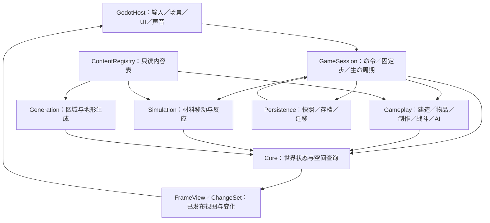

# 融合游戏技术框架与性能方案

> [!abstract] 已确定技术路线
> **标准 Godot＋C++20 游戏逻辑＋GDExtension 接入＋资源配置；CPU 保存真实世界状态，Godot 负责编辑、输入与表现。**
>
> 材料模拟、建造、背包、制作、战斗和敌人行为统一使用 C++。长期采用同一套核心，Demo 先完成草原、洞穴、史莱姆王；玩法见 [[Demo内容方案]]。阶段 A 工程骨架、阶段 B 石墙闭环和材料实验场已实现；其余模块为分阶段方案，大规模材料性能尚未验证。

**框架主线：操作变成命令 → C++ 修改真实状态 → 发布变化 → Godot 显示 → 从完成的逻辑步保存。** 后续增加矿物、建筑、法术和首领，沿这条流程扩展。

## 当前实现：石墙闭环与材料实验场

当前为 `pixel_runtime`、`pixel_persistence`、`pixel_physics` 静态库、Box2D 静态依赖、`pixel_host` GDExtension 和七个原生测试程序。统一入口是 `tools/project.ps1`；版本仍按 `tools/versions.json`、`tools/artifact-hashes.json` 固定，C++20、单线程、60 Hz、Compatibility、Windows x64 未变。

| 位置 | 已实现内容 |
|---|---|
| `native/core/world_state.*`、`coordinates.hpp` | 64×64 分块、有限边界、负坐标向下取整；材料查询区分空气与越界。每单元紧凑材料索引及温度、寿命、燃料、燃烧、创建 tick、Q8 二维速度、运动余量及机械/黏附计数、引信和带电显示步数；缓存数量、活动标记与显示脏标记。 |
| `native/content/content_registry.*`、`reaction_table.*` | 不可变材料与接触反应注册表；原生解析反应表，校验行号、整数范围、重复/缺失 ID、运动参数、火焰约束和两/三材料引用；注册时展开源标签/后缀，按第一输入建立源分派索引，作者规则保留原索引。 |
| `native/simulation/material_simulation.*`、`material_interactions.*`、`explosion_simulation.*`、`electrical_simulation.*` | 独立实验场与命令；材料运动/反应/热、机械相态/黏附、遮挡爆炸/连锁，以及有限电能传播/加热与活动区块。 |
| `native/physics/box2d_solver.*`、`native/simulation/rigid_simulation.*` | 独立 Box2D 求解库、刚体创建/切出/分裂与状态回写；不把物理库依赖传给原生运行时。 |
| `native/session/game_session.*` | 唯一拥有世界；FIFO 命令、固定步阶段、变化发布、一致快照和完整校验后的原子替换。 |
| `native/gameplay/stone_rules.*` | 阶段 B 圆形挖掘、每区块一个聚合掉落、全场拾取、按实际量修补 8×8 格；失败不扣料、不部分修改。 |
| `native/persistence/world_file.*` | 格式 15 显式小端编码，读取格式 1～14 并迁移；保存源液体累计/方向、旧流量、细动量及燃烧强度/计数/颜色，校验长度、校验和、形状、单元状态与石材账目，临时文件替换及耗时。 |
| `native/simulation/liquid_simulation.*`、`source_liquid_simulation.*`、`tests/liquid_tests.cpp` | 普通源液体局部累计/交换；旧作者液体的变密度压力投影、邻接黏性冲量、PIC/FLIP 式速度回传、守量面输运与封闭环流；原生压力/动量/活动存档检查。 |
| `native/godot_host/`、`game/scenes/` | C++ Resource 转原生数据，唯一物理步节点；材料/工具选择、连续画笔、暂停单步、保存/读取/重置；每区块复用纹理，仅更新变化区块。 |
| `game/content/materials/`、`game/content/reactions.txt` | 60 项材料资源、路径清单、ID/标签接触反应表；Inspector 可编辑。 |
| `tools/import_noita_materials.py` | 只读本机 Noita 包，导入选定材料属性链和 29 张纹理，记录来源及 SHA-256。 |
| `tests/material_tests.cpp`、`tests/godot_smoke.cpp` | 原生材料行为与持久化检查；扩展性测试；实际 GUI 输入完成石墙与材料实验场闭环。 |
| `generation` | 保留职责说明；尚无人、世界生成、完整背包、制作、战斗或联机。 |

### 数据归属、固定步与变化发布

`GameSession` 唯一拥有 `WorldState`；每个区块持有材料和附加状态，内容表只读。`Material` 是存档局部索引，0 为空气、1 保留给 `material.stone`，其余由稳定 ID 映射，不给每种新材料添加 C++ 枚举值。最多 65534 项非空气定义，数量缓存按映射大小分配。读取按保存映射查定义，资源清单重排不会改变已保存材料含义。

唯一的 `SandboxSessionNode::_physics_process` 执行：**边界读取/重置，或 FIFO 命令（含调试爆炸）→ 引信计数/聚合爆炸 → 源附着/随机释放或作者黏附计时 → 普通源液体局部交换 → 其他作者液体压力/动量与守量输运 → 其余向下/向上移动及像素表面重建 → 机械静止判定 → 接触反应 → 电能脉冲/带电显示 → 热、燃烧与寿命 → Box2D 固定步/刚体姿态回写与排液提交 → tick 增加 → 变化发布 → 按需保存**。单步请求仅由此节点暂时恢复、推进一次并暂停。两个 `_process` 只读统计或刷新显示。

移动依全局坐标顺序遍历，交替左右方向；粉末与气体等每单元每步积分一次速度，通过子步逐格检测，可跨多格但不能穿过薄墙。交换双方标记，腾出的空气允许后续单元填入。Q8 速度/余量随材料交换和保存，支持分数重力、加速和终速。液体横移寻找有下降通路的方向；没有通路且没有外部冲量时不随机横移，冲量按配置阻尼衰减。分数重力遇到支撑也清理余量，防止位置静止而内部状态持续振荡。扰动由 seed/tick/坐标哈希得到，没有未保存的随机数状态。接触反应每单元每步至多一组，避免产物同阶段连锁；可匹配空气，并设置第一输入的最小龄期和接触热量范围。温度读取使用活动区域的阶段缓冲，避免扫描方向直接传播整排热量。活动状态和显示脏状态独立：变化唤醒相邻区块，寿命、燃烧、热源和非零温度持续唤醒，冷的静止材料可休眠。液体的 `flow_search` 仍接受 1～128，但只表示近处直接探测预算；存在更远的开放通路时，用当前有限行的查询继续寻找，不再把预算当成物理可达距离。查询允许经过未附着的同种液体，避免前方同种颗粒把后方液体的导流判定截断；实际输运仍由原逐单元目标检查完成，不直接交换同种颗粒或远距离搬运。

旧作者液体行查询按“材料索引＋世界行”保存左右最近的下降出口距离，最多缓存 16 项本步派生记录；当前行或下行发生实际移动后，用行修订号使对应记录失效。缓存只含通路标记和距离，不复制整份材料状态，也不写存档。原始待更新掩码所在的区块行扩展到有限世界的全部横向区块，覆盖孤立液滴的远端出口；连通压力依赖另外沿液体连通分量跨越横向及纵向区块。行查询保留为孤立液滴和零动量、无有效流量预约时的像素表面重建，不替代下述压力阶段。

### 普通液体局部运动：当前默认路径

当前液体实验场仅预置石质容器、水、油；左槽落水、中槽逆密度分层、右槽手动绘制。原有混合实验场作为回归夹具保留。实际资源中 21 种普通非砂、非黏液、非静态液体启用 `source_liquid`，由 `SourceLiquidSimulation` 在同一个固定步处理；其他材料及作者液体保留原路径。

依据 [[材料、地形与物理#16. 六类物理交互：运动、交换、碰撞、黏液、刚体与松动]]，新路径读取原始浮点 `liquid_gravity`、`liquid_damping`、`liquid_flow_speed`，缺省值分别为 0.5、0.8、0.9。成功下落累计 `q_y += gravity × 0.25`，额外下落局部预算从 `q_y - 1` 开始，每次成功减二；单侧可走时按流速累计 `q_x`，侧移成功后乘阻尼。非空普通液体交换须过 `Random15 % 101 >= 75` 门且自身密度更大。完整单元状态与在途电能地址随交换迁移；已更新但未移动的单元仍可被较重液体交换，实际已移动目标延后到下一步。

这些材料不再进入压力未知量、旧表面重建和远端行出口搜索，也不把源黏度换算成更新间隔。仅普通源液体存在时，不执行旧液体的横向整区块行唤醒扩展。封闭静水保持稳定并可休眠；随机交换失败或横向累计不足时继续保持活动资格。源环境冻结使用方向 3 且下落累计为零的状态门。

**适配边界：** 单线程 60 Hz、交替扫描与按单元派生随机流仍为项目约定；两侧均可进入时的选向、额外下落偏移、已移动目标冲突处理、显式冲量的一次性速度交接和固定地形阻挡并非完整原版调用链。旧速度字段中的冲量移交给新累计/逐格向上运动；旧 Q24 压力余量不再执行。没有新增全局压力、长距离找平或 U 形管压力上涌。黏液/胶水没有改成普通水分支，尚未重做其完整运动。

刚体仍通过现有逐格排液转移单元及其新状态，并保留 Box2D 的既有密度浮力近似；普通源液体已退出旧模型的双向动态压力和隐式阻力。不能将这项边界写成已复刻 Noita 的刚体受力。完整原版调度、延迟队列和高速粒子仍待恢复。

格式 15 增加两个浮点累计量和一个方向字节，按明确位模式序列化，拒绝非有限值/非法方向。格式 14 及更早版本为新字段补零，原有状态保持兼容；读入后运行当前液体规则，不保证旧压力轨迹。真实文件继续模拟与受影响旧格式迁移见 [[工程验证]]。

### 液体压力与动量

本节描述保留给 `source_liquid=false` 作者液体（含尚未重做的黏液路径）的连续模型，不适用于上述普通源液体。`LiquidSimulation::step` 只在唯一固定步内运行，`WorldState` 继续拥有全部材料与动量；本步节点、面、压力和搬运计划返回时释放。`core/physical_units.hpp` 统一液体与刚体的 16 单元/米、10 米/秒²、60 Hz。液体 `gravity_q8 / 256` 是该世界重力的倍率，粉末、气体等已有 CA 加速度解释保留。材料值和锁定依赖未改。

速度约束子步内，用质量加权面速度和调和逆密度构造 `-div((1/rho) grad(p)) = -div(u*)`，`p` 为本子步压力冲量势。MIC(0) 预条件共轭梯度最多 2048 次迭代，最大散度残差目标为 `1e-7 × max(1, 初始最大散度)`；每步从实际自由表面重建静水初值。自由表面压力为零、固定边界法向流量为零；封闭域保留常数压力零空间，不增加虚假出口。连通分量跨横向和纵向区块传播压力；无流动液体和单粒子直接复用已有运动，定义每步解析一次。

移动刚体湿面参与同一方程的 `B M^-1 B^T` 项，质量、惯量和力臂由实际像素/密度推导，动态压力同时修改液体与刚体平移/转动。相邻液体以等量反向冲量交换黏性，固定墙面对切向运动产生耗散。刚体接触的相对速度阻力沿用项目 8/秒，通过正定 3×3 隐式方程求解平移/旋转，并给液体回写反向冲量，不按接触数抹弱整体阻尼。静水参考响应与动态压力分开，Box2D 仅保留既有阿基米德采样，避免重复浮力；这仍不是原版独立浮力公式。

面速度以 FLIP 式增量和少量 PIC 采样回传。Q8 主速度加有符号补数构成 Q16，避免慢速排液动量被舍掉。没有固定墙的分量校正面采样损失的整体动量；能量限制优先保留整体平移、耗散内部变化，匀速液块和自由刚体/液体的水平总动量只容许 Q16 量化误差。固定墙和碰撞可向环境传递冲量，既有速度上限仍有效，不承诺任意复杂接触的连续守恒精度。

沿有向面通路寻找供给端，再把每个实际液体单元跨相邻面搬运；封闭有向环也转移温度、创建时间、燃料和电能地址。开口流量使用可保存的 Q24 两轴余量，流向或通路失效时释放旧预约。边缘下方仍有容量时允许同高度先溢出，不能把悬崖边薄水层误判为静水。没有下方支撑的液体离开顶壁时开放分离面，避免负压把落水吸在顶壁。

离散自由表面不能表达任意小的高度差。静水参考先抵消重力，动态扰动继续投影；回传动能受入射动能、刚体边界做功及重力做功限制。自由落体按速度积分重力做功，受支撑的整单元输运按实际面位移计重力做功；能量验证使用一单元表面量化界，未宣称逐步严格连续能量守恒。无刚体接触、带耗散的静水分量在低于一 Q8 单位的速度尾段静止；有入射动量的自由流动保留细速度。原有行查询负责无有效预约的像素表面重建，最终清理余量并休眠。

压力和物理矩阵不写存档，读取后从形状及保存的动量/余量重建。求解未收敛或阻力矩阵失效会明确报错；Host 暂停故障会话并拒绝编辑、继续和保存未完成步，成功读取或重置后恢复。气体/火焰作为可置换大气相，不解气体动量/压缩；静态液体、附着材料、粉末和固定固体不进入液体压力未知量。

数值方法参考 Bridson 与 Müller-Fischer 的课程讲义[^fluid-course]；整单元输运、能量限制、静水/分离判据与参数映射是项目规则。尚无连续表面张力、连续切割单元和移动几何的全隐式耦合，不能称为完整 Noita 私有物理。实际验证与性能见 [[工程验证#液体压力与动量：2026-10-28]]。

[^fluid-course]: [Fluid Simulation — SIGGRAPH 2007 Course Notes](https://www.cs.ubc.ca/~rbridson/fluidsimulation/fluids_notes.pdf)，Bridson 与 Müller-Fischer，压力投影、自由表面/固体边界及 PIC/FLIP 方法。

### 其他运动与接触基础

气体和火焰使用独立的 `gas_upward_speed_q8`、`gas_horizontal_speed_q8`、`gas_downward_speed_q8`，分别限制上升速度、受阻扩散及向下冲量。零扩散允许在洞顶停留；分数速度累计余量，不借用液体终速。默认值为 256/256/2048，均是项目参数；选定原版定义没有显式给出 `gas_*` 方向速度，不能把逆向绑定的字段名称当成公式或默认值证据。

反应表继续支持 5～8/10 列及命名选项，原生解析器处理 BOM/CRLF、空白与行号错误。附加 `probability` 后启用下节的源分派；未附加时保留原作者模式的整数分母、任意相连三处输入及连通圆区域。两类都使用同一注册表、世界和容量检查，不引入第二个更新入口。

`take_changes()` 合并多个逻辑步的脏区块。Canvas 对每块复用 64×64 RGBA8 字节缓冲、Image 和 ImageTexture，批量写字节后更新变化纹理；无逐像素 Godot API 调用或逐单元 Node。日常 UI 不复制完整材料形状；完整快照仅在请求保存/测试时产生。

石墙仍为原点 `(-64,0)` 的 192×96 世界，初始 7168 石材，跨 `x=0/64`、`y=64`。挖掉多少就产生多少掉落，重复挖空气不奖励；修补先检查整个格和资源。**世界＋掉落＋持有＝初始石材量**保持成立。暂停的石墙拒绝修改；暂停的实验场允许输入排队，需单步/继续后提交，未执行输入不序列化。

### 材料范围与原版依据

实验场独立初始化为原点 `(-64,0)`、256×128 的封闭世界，包含沙架、水油槽、木桥、气室、冰和静态水。60 项定义覆盖原有岩石/沙/水/油/木/烟气/火/冰/熔岩/酸，以及雪、盐、盐水、有毒污水、血、土、泥、煤、胶水、水泥、混凝土、钢、金属粉、酒精/酒精气体和冻结变体，新增黏液、冻结黏液、短命黏液雾效、普通火药、爆炸火药、铜/黄铜/银，以及发光岩、熔岩岩和冷水。再增加对应熔融金属、金、蜡、钢粉、燃烧液体及刚体木材 `wood_prop`、固态 TNT。右上方另有空反应槽供画笔混合实验，中上方有空冶炼槽。底部有盐水、净化、凝固和松动石条样本，右侧横梁下有胶水与黏液。空气为内建空位。

分类、密度、原版标签、原始温度字段和纹理参考本地 `data/materials.xml`；原始属性链与项目覆盖分别记录在 `source-materials.json`，与 [[Noita材料系统]] 的静态分析边界一致。网格中的固定木头使用 `wood_static`，不把刚体 `solid` 伪装为同一种网格运动。

项目规则：沙下落堆积，水侧流摊平，油水按密度交换，烟/蒸汽上升并按下节的气体计数处理到期；静态水保留位置及水行为标签。火必须为移动的 `fire` 类型、带 `[fire]`、有限寿命且不可普通收集。火画笔初始寿命 90 tick；燃料可继续产生新火。木头/油等原版预置按下节的概率点燃、发焰反馈和分类燃尽规则处理；火与烟分别配置，不能统一解释成逐步扣燃料或空气邻接判定。水可冷却、受热转蒸汽，水/血/酸/污水有配置冻结变体，冰/雪可融化。60 条接触配置（展开后 186 条）包含火＋水→保留火＋蒸汽、熔岩＋水→石头＋蒸汽、酸＋可腐蚀材料→保留酸＋酸气；盐溶解、水净化污水、水泥接触/龄期凝固、酒精接触火/熔岩及空气蒸发；三输入火＋两份盐水→保留火＋盐＋蒸汽，并有独立盐水火槽。新增火接触冻结黏液使其融化，水/火/酒精接触黏液产生源配置中的黏液雾效或烟。雾效 `cloud_slime` 的原分类仍为 liquid、重力 0、寿命 10；`[slime]` 标签不代表启用物理黏液分支。同材料输出不重置寿命、创建时间或机械状态，防止反应把有限寿命产物无限续期。另接入铜＋黄铜＋水→银＋烟＋烟的原版三输入配方。具体输入/输出及源分支抽样参考本地证据；作者采样分母、源入口调度和时间尺度为项目规则。

热量是项目整数单位，环境为 0，非摄氏温度；传播采用邻域温差交换近似，温度读自阶段缓冲，未实现严格能量守恒模型。原版显式重力、阻尼、流速和黏度属性会导入，但其 Q8 换算、缺省参数、采样分母、黏度到更新间隔的映射、燃料消耗和火时长仍为项目调参，不声称是原版内部公式。画笔/擦除是显式来源/去向；反应、燃料与寿命有明确转化，不能把阶段 B 的石材守恒扩展成所有材料数量恒定。调试工具和反应改变石头时同步调整实验账目，不发放拾取奖励。

新增已有类别的材料只需增加 `.tres` 并加入 `catalog.txt`，使用配置标签、热转化或反应表接入；原生扩展性测试使用额外材料验证了这一点。新运动机制、角色碰撞、刚体转换和断裂仍需明确实现，当前 Box2D 刚体基础已接入；尚无人物、烧瓶、沾染状态、持续电源/受电器或完整原版流体/化学系统。

### 接触抽样、标签与必要邻居

依据 [[材料、地形与物理#10. 其他材料互动：接触反应、冷热转化与外部入口]] 和 [[材料、地形与物理#11. 区域反应、标签展开与缺失邻居导致的退化]] 接入已确认分支。`probability=20` 按 float×100 向零截断为门槛 2000，复用一个 15 位随机值 `%10001` 作材料提前过滤、候选索引及记录门槛比较；记录比较为 `<=`，因此概率值 0 仍保留样本为零的情况，不改成严格均匀百分率。

源路径只随机一个世界四邻居，在这个材料对中选 `sample % candidate_count`，失败不依次尝试其他候选或邻居。`fast=1` 独立分流；当前每个活跃第一输入每固定步各尝试一次普通/快速入口、使用按种子/tick/地址派生的随机流，是项目调度，尚未还原原版频率或完整双向注册。潜在邻居变化唤醒材料；不让所有带反应表的静态材料无限保持活动。

`direction=top/bottom/left/right/any` 限制第二位置。第三输入再从第一位置选四邻居；若与第二位置重复则反射到相反位置。第三位置不可只是“第二材料旁边再接一格”，也不遍历全部三输入排列。`destroy_lonely=1` 在第一位置左右均为空时把第一输出改为空气。源气体的 `req_lifetime` 读取有符号气体计数；其他类型仍用项目 tick 龄期，不宣称恢复其全部原版计数。

源标签在注册时递归展开成具体 ID：同一标签在全部输入和输出中绑定同一成员，不同标签递归组合；替换后的源名/后缀必须对应已有唯一 `source_id`。空标签成员表不注册记录，缺少或重名的实际材料报错，不自动造新材料。作者旧模式继续支持原同槽家族规则。

`required=1` 是必要邻居条件，第二输出必须为 air，第三输入和区域字段不适用。它先用普通入口同一个样本按严格 `< 最大门槛` 过滤，再收集记录；按上、下、左、右检查，方向不匹配会结束本方向扫描，匹配仅以末项覆盖删除一个候选。仍缺失时选择剩余最大门槛记录，仅转换第一位置，不消耗空气邻居。满足条件的静态材料可休眠，邻居变化后再检查。现有 60 项预置没有植物/`requires_air` 材料，本轮没有额外导入植被；此入口由真实原生世界用例覆盖。

### 接触触发的区域转化

`blob_radius_a/b` 范围 0～64；反应表中 0 仍表示单点，非零调用区域几何。源规则 `restrict_a/b=1` 使用受限径向采样：先检查中心与输入，转换中心，再按 `trunc(R×2π+0.5)` 条方向推进；遇原输入转换，遇已有输出继续，遇其他材料或不可访问范围停止本方向。中间位置/角度使用 float，坐标向零截断，负坐标不换成 floor；不是沿弯道洪泛。不同 C 运行库三角函数的逐像素边界未与原版实测对照。

`restrict_a/b=0` 对严格 `dx²+dy²<R²` 的圆内坐标转换，不逐点限制为输入材质，允许覆盖其他材料/空气。独立几何入口的受限 R=0 处理中心，无限制 R=0 不处理坐标；这不同于反应表用 0 表示单点。限制开关缺省为 true、两个半径缺省为 0，现已由第 14 节的记录构造字节确认。

当前单线程选择 C→B→A 的局部计划覆盖次序，后续径向读取已计划的产物，重叠按后写覆盖。全部产物/释放位置/碎片容量通过后才提交，失败保留原世界；每单元每步最多参与一次。原版线程缓冲消费者未知，这套原子提交和冲突规则是项目保证，不从指令调用顺序推导原版也具有同样保证。未启用源概率的作者区域仍使用原连通圆与最近锚点分配。

| 实际接触 | A/B 输出 | 区域半径 A/B | 依据与边界 |
|---|---|---|---|
| 熔岩＋普通水 | 石头／蒸汽 | 6／3 | 原配置显式限制为各输入材料。 |
| 熔岩＋冷水 | 石头／蒸汽 | 4／4 | 原配置半径与产物。 |
| 熔岩＋泥 | 固定砂土／蒸汽 | 4／4 | 不再统称为石头。 |
| 熔岩＋盐水 | 发光岩／蒸汽 | 6／3 | 新导入 `rock_static_glow`，未实现额外光照。 |
| 熔岩＋血液 | 熔岩岩／蒸汽 | 4／4 | 新导入 `lavarock_static`。 |
| 熔岩＋静态水 | 石头／蒸汽 | 6／3 | 保留已有实验场能力的显式项目配方。 |
| 冷水＋冰＋空气 | 冰／保留冰／保留空气 | 4／4，C 为单点 | 空气须另邻接第一位置；第二限制开关缺省采用项目 true。 |

以上半径、材料组合与产物保留本地 XML；当前源配方采用上述直接世界几何。酸的快速入口与区域半径同步接入；缺省限制标记、调度及提交方式仍按项目边界记录。`source-materials.json` 保存 57 条唯一匹配的原始字段及 3 条作者配方行号。

区域提交直接更新世界、材料数量、石材实验账目和变化区块，不生成逐像素 Node 或库存奖励。没有跨步骤的临时反应计划，当前格式已保存全部实际结果和未满足龄期的输入状态；区域转化无需保存跨步临时计划。已保存的旧形状不被重置，但以后逻辑步采用当前反应规则；尚未实现存档锁定旧内容规则版本。

### 环境与区域冷热转换

`source_phase=true` 将源材料相变与项目存储热量分开。`cold_chance_rev/warmth_chance_rev` 按本地构造证据默认 100，保留显式／继承的 500；当前支持非负有符号 16 位值。`SourcePhaseCandidates` 先分别求冷、暖候选，即使冷已通过仍消费暖样本；冷优先。环境门槛来自世界的两个字节，默认 0/0，调试冷／热分别用源脚本的 5/12。候选成立后只查一个四邻居：冻结排除非砂 liquid 邻居，融化排除同材邻居；失败不回退普通接触配方。

液体源阻断谓词的状态字节／浮点槽所有写入仍未知，当前明确用项目“未松动、速度／运动余量为零”作桥接，不把该映射写成已恢复原版状态。冻结目标的反向暖目标后处理存在覆盖顺序未知；保留现有明确目标，不按 XML 最后名字猜测最终融化结果。

`MaterialInteractions::temperature` 由命令阶段调用，正 T 选择暖目标、负 T 选择冷目标，用 `Random15 % (rev+1) < abs(T)` 判断，不写入或累积温度，也不先检查邻居。区域工具承接源组件 bypass=1 的入口。当前圆刷按格采样是项目工具；没有实现 MagicConvert 组件的渐进半径、对称重复采样、循环或全部点燃／清污／换材组合。原作者材料仍保留基于存储热量的阈值转换。

### 酸、法力药水与气体计数

当前额外导入静态酸气、法力药水、玻璃和熔融玻璃，共 60 定义。酸配方仍按标签绑定具体目标 ID，受限半径 2 只沿该 ID 和已有酸气推进；输入／输出相同的酸端直接跳过，不按硬度或 HP 计算腐蚀。新增酸＋空气、酸＋酸气、静态酸气的普通／快速分流、酸冰火／熔岩融化，以及法力药水＋水和两组金属标签配方；补入蒸汽＋静态材料凝结和火＋冰显式融化。玻璃无 `[corrodible]` 却带 `[meltable_metal]`；原版玻璃静态／裂纹体模式未接入，现工具只创建项目动态刚体。

`source_gas` 使用有符号计数：构造时 D=max(1,trunc(float(L)×0.3f))、计数为 `Random15%(2D+1)-D`；实际气体交换／移动时递增，L>0 且计数>=L 则淘汰，L=0 跳过。相同气体换材复用计数，源反应龄期也读取它。没有统一逐固定步加一，受阻酸气因此不保证 7.5 秒消失；原版其他写入者未知，这只是已确认计数入口在项目输运中的承接。火仍保持项目有限寿命，旧作者气体仍按原 tick 倒计时。

### 燃烧入口、供氧与烧损

60 项原版预置启用 `source_burning`，依据 [[材料、地形与物理#9. 原版燃烧：功能清单与关键算法]] 接通已确认分支。保留已有作者材料的 `source_burning=false` 燃料倒计时模式；它使用原项目热量阈值、空气/氧化剂邻接和燃尽产物，不冒充原版算法。原版预置改用独立的 `burnable`、有符号 `fire_hp`、火/烟门槛和点燃入口产物；`fuel` 仍用于旧模式、气体项目预算及已有爆炸消耗校验，不再作为普通源网格和刚体的逐步燃料倒计时。

`combustion.hpp` 提供 32 位溢出的 LCG、15 位输出和包含两端的 `%101` 采样。火焰传播先检查源强度、随机一个四邻居和目标可燃状态，再由目标普通点燃比较 `< 100-ignition`；`ignition` 在源模式下是 0～100 的点燃难度，不是温度。独立火单元每次项目更新尝试传播两次，其他燃烧单元一次；新被引燃的目标留待下步执行共同燃烧更新，避免扫描顺序造成整片当步连锁。方向映射、每单元/固定步种子流及 60 Hz 调度是项目选择，未还原原版共享随机上下文或调用频率。

加热工具仍写项目温度 120，并对可燃源材料提交强制点燃，绕过普通随机门槛；其他高温达到项目热量 100 时尝试普通点燃，属于现有热系统的桥接。点燃入口处理 `ignition_output`，源名来自 `on_fire_convert_to_material`，不是燃尽产物。网格 liquid 类 `fire_hp=0` 在该入口立即转为火焰产物；`on_fire` 独立控制初始燃烧，不要求 `burnable` 或正燃料，所以真实 fire 可初始着火且不可燃。

共同更新先独立抽样 `generates_flames`，缩放有符号强度字节，随机左上/正上/右上之一，只尝试一次空位创建。需要氧气时，成功发焰将强度恢复为 `burn_heat` 的低字节；未发焰逐步减一，按有符号解释到零或负数则熄灭。随后独立抽样烟，使用此时的强度；没有火不等于一定没有烟。烟、蒸汽、氧化剂标签或旁边的空气均不会直接替代这条发焰反馈。强度 150 的有符号字节分支按已确认指令保留，不据此宣称已恢复其全部例外。

网格 liquid 类（含静态木头）以 15 位随机值 `% (fire_hp+1)==0` 抽样燃尽并转为火焰材料，`-1` 跳过检查，90000/1000000 不改成均匀大范围随机数。刚体像素使用独立 uint16 烧损计数并保留回绕；每八次更新逐通道变暗，按项目 `tick&31` 检查 `counter>fire_hp` 后移除真实像素，不生成统一灰烬。此全局计数映射不是原版帧时长。气体完整计数/存活逻辑未恢复，暂保留项目有限预算；独立火的运动和 90 tick 画笔寿命也仍属项目模型。

传播变色保留随机 RGB 因子、最低 19 与 alpha；未命名的原版目标类型谓词暂用项目“非气体/非火”限制。Canvas 使用保存的颜色调制纹理，刚体纹理缓存把颜色纳入变化判断，不将燃烧木头统一涂橙色。直接冷却清除燃烧/待点燃标记，保留强度、计数和焦化颜色；外部火焰可在同一步再次引燃，冷却不提供隐含防火时间。水仍参与热量、反应和发焰空间占用，不统一执行无条件灭火。

缺省属性未恢复：当前选定资源对缺失 `fire_hp/generates_flames/generates_smoke` 分别使用项目值 100/100/0；可燃/初始燃烧缺失时用 false，点燃难度 85、强度 100、需氧 true、火/烟材料 fire/smoke 等也只是项目回退。来源清单集中记录，不将缺失属性按原版零值解释。材料参数、源判据与项目调度分开；尚无角色着火、沾染保护、完整火单元寿命、完整热传导或原版引爆公式。本轮检查见 [[工程验证#原版燃烧分支接入：2026-10-28]]。

### 源名家族、熔融与淬冷

原生注册表把源配方中的标签及后缀递归替换为具体 `source_id`，再映射回项目稳定 ID；同一标签跨输入/输出共享绑定，源码字符串替换不在逐像素接触时重复执行。作者旧模式保留同槽家族选择。缺少、重名或非法家族成员仍拒绝注册，游戏不会凭后缀创造材料。

60 项定义中的铜、黄铜、银、金和金属粉各有熔融态，按实际原版密度、粉末/液体分类接入现有输运。强火材料标签或熔岩可熔化这些基材；普通火能把蜡变为熔蜡，火输入转烟；熔蜡接触空气可凝固。铜/黄铜/银/金的熔体接触 `[water]` 后恢复对应粉末并产生蒸汽，接触 `[frozen]` 后恢复粉末并保留实际冻结材料。`steel_static` 等带 `[meltable_metal_generic]` 的材料按原配方熔成通用 `metal_sand_molten`，淬冷回金属粉；单独的 `steel_molten` 则淬冷成 `steel_sand`，不伪装为原固定钢墙。原版 `[cold]` 淬冷组合尚未接入，因为当前未导入对应冷材料。

60 条配置当前展开为 186 条运行记录，其中源记录 183 条、作者记录 3 条。源索引按第一输入建立，候选顺序影响共享样本选取；作者规则保留原先的多输入索引及顺序。注册最多 65534 条展开规则和 800 万条索引项，超限明确拒绝；不是为每个材料创建新的 C++ 模拟分支。

`initially_burning` 直接保留源 `on_fire`，与可燃性及预算分开。源 `fire_hp` 原值 90000/1000000 保留在有符号定义阈值；uint32 `fuel` 的 0～10 亿范围继续支持旧作者规则与项目气体/爆炸预算。原版预置熔体的普通燃尽已经改为上节的随机火焰产物路径，不再套用“每步减一，燃尽保留熔体”的旧假设。读取按实际保存的强度、计数和形状恢复，不按初始标记重新点燃。

燃烧液体 `liquid_fire` 是 liquid，带 `[fire_strong]`，使用实际液体运动；它与 `cell_type=fire` 的有限寿命气态火焰分开。所有新状态仍由世界拥有、在唯一固定步更新；游戏规则不依赖 Godot。

### 固体松动与黏附边界

`can_loosen` 只允许固定的粉末式网格固体，静态液体不支持；导入预置按这一分类启用，属于项目能力映射。松动命令和冲击修改 `CellState.mobilized`，保留材料 ID、温度、燃料、寿命与创建时间。`motion(mobilized)` 决定固定或粉末运动；同种岩石从下落到固定不需要伪造另一个材料 ID。每次实际移动清零静止计数；支撑存在、速度归零且连续 `settle_ticks` 个固定步没有输运后再固定，默认 30。固定后移除支撑不会自动触发整栋结构坍塌，需要再次扰动；目前爆炸已使用独立耐久和像素 HP，具体规则见下节；刚体擦除/分裂见下文，实体伤害未实现。

### 源附着与作者黏附

原版预置的液体类材料启用 `source_adhesion`，原整数 `liquid_sticks_to_ceiling` 默认 0，不再把它换算成力、长度或固定时长。来源与原算法见 [[材料、地形与物理#15. 液体与砂类的附着：支撑方向、状态分类与随机脱落]]。胶水、土、泥虽带砂类标记，也可进入这条路径；普通水等门槛为零的材料不附着。

获取阶段使用原版 32 位坐标散列选择右/上/左中的一个支撑，侧面不成立时不回退检查上方。当前世界能表示的获取锚点为液体类的静态砂及已附着砂；维持阶段还接受对应静态液体与已附着流体，保留原版两类谓词的差别。已附着像素从液体压力/输运和其他运动中排除，仍参与燃烧、反应和状态更新。

维持采用 `Random15%101<20`，通过后先检查保存方向的支撑。支撑无效则释放；支撑有效再以 `Random15%101<liquid_sticks_to_ceiling` 检查下方，只有下方为空才随机释放。门槛 100 仍可脱落。源模式没有旧的固定保持时间或 16 步冷却，也不制造固定长度的竖直黏液链。

`CellState.source_attachment` 保存 5/6/7 三个支撑方向，0 表示自由。1 是项目连续输运的交接状态：随机释放或实验冲击后，等待实际移动一格才允许重新获取附着；否则下一步附着会把仍在累计的细速度清零。实际液体交换、通路/环流输运、其他材料交换及刚体排液都会清除旧附着状态。交接不注入额外速度，不设置固定等待时长，并随存档保留。

旧作者配置继续支持 `adhesion_strength_q8` 速度阈值、`adhesion_hold_ticks` 保持时间、`slime/adhesion_span` 有限竖直链及 16 步冷却。源预置中的这些旧字段仅为旧档/作者兼容保留，源模式忽略它们；旧档已存计时在首次源附着更新时清零，之后采用当前规则。`liquid_slime` 的其他运动公式与默认侧速仍未完整恢复。

当前每个活跃固定步提供一次完整更新许可，随机流由世界种子/tick/地址派生；动态砂的方向/20 次计数分类未完整表示。原版许可频率、世界随机流顺序、全部支撑状态、凝聚及附着受力仍未完成。附着维持保持活动资格，外观未变时不反复上传纹理；不能要求随机附着材料像冷静水一样全部休眠。

### 源网格爆炸与持续 HP

源预置启用 `ExplosionDefinition::source_rules`。`source_blast_probe` 按 360 方向读取当前 HP；先迈一步、向零截断、跳过重复格，只让 solid／sand 阻挡，先消耗能量再判断硬度／耗尽；输出距离平方和最大单格消耗，探测不写世界。区域阶段在严格半径内按方向表扣 HP，存活格保留 `damage_taken`，后续爆炸读剩余 HP；硬度不合格不扣 HP。独立 `Random15%101 < create_probability` 生成火材料，不把整片覆盖范围统一强制点燃。

原版角度映射的全部细节、正弦边缘修饰、额外像素形状探测、火花数量／消费者和延迟队列未完整恢复。当前角度分桶、刚体遮挡／推力、引信聚合仍是项目模型；未实现新队列或角色伤害。旧作者爆炸保留下面的 DDA／压力模型，不能把这两条路径混为原版统一算法。

### 爆炸、耐久与连锁

`native/simulation/explosion_simulation.*` 使用普通 C++ 处理射线暴露、统一提交、引信与连通燃料聚合。材料的 `durability`、`hit_points` 独立于阶段 A 的 `hardness`。每条射线读取爆炸前的材料形状，网格使用 DDA supercover 单元穿越，刚体使用逆旋转后的逐实际像素方形相交；合并为按进入距离排序的命中序列，避免对角穿墙和把两个共享投影的实际像素只算一次。超过耐久上限即阻挡，其他材料消耗射线能量；每处取各射线的最大暴露值，不叠加重复奖励，也不让先处理的射线开洞为后面的射线制造捷径。只分配局部暴露/访问缓冲，无爆炸像素 Node。

挖洞开关与液体移除分别配置；范围内、耐久允许且暴露能量足够时才删除。外围冲击范围为半径加四分之一（至少加 1），能松动、推动和加热剩余材料，并可破坏黏附；射线按距离衰减。被销毁的石材明确减少实验场账目，不额外发放库存；原石墙采集规则不受影响。固定步计时包含命令阶段与所有材料阶段，不遗漏手动爆炸成本。

`ExplosionDefinition` 配置半径、射线能量、耐久上限、热量、冲量、引信、压力阈值、挖洞/液体开关、残留与火焰。爆炸火药受热点燃或足够压力后在单元状态中锁定引信；冷却不会取消已启动的引信。到期时上下左右连通的同种燃料聚合并转为残留，再产生一次爆炸；分离堆由压力启动自己的引信，不在同一步递归引爆。网格与刚体共用每步至多 64 次材料聚合爆炸尝试，失败只发布延后计数，剩余到期单元保留引信 1，可保存并于下一步继续；用户显式排队的调试爆炸另受原命令队列上限约束。

本地 `gunpowder` 没有 `ExplosionConfig`，`gunpowder_explosive` 有独立配置，二者分别导入。原半径下限/射线能量/触发字段和完整嵌套配置保留在 `source-materials.json`。项目把 `cell_explosion_radius_min` 用作基础半径，把 `cell_explosion_damage_required`×1000 用作压力阈值；聚合能量最多乘 16、半径按堆大小增长至最多 48，强度和热量默认值也为项目规则。未知原版默认值、`cell_explosion_power`、射线采样/衰减、随机性和聚合公式尚未还原；没有实体伤害或连续冲击波压力场；源网格路径已支持上节的持续 HP 损伤。刚体破坏与推力已按下述项目规则接入。

### 爆炸与实际刚体材料

`ExplosionSimulation::apply` 返回实际成功/影响量/错误和新碎片的父子关系。地形和旋转刚体用同一组爆炸前射线消耗 HP、检查耐久和计算热暴露；一条射线同一实际像素只结算一次，多个射线取最大值。刚体像素按实体处理，不因 `liquid_sand=0` 误用液体保护开关。普通破坏、网格燃料消耗、热状态、刚体删除与最终碎片容量先规划后提交；超出 64 个刚体或 ID 耗尽时，整次爆炸失败，地形和燃料不部分修改。无物品奖励，石材来源/去向照常结算。

先按真实剩余像素分裂并继承原点速度，再给各碎片各自施加压力，避免对称爆炸在原父体上把左右冲量抵消。压力按实际暴露面积累加，密度总量和平方距离惯量分别抵抗线/角速度变化；线速度/角速度仍受原 512 单元/秒和 20 弧度/秒上限约束。不可破坏的刚体可以承受前侧压力并遮挡后侧。面积冲量的 Q8→每秒换算、密度单位、惯量离散和压力衰减属于项目模型，不是还原的原版公式。求解仍由现有 Box2D 固定步接收公开速度，不写引擎物理节点。

刚体燃烧或受压可锁定已有 `CellState.detonation_ticks`，冷却不取消引信。阶段开始捕获到期资格，局部同材料四邻连通燃料聚合；新引爆压力只能启动后续引信，不递归当步引爆。父/局部坐标资格随碎片关系迁移，前一次爆炸切断物体后，到期材料不会丢失更新。网格事件按原顺序先提交，然后处理已捕获的刚体事件，统一受 64 次尝试限制；余下引信 1 可保存。刚体自爆先使用同一材料产物规划器释放残留，再执行爆炸，二者一起成功才替换当前世界。仅这种低频事件临时复制普通世界候选以保证失败回滚，常规步进/显示不复制全世界；大批同时自爆的成本仍待测量。原材料作为自身残留时清空已消耗燃料和引信，避免无穷奖励/反复自爆。

本机 `tnt` 是独立 `solid`，导入原密度 8、耐久 11、HP 10000、燃料 600、最小半径 5 和射线能量 50000，保留完整继承配置和新纹理哈希。引信 4 tick、烟残留、热量/冲量、聚合和压力阈值换算仍是项目映射；没有导入原版炸药箱实体的生命值或 `ExplodeOnDamageComponent`。此轮新增 TNT 后为 56 定义、29 纹理，当前反应表为 60 条配置/186 条展开记录。

### 电能脉冲与材料导电

电能仍由世界的 `ElectricPulse` 列表与单元状态唯一持有，在接触之后、热之前提交。`ElectricalSimulation` 负责注入、材料转移和碎片整理，`MaterialInteractionStage` 接入专题第 12 节的传播；不创建电弧 Node 或另一张导电网格。源预置的新注入使用 `source_rules=true`；旧存档／作者脉冲保留原四邻路径、按材耗能与均分逻辑。

导电非砂 liquid 规范化方向，抽 -135°～135° 的旋转并乘 2，向零截断成位移；前 16 次候选不统一复查 conductivity，第 17 次要求现存导体，最多 17 次。其他情况按半径 1、2、3、4 扫完整方形，首个有候选的范围内按 `dot(normalized_dir,normalized_delta)-0.5*distance` 取严格更优者，不做射线遮挡或连通路径检查，允许跨短空气／油缝。流体标记目标并累加浮点方向；附近搜索标记旧位置 3×3 并把方向设为整数位移。

普通成功推进扣 1 能量，恰等于分叉门槛时父结束、创建两条子脉冲，能量／门槛各整数除 2、剩余分叉量减 1，子方向长度 30、随机偏转 -0.1～0.1 弧度；向下取整损失计入耗散。子脉冲下一固定步开始是项目所有权约定。每步仍核对原有能量=剩余+耗散。源附近搜索的非导体加热先过浮点概率，再过普通点燃门槛；它不写项目温度。独立 `set_fire` 模式调用 127 强度的强制入口、一次更新扣 1；当前仅支持正能量和正 speed。

单元保存最近电访问 tick，recent 取差<10；蓝色倒计时与该标记分别保存。未知第二标记当前按 false、环境例外关闭；tick 对源时序的映射和注入头预标记是项目策略。画笔默认 energy1000、speed32、heat0.1、分叉次数2／门槛500、显示10，均明确为项目参数。源未声明 conductivity 时仍使用既有项目回退；没有新增 ElectricCharge、持续发电源、接收机关、裂纹组件或角色电击。原版这些组件的分析不等于项目已实例化。

### 刚体导电与电能地址

电能传播在 `MaterialInteractions` 的接触之后、热之前执行，直接复用同一份实际像素邻域和材料读写；`ElectricalSimulation` 负责注入、所有权转移和碎片地址整理。网格与刚体同样消耗有限电能、分流、加热和显示余辉，热继续参与既有供氧、燃烧和引爆阶段。每个实际像素的访问标记独立，旋转后投影重合也不会合并材料或重复结算；粉末/液体原有网格传播保持兼容。

`ElectricPulse` 的当前与前一地址各有独立 `body` ID：0 采用世界网格坐标，非零采用该刚体的局部像素坐标。脉冲因此随刚体平移/旋转而保持材料归属；进出刚体时通过实际暴露边缘接触转换地址，旧作者路径要求实际接触；源附近搜索允许跨短缝，仍保持目标像素的实际所有权。旋转边缘仍采用现有中心采样，是项目接触近似，尚未证明为原版电路/接触算法。

切出带电地形时，同时转移脉冲、前一地址和余辉；分裂后按实际剩余局部坐标迁移到正确的子 ID。导电材料熔化/反应并释放到网格时，脉冲使用产物实际预留位置；旧脉冲遇非导体按原规则耗散，源脉冲可继续附近搜索。头部像素被擦除、腐蚀或爆炸移除时，剩余能量计入 `electric_spent` 并删除无效头；丢失的前一位置重置为当前地址。材质转移到较远的网格位置时，旧脉冲同所有者下不相邻的历史地址重置；源脉冲保留合法的跳跃历史。失败的容量/释放计划不迁移任何电能。

`electrified_cells` 统计网格和实际刚体像素，带电时间逐步减少；该显示不是可回收能量。刚体仅在蓝色开始/结束或形状变化时更新纹理；计数变化与物理运动不单独重建图像或碰撞形状。暂停、结束、重置、保存/读取继续使用唯一会话边界。没有电力节点副本、后台线程、持续电源或受电器。

### 像素刚体与独立物理库

`WorldState::bodies()` 唯一持有刚体的局部像素、材料索引和状态，以及稳定 ID、世界位置、角度、线/角速度和睡眠。网格与刚体分别储存实际像素；显示和 Box2D 不拥有另一份材料量。`material_count()` 合并两者，石材账目包含刚体石材。`material_at()` 明确查询网格，`surface_material_at()/surface_cell_state()` 合并刚体表面，`body_pixel_at()` 返回其实际局部像素地址；旋转查询使用逆变换和缓存边界，不把旋转后的显示像素数量当成材料量。

原生 `RigidSimulation` 处理创建/切出、擦除、冲击、四邻连通分裂和求解结果发布；`RigidSolver` 是实际已实现的普通 C++ 求解边界。`GameSession` 注入并拥有 `pixel_physics` 的 Box2D 实现，`pixel_runtime` 没有 Box2D 链接或头文件依赖。无求解器的独立会话继续支持原网格测试；刚体命令或刚体存档会明确失败并保留旧状态。返回主界面、重建世界和成功读档均释放旧求解缓存。

新增 Box2D 固定为 v3.1.1、提交 `8c661469c9507d3ad6fbd2fea3f1aa71669c2fe3`；现有 Godot、godot-cpp 和工具链锁值未变。`bootstrap` 克隆该标签，CMake 检查提交和已跟踪源码改动，禁用示例、上游测试及其额外下载；静态链接，C17 仅用于第三方库，项目规则仍为 C++20。选择与 API 依据见 [该版本发布](https://github.com/erincatto/box2d/releases/tag/v3.1.1)和[该版本模拟文档](https://github.com/erincatto/box2d/blob/v3.1.1/docs/simulation.md)。这是项目求解器版本，原版修改与调度仍待核对。

当前生成笔刷圆形的像素体，或从实际固定地形圈内切出形状；没有复制源地形或生成库存。每个物体最多 1024 像素、局部坐标 -32～32，最多 64 个刚体；创建/分裂超限在提交前失败。切出可保留固定固体的温度、寿命、剩余燃料、燃烧和引信；仍拒绝黏附计时及源附着/释放交接状态，静态液体不属于可切固体。可直接创建有爆炸配置的实体固体，包括实际 TNT。`cell_type=solid` 分类为 `Motion::rigid`，通过会话创建刚体，不允许作为普通固定网格写入或读取。

碰撞由局部像素矩形覆盖精确表示，可包含孔洞；按材料密度建立复合多边形。地形依区块碰撞修订检查，只重建材料索引或占用发生变化的固定粉末式固体，流体不当作刚性地面。模型按 16 单元/米、重力 10 米/秒²、60 Hz、4 子步、主线程推进，启用连续碰撞。摩擦读取材料的 `solid_friction`；20 项保留继承后的原版显式值，40 项缺省为项目值 0.6。现有源值为 0.05～1，接入校验要求有限的 0～10000；这不是原版参数范围声明。两形状接触使用锁定 Box2D 默认的几何平均混合，原版混合公式仍未确认。弹性 0.05、单位比例和冲击参数仍为项目值。擦除先规划所有改动，再按四邻连接分裂；新碎片继承角速度，并按质量中心变化补偿线速度。移动不修改材料数量，擦除是明确去向；修补先拒绝刚体占位。

地形矩形按同材质合并，缓存保留真实材料索引，因此同样占位的冰/粗糙地面互换也会刷新接触摩擦。矩形的派生世界边界随缓存保存，预求解回调沿接触法线检查外侧固定实体；只有全部接触点都位于相邻固定实体覆盖的内部面时才屏蔽接触，外露墙/台阶保留。这样可消除区块与材质矩形内部侧边造成的绊阻，不通过取消全部侧碰撞或修改刚体速度绕过问题。回调只在本步读取原生世界和定义，步后清空临时借用指针，不拥有第二份世界。

Canvas 每个刚体使用一张复用纹理；形状修订或逐像素燃烧/带电布尔标记改变时批量更新，尺寸相同调用 `update`，仅必要的尺寸变化重设图像。燃料/温度/带电倒计时不会反复上传同色图像，燃烧标记不触发 Box2D 形状重建。姿态改变只更新绘制变换，不创建逐像素 Node 或每帧重建纹理。`ChangeBatch.bodies_changed` 与网格脏区块分别发布。网格材料的移动使用合并表面查询，沙粒可被实际刚体阻挡。

当前刚体已参与下面的共享接触/热阶段；导电、电热和爆炸已经接通；已接入下述流动液体排挤与浮力近似，松动显式工具命中刚体仍报错。未导入完整木箱实体或自动把所有失去支撑的地形变成刚体。Box2D 接触/求解缓存不序列化，读档先恢复完全相同的公开材料/运动状态，再重建物理世界；接触后的未来结果仅做容差检查，未承诺与未中断物理世界逐位相同。

### 刚体排液、浮力与阻力

Box2D 步进后的候选姿态先回写，再由 `RigidSimulation::displace_liquids` 使用同一逆变换占位查询收集被覆盖的流动液体。每个实际网格位置只排一次，不按旋转显示像素数量结算。排液沿连通液体和刚体占据的空气空间寻找有限世界内未占用的空气，不能穿过固定地形、粉末或世界边界。为每个受挤压单元重建通路，从空气端向刚体方向依次挪动相邻液体；稀疏规划表保存被改变单元的材料、完整 `CellState` 与原始位置，后续通路读取前面已经规划的结果。刚体内部仅传递挤压，不填入其他液体。全部通路成功后按世界坐标顺序提交，再依据原始位置到最终位置的映射一次迁移网格电能当前/前一地址；不消耗库存，不生成材料副本。没有足够空间则材料一处不改，整批刚体恢复旧姿态、线/角速度归零，下一步求解器读取校正值；UI 显示本步 `fluid_displaced/fluid_blocked`，只读已发布结果。

Box2D 适配器按每个实际刚体像素施加阿基米德浮力并保留力矩；动态压力和 8/秒双向阻力已在此前的液体阶段求解，适配器不重复施加单向阻力。排液后不能再用“底层网格仍有水”判断浸没，因此在刚体连续占位行内寻找左右暴露液体，重建局部静水密度；扫描不跨其他刚体，最多 94 单元覆盖当前局部形状上限。低密度测试刚体浮起、高密度下沉；只有流动液体参与，不把烟、火、粉末或静态水伪装成流动水。

静水浮力仍为有限场景的中心采样近似，浸没面积随离散占位变化；动态压力和阻力已有反向冲量，未做连续面积积分和完整黏性边界层。刚体外部通路中的液体逐格挪动，速度、燃料、创建时间和余辉随各单元一起移动，底层水不再直接跳到油层上方；多个受挤压单元可以复用通路，但不能重复使用同一个空气容量。电能批量迁移只使用每份材料的最终位置，避免同一脉冲被重复移动或在中间状态错误清除历史地址。压力已在本步当前几何上反馈运动，后续几何排液仍为独立的通路计划，不是连续移动几何的全隐式求解。空间不足时所有候选刚体一起撤回；无网格空位的遗留重叠快照先交给已有容量检查，避免先提交不可实现的压力冲量。`pixel_runtime` 仍只依赖标准库，Box2D 仅接收力并求解运动；格式 12 保存动量、流量余量及燃烧状态，物理缓存仍重建。

本机 `tools_modding/component_documentation.txt` 中 `PhysicsBodyComponent/PhysicsBody2Component` 另有默认 0.7 的 `buoyancy` 参数；这不是已经证明的阿基米德系数或材料密度换算。当前没有导入其实体配置或恢复原版公式。例如原 `wood_prop` 材料密度 6、水为 4，在本项目当前模型中木质刚体下沉，不能由测试中的自建低密度材料浮起就宣称原版木箱行为一致。

### 网格与刚体共享材料交互

`MaterialInteractions::step` 从原材料步抽出同一份两/三输入、标签、受限 blob、供氧、热传播、燃料、冷热相变和寿命规则；电能阶段仍在接触之后、热之前。它直接读写世界拥有的网格单元或刚体局部像素，没有另一份完整材料网格。每个实际像素本阶段只有一个地址，已反应标记共用；刚体删除暂用阶段内墓碑，待全部交互完成再按四邻连通分裂，不会因中途更换 ID/数组下标而重复结算。接触阶段释放到原遮挡网格位置的产物会加入随后的热阶段；本热阶段新生的产物留待下一步更新，不随目标位置和扫描方向重复扣寿命或燃料。

刚体内部按局部上下左右连接；暴露边缘用旋转后的相邻像素中心采样世界表面，合并重复地址并排除自己。网格接触使用现有表面查询。热读取保留阶段缓冲，刚体与网格间可传热及冷却；源模式的发焰只考虑实际世界空位，内部下层网格空气不能穿过实心像素供氧。这个旋转接触近似、邻域和热公式属于项目规则，不是原版完整碰撞/热交换算法。

转换前先规划所有产物、唯一释放位置和最终碎片容量。固定粉末式固体或 `solid` 产物保留刚体所有权并重建材质/质量；动态粉末、流体和气体产物离开刚体，写到本像素投影或至多 2 格内经可用单元连通的空网格位置，继承刚体该点的线/角速度并换算为网格 Q8。不能穿墙、覆盖现有网格材料，或把同一位置预留两次。空间不足、碎片超过 64 个或 ID 耗尽时整组反应延后，输入和成对产物不部分提交；热状态仍可演化，旧模式燃尽受阻时保留最后燃料；源模式点燃换材受阻时保留待转换标记、原材质及烧损状态，后续重试。`deferred_reactions` 发布实际延后次数，界面操作栏可见。当前配置无“网格反应直接生成 solid 刚体”产物；自建这种输出也会延后，尚未实现自动成体。

形状改变后复用刚体的四邻分量计算，按密度重新求质量中心并补偿碎片线速度；各实际像素只保留一次。燃烧可逐步烧穿，酸可局部切断；产物、数量与实验石材账目一起更新。加热/冷却工具按实际刚体像素中心命中；切出保留已有热/燃料状态。纯网格原有反应仍走同一个实现。液体压力/动量与刚体排液、浮力的范围分别见对应章节，不能据此宣布完整材料复刻。

### 存档与兼容

格式 14 沿用 28 字节 `PSBWALL` 头部、版本、载荷长度和 FNV-1a 64 位校验和。基础字段为 seed/tick、原点/尺寸、64/8 比例、ID 映射、形状、掉落/持有和石材账目；实验场标记之后为状态布局修订号 13。每单元显式写温度 int32、寿命 uint16、燃料 uint32、燃烧 uint8、创建 tick uint64、两轴速度 int32、两轴余量 uint16，再写松动标志 uint8、静止/黏附/脱落冷却/剩余引信/带电显示各 uint16，再写两轴 Q24 流量余量 uint32 与两轴 Q16 动量补数 int16，再写累计损伤 uint32、有符号气体计数 int32、最近电访问 tick uint64（无标记为 UINT64_MAX），再写强度 uint8、烧损计数 uint16、焦化色 uint32、待点燃转换 uint8、源附着方向/释放交接 uint8，合计 79 字节附加状态，不序列化对象内存或填充。随后写脉冲数量和每个 56 字节的显式记录：当前位置/前一位置四个 int32、能量 uint32、速度/热采样分母/热量/显示时长四个 uint16，再写当前/前一刚体 ID 两个 uint32，再写源模式 uint8、方向两个 float32 位模式、分叉次数 uint16／门槛 uint32、热概率 float32 位模式和直接点火 uint8。

格式 1 石墙文件补零状态；格式 2 保留热/燃烧状态并补零速度与创建时间；格式 3 保留已有运动字段；格式 4 保留机械/黏附字段；更早格式补固定相态与零机械/黏附计数，格式 5 保留引信；更早格式补零引信，旧格式补零带电显示和空脉冲；格式 6 保留电能字段并把旧 uint16 燃料无损扩宽，格式 7 保留宽燃料，补空刚体和下个 ID 1；格式 8 保留全部刚体、引信和既有网格脉冲，两个新所有者字段补 0；格式 9 保留全部电能地址并补零流量余量；格式 10 保留 Q24 余量；格式 1～10 的细速度补数补零；格式 11 保留全部细动量；格式 1～11 的强度、烧损计数、颜色和待转换标记补零，新写入均为 13。格式 12 保留已有燃烧状态；格式 1～12 新增损伤／气体计数补零、电时间标记置无标记、环境补 0/0，旧脉冲保持作者模式。旧规则未来不逐步等价，缺少旧强度的燃烧按零强度进入当前规则，不根据旧燃料反推原版烧损计数。旧实验场载入后保留旧索引，并追加当前注册表的新定义，让新反应产物和画笔可用。缺失旧 ID 仍拒绝读取。未知版本/布局修订号、未来创建 tick、非法燃料/速度/余量、非固体的松动相态、越界静止/黏附/引信计数、非爆炸材料上的引信、重复脉冲头、非法能量/速度/路径均拒绝。

脉冲后写下个刚体 ID uint32、刚体数量 uint32；每体显式写 ID uint32、形状修订 uint64、位置/角度/线速度/角速度共六个 float64 位模式、睡眠 uint8、像素数量 uint32，共 65 字节。每像素写局部 x/y int16、材料索引 uint16 和相同 78 字节附加状态，共 84 字节。最后写环境冻结／融化两个 uint8。无引擎句柄、指针、对象填充或接触缓存。读取检查唯一 ID/局部坐标、四邻连通形状、有限姿态/速度、世界边界、定义、数量与受支持状态；刚体的寿命和燃料按实际定义校验，旧倒计时模式的燃烧必须有剩余燃料；源模式允许初始 fire 零燃料着火，待点燃标记要求燃烧标记为真；刚体引信要求实际爆炸配置、正剩余燃料且不超过定义的延时。格式 13 为网格与刚体使用同一显式状态编码；流量余量小于 2²⁴，细速度补数范围为 -255～255。脉冲当前/前一刚体和局部像素必须存在，头部按所有者＋坐标唯一，旧脉冲同所有者前后地址须相邻或相同，源脉冲允许附近搜索跳跃与同位置分叉；跨所有者只校验地址存在，因为历史接触可能已随运动消失，不能按读档当下的距离误拒。带电时间均不超过 60。缺少物理求解器不替换旧世界。

文件上限 16 MiB、世界上限 512×512；编码结果也在替换前检查文件上限，避免生成自己无法读取的档。读取先校验全部数据及内容，再构造候选世界替换。成功后暂停，失败保留旧世界与输入队列。活动标记为派生缓存，读档重建；无刚体的网格会话测试比较了注册顺序倒转后恢复的连续 100 步完整状态；刚体接触后的未来结果使用上述容差检查。

保存路径继续为 `user://saves/stone_wall.psw`，石墙/实验场共用单槽。测试使用按进程隔离的 `user://smoke/stone_wall-<pid>.psw`。写入先写同目录 `.tmp`，flush/close 后以 Windows `MoveFileExW(REPLACE_EXISTING | WRITE_THROUGH)` 替换；失败保留旧目标。仍为同步 I/O，未实现压缩、多槽、备份或断电恢复保证。

本轮新增互动结果见 [[工程验证#新增冷热、电弧、爆炸与腐蚀：2026-10-28]]；实际命令、行为证据与耗时集中于 [[工程验证]]。以下其余架构和大世界预算继续作为长期方案，不能据小实验场结果推断其性能。

### 完整复刻目标仍在推进

以上是当前实现，不能据此宣布完成全部原版材料。后续仍需实现或核实：原版运动缺省值、气体方向公式和停止判据、动态砂的完整附着分类/更新调度、横向凝聚、爆炸的原版采样/衰减/聚合公式、电力原版分叉/损耗与电弧、区域缓冲消费与重叠冲突、液体冻结阻断状态的全部写入和反应真实更新频率、原版完整配方、刚体与流体的排挤/浮力耦合，以及原版运行时的受控对照。当前不把 60 项定义和 60 条反应配置的测试通过等同于完整 Noita 行为一致。

## 1. 总体结构：一个运行时，少量明确模块



图中箭头表示调用或数据流。**编译依赖单向向内：GodotHost 依赖运行时，运行时不引用 Godot；存档模块使用运行时定义的快照格式，运行时不直接读写文件。**

| 模块 | 职责 | 边界 |
|---|---|---|
| **Core** | 坐标、ID、世界分块、实体与容器存储、空间查询、修改记录。 | 普通 C++；拥有数据结构，不判断具体配方或首领行为。 |
| **Simulation** | 沙、水、气体、火、温度及材料反应；活跃块与休眠。 | 通过受控写入修改 Core；不发放背包奖励。 |
| **Gameplay** | 控制与移动、建造、采集、背包、制作、法术、伤害、AI、进度。 | 对 Core 执行规则；不读取场景树决定生命、库存或地形。 |
| **GameSession** | 新建/读入/暂停/退出世界、命令顺序、逻辑阶段、任务发布。 | 拥有本次游戏状态和只读内容表；只做调度，具体规则留在对应系统。 |
| **Generation** | 区域布局、地形、矿点、模板与初始实体。 | 输入种子、坐标、生成版本与内容表，输出普通数据，不实例化显示节点。 |
| **Persistence** | 快照编码、压缩、文件读写、校验和版本迁移。 | 保存显式字段；不保存 C++ 内存镜像或 Godot 场景树。 |
| **GodotHost** | 原生类注册、资源转换、输入、界面、镜头、显示、声音与调试工具。 | 唯一依赖 `godot-cpp` 的业务模块，消费已发布结果。 |

这些是职责划分，首版只需要 **运行时静态库、存档静态库、一个 GDExtension 动态库**，以及测试/基准可执行程序。Gameplay 内按系统分文件，不为每个系统创建独立动态库，也不先建设通用插件平台。

```text
Project/
  native/
    core/             世界存储、ID、查询与修改记录
    simulation/       材料规则与活跃调度
    gameplay/         建造、物品、制作、战斗、AI、进度
    session/          会话、命令和固定步调度
    generation/       区域、模板、生成随机
    content/          原生定义、校验与运行时内容表
    persistence/      快照编码、存档与迁移
    godot_host/       原生节点、Resource 类、UI 与显示适配
  game/
    project.godot
    scenes/           主界面、世界、HUD、家具与角色表现
    content/          材料、物品、配方、敌人等 .tres 定义
    assets/           图像、声音、字体、着色器
    bin/              扩展构建产物
  tests/              原生行为测试与 Godot 接入检查
  benchmarks/         固定种子、固定负载、耗时记录
  tools/              构建、检查、内容导出与游戏导出入口
  third_party/        固定提交的 godot-cpp 等依赖
```

核心、玩法、会话、生成与原生内容表先编进运行时静态库。头文件边界约束依赖；Godot 的 `Node`、`Resource`、`Variant`、`Image` 不进入该库。GDExtension 无需重编整个引擎，后续只有扩展接口不足时再评估引擎模块。[^native]

## 2. 世界状态：每种事实只有一个所有者

`GameSession` 拥有 `WorldState`。系统访问本阶段允许的数据，不各自维护一套世界副本；绘制缓存、空间索引和界面列表均可从真实状态重建。

| 状态 | 保存在哪里 | 必须遵守的规则 |
|---|---|---|
| 实际前景形状、材料、温度等 | `ChunkStore` 的材料数组与附加状态。 | 完整方块与破损形状均以这里为准，建造格不再保存另一份实心碰撞。 |
| 背景墙、覆盖层、家具占位 | 独立格层及占位索引。 | 背景不挡水；家具占位索引引用实体，不复制其库存与生命。 |
| 人物、树、家具、门、掉落、弹体 | `EntityStore` 的组件数据。 | 场景节点只是表现；位置、生命、功能是否有效由运行时决定。 |
| 背包与箱内物品 | `InventoryStore`，由所有者实体引用。 | 拾取、移动、制作统一转移数量；UI 不另外保存权威库存。 |
| 时间、随机状态、世界进度 | `WorldState` 的全局状态。 | 世界进度与玩家进度分开；每个系统使用自己的随机流。 |

材料用紧凑数组；实体先采用明确的组件结构与集中存储。沙粒不是实体，一个石块也无需一个 Node。角色与大量弹体的热数据可连续存放；完整 ECS 是否值得引入由后续规模与分析结果决定。

三类身份分别处理：

- **内容 ID**：如 `material.stone`、`item.iron_ingot`，指向定义；存档保留稳定 ID 或对应映射，运行时转换成紧凑索引。
- **持久实例 ID**：人物、家具、箱子、独立装备等需要跨存档引用的对象使用；卸载再载入身份保持一致。
- **运行时句柄**：索引＋代次，检查对象是否已销毁；不把内存地址或数组下标写进存档。普通可堆叠物品只需要定义和数量，不为每单位石材分配身份。

库存资源量使用整数最小单位；生命、速度等不要求一律整数。世界坐标与块坐标有明确类型，负坐标按向下取整换算；像素、建造格、屏幕坐标显式转换。

## 3. 一次逻辑更新：命令提交，结果发布

GodotHost 用唯一会话节点的 `_physics_process()` 推进固定逻辑步，当前配置为 **60 Hz**，后续结合材料负载验证。`_process()` 负责显示与必要的插值，不再推进第二套材料或战斗逻辑。固定步与渲染帧率分开是 Godot 支持的工作方式；具体步长仍需本项目验证。[^ticks]

| 阶段 | 本步处理 | 顺序约束 |
|---|---|---|
| 1. 接收 | 输入命令、已完成的生成/读盘结果、上步延后操作。 | 按目标 tick、来源和序号确定次序；加载结果只在边界挂入。 |
| 2. 决策 | 控制、AI、工具与施法产生行动。 | 读取上一已完成版本；暂不让节点回调直接改世界。 |
| 3. 玩法执行 | 提交操作，推进角色/弹体运动，处理碰撞产生的破坏与伤害。 | 子步骤固定；提交时按当前工作状态重新核对，防止两次消耗同一资源。 |
| 4. 材料模拟 | 活跃区域材料移动、燃烧和反应。 | 读写范围明确；先串行，后按同一规则引入并行。 |
| 5. 后果结算 | 环境伤害、家具失效、死亡、掉落与进度。 | 已死亡对象立即标记失效；结算一次；需要回到已结束阶段的连锁操作排入下步。 |
| 6. 发布 | 发布版本、变化批次与事件；响应保存请求。 | Godot 读取完整结果；用于后台保存的数据在此冻结。 |

决策读上一版本，玩法提交与碰撞读本阶段工作状态，界面读已发布版本。这里的“版本”先是发布序号与访问约束，不要求每步复制整个世界；首版同步推进即可。

对外只保留少量入口：**提交命令、推进固定步、查询已发布状态、获取变化批次、取得存档快照**。纯查询不修改世界；重置世界、退出与读档经过会话生命周期，先停任务，再释放旧状态。

**命令、事务、事件各司其职：**

- 命令表达请求，例如放置、挖掘、拾取、制作、施法；携带操作者、目标与序号，失败返回明确原因。
- 事务保证一项操作的多处修改同时成功，例如扣石材＋挤水＋填材料，或扣矿石＋增加锭。先验证和准备缓冲，再提交；失败保留原状态。这里是局部数量与世界修改协议，无需引入数据库。
- 事件说明已经发生的事实，例如物品增加、敌人死亡。UI、音效、特效可以订阅；发奖励、扣材料与首领进度由原生规则完成，不依赖显示事件监听器。

`ChangeSet` 按区块和实体合并，分别记录材料、固体形状、背景、占位、库存等变化。水的颜色变化不必触发固体轮廓重建；大量像素变化也不逐像素发 Godot 信号。显示错过增量时可重新请求该页完整状态。

## 4. 世界底座：分块、空间查询与远处区域

**世界有多大、驻留哪些块、模拟哪些块、显示哪些块分别管理。** 流式管理器负责加载/生成与卸载，材料调度器负责活跃范围；可见范围由镜头决定。

| 尺度 | 首轮候选 | 决定什么 |
|---|---|---|
| 材料单元 | 1 个世界单元 | 实际形状、材料与流动。 |
| 建造格 | 8×8 材料单元 | 放置对齐、背景与占位；与人物尺寸一起确认。 |
| 模拟小块 | 64×64 材料单元 | 活跃调度、变化范围和睡眠。 |
| 保存区域 | 256×256 材料单元 | 世界数据加载、归属和落盘组织。 |
| 渲染页 | 比较 128×128 与 256×256 | 上传次数与上传字节量，独立于保存区域。 |

这些均为本项目原型参数，不是 Noita 规格或实测最优值。建造比例与材料单位属于世界格式；渲染页大小属于表现配置。

每块记录活动范围和邻域唤醒。首版远处材料与实体暂停，返回后续接；世界日夜时间独立推进，生产离线补算以后按具体系统增加。移动实体跨保存区域时转移归属，只保留一个实例。

**未加载区域不能默认为空气。** 玩家前方预取，材料边缘保留邻域；任务不越过可写边界。必要时请求加载并临时阻挡边界流动；跨区操作所需区域未就绪则延后或失败，不能让水、掉落或实体消失。卸载前结束引用该块的任务，并确保其版本可恢复。

统一 `WorldQuery` 提供地形采样、形状检测、射线、液体接触、支撑和功能对象查询。查询按用途过滤：**人物站立、弹体阻挡、材料流动、建筑占位**。平台允许人物单向站立、水流穿过；关闭的门按定义阻挡人物与流体；背景墙只承担背景规则。

角色与弹体的权威运动先在 C++ 中完成，查询实际材料与功能对象。Godot 中对应 Node2D 同步位置并显示，不再独立推进角色物理。需要引擎刚体的箱桶后续增加专门适配，明确该对象运动由谁决定；首版无须让两套物理互相修正位置。

## 5. 玩法系统：通过共同底座连接

| 系统 | 自己负责 | 与其他系统怎样连接 |
|---|---|---|
| **建造与采集** | 工具效率、放置条件、修补、支撑、回收规则。 | 写材料/占位/实体，经数量事务连接库存；工具、爆破、燃烧汇入受控世界修改。 |
| **物品与容器** | 堆叠、资源余量、移动、装备实例、拾取与聚合掉落。 | 统一数量转移；箱子和背包复用容器逻辑。 |
| **制作与工作站** | 配方条件、材料组、工作站能力、产物与空间检查。 | 查询有效家具能力和容器，提交完整制作事务。 |
| **角色与战斗** | 移动、攻击、伤害、生命、状态、死亡与战利品。 | 接触材料产生状态或伤害；死亡提交掉落与进度。 |
| **法杖与法术** | 法杖实例、施法顺序、弹体和效果组合。 | 生成普通弹体、伤害、材料修改等操作；复用战斗与世界接口。 |
| **AI 与首领** | 感知、状态、行动选择、阶段转换。 | 与玩家共用移动、攻击、施法能力；史莱姆王不独立实现第二套伤害系统。 |
| **世界进度与生态** | 生成条件、刷新规则、时间条件、首领标记。 | 读区域与进度，按规则请求实体生成；不依赖画面是否播放了死亡动画。 |

AI 首版用简单状态机；状态数据保存在实体中，行动调用公共能力。后续需要行为树时替换决策组织，移动、攻击和受伤接口继续使用。

家具提供 `crafting_station`、`container`、`door` 等能力，系统按能力查询；普通史莱姆和首领用共享组件加不同配置。新增类型需要新规则时扩展对应系统，不把所有行为集中进一个按名称判断的巨大函数。

**贯穿示例：石墙被爆破，再回收与制作。** 爆炸提出破坏范围 → 世界修改核对硬度并移除实际石材 → 按回收规则产生相应数量的掉落包 → 发布形状/显示/支撑变化 → 拾取把掉落转入背包 → 制作扣料并增加产物 → 存档保存最后的形状和数量。

原先 64 单位石材，爆破移走 24 后，世界只剩 40；可回收的 24 存在掉落中，不再留在原像素。燃烧转化、配方加工和掉落损失使用明确的输入/输出规则，不能把所有材料都假定为永远等量回收。树木与家具另有采集预算时，也只有一个结算入口。

## 6. 内容配置：规则写代码，定义编辑资源

主配置使用 C++ 注册的自定义 Godot `Resource`，在编辑器中保存为 `.tres`。加载时转换成不依赖 Godot 的 `ContentRegistry`，校验后整次会话只读。Godot Resource 提供属性编辑与序列化能力，也可能被多个实例共享，因此角色生命、箱内物品等可变状态不写回定义资源。[^resources]

定义至少覆盖：**Material、Item、Recipe、Building、Actor、Ability/Spell、Biome、SpawnRule**。材料硬度与反应、物品堆叠、配方、家具能力、敌人数值、区域生成池均通过稳定 ID 关联。

内容载入流程固定为：**读取资源 → 校验 ID 与引用 → 检查数量/单位/能力组合 → 建立紧凑索引和查询表 → 创建会话**。同一套校验器也供无画面内容检查使用；GodotHost 负责资源读取，原生校验器只接收普通定义数据。

- 新增石材、配方、敌人数值变体：增加或调整定义，无须修改无关系统。
- 新增传送、连锁施法等能力：在对应 C++ 系统增加行为，再由定义组合。
- 修改运行中的核心规则：开发阶段先重启会话应用；完整内容热重载、模组脚本留到确有需求时实现。稳定 ID 与数据边界只是为扩展留出空间，不等于已经具备模组支持。

表现资源另外映射图像、场景、音效与本地化键。运行时只输出表现 ID 和状态，测试不加载贴图；改动画或 HUD 布局不要求修改材料模拟。

## 7. 生成与存档：长期世界从第一版保留实际变化

首版 Demo 可用有限世界、保证可达的区域骨架和局部随机内容。生成阶段划为：**区域布局 → 地形与矿物 → 局部模板 → 实体与资源 → 必要路径和关键材料检查**。世界生成只产生数据，显示节点由 GodotHost 在需要时建立。

每个区域记录生成版本与是否已经生成。按世界种子、生成阶段、区域坐标派生随机流；相邻区域共用的结构先由更大范围规划或使用一致的边界规则，避免加载顺序改变洞穴接缝。战斗随机与视觉随机不共用生成状态。

首版持久化方案以**保存已生成区域的实际状态**为主，无需先实现复杂的“种子＋全部修改日志”。旧区继续读取存档，新区才生成；生成规则升级不能覆盖旧区、恢复已采出的矿物。旧存档需要的生成版本与内容定义，要保留或通过明确迁移替换。

世界清单保存格式版本、内容版本、生成版本、种子、逻辑 tick、材料/建造比例、全局进度与区域索引；区域数据保存材料与附加状态、背景、实体、容器、掉落和待处理状态。动态规则尚未结束的计时、采集余量和必要延后操作也要恢复，或在保存边界按既定规则清空，不能静默丢失。

保存流程为：**完成逻辑步 → 取得一致快照 → 后台编码压缩 → 写新区域文件 → 最后提交新清单**。快照数据由保存任务独占或保持不可变；不把活的数组指针交给后台线程。首版可在边界复制所需数据，记录耗时后再引入更复杂的快照机制。

新清单只引用已完整写入的数据；保留上一代清单和其引用文件，读档校验失败时可恢复。文件替换与刷盘策略在目标平台实现并测试，不能把“写了临时文件”当作已经保证断电安全。退出等待必要保存任务完成，读档前检查内容 ID，避免缺失物品被直接删掉。

这是状态存档，不是逐帧事件日志。固定种子、命令记录和随机状态可帮助诊断；跨平台严格重放、联机同步与回滚需要额外设计，当前单机 Demo 不承诺这些能力。

## 8. Godot 接入：编辑和表现集中在边界

只暴露场景需要的 C++ 类：会话节点、世界显示、实体显示、HUD 控制与内容 Resource。引擎内通过属性、方法和信号连接；原生玩法系统之间直接调用 C++ 接口，不绕回 Godot 信号。官方 `godot-cpp` 支持原生类注册、属性绑定和场景调用。[^workflow]

场景入口保持简单：主界面 → 创建/载入会话 → 世界视图＋HUD → 保存并退出。输入映射由 Godot 管理，转换成移动、使用工具、交互等命令；背包拖动与建造预览也遵循同一命令入口。

材料前景按渲染页生成图像，复用缓冲与已有纹理，仅提交变化页。`ImageTexture.update()` 要求尺寸、格式与 mipmap 配置匹配；它更新现有纹理，不自动提供任意脏矩形上传。[^texture]

背景层、家具、角色、UI、声音和纯视觉粒子单独表现。照明与遮挡缓存根据地形/光源变化失效；若以后光照参与敌人生成或成长条件，对应数值规则放进运行时，不从屏幕亮度反推。

场景树和纹理提交由主线程处理；工作线程计算普通数据。Godot 官方说明活跃场景树不具备线程安全性，GPU 交互还可能引入同步停顿。这里采用集中的主线程适配，是本项目的约束。[^threads]

当前工程使用 Compatibility；材料模拟阶段沿用它建立基线，需要 Compute Shader 时再评估 Forward+ 或 Mobile。官方计算着色器路径依赖 RenderingDevice；把权威材料迁入 GPU 还要解决查询、读回与存档一致性，因此当前先保持 CPU 状态权威。[^compute]

## 9. 工程与性能：让每次修改有可比较的结果

当前已按 Windows x64、C++20、MSVC、CMake/CTest 建立统一构建，由 `tools/project.ps1` 调用；`core-test` 可独立构建原生核心，扩展链接固定提交的 `godot-cpp`，不需要另一套 SCons 日常入口。官方入门示例使用 SCons，仓库也提供 CMake 构建文件；本项目实际版本和构建方式以锁文件与 CMake 配置为准。[^workflow][^cmake]

固定 Godot 版本、godot-cpp 提交、目标 API、编译器/运行库、架构与构建配置。扩展兼容不能只看版本名称；搭建阶段已有编辑器接入和导出运行记录，升级依赖或接入边界时重新验证。正在使用原生库的进程会影响替换，首版按停止运行、编译、重新启动的流程，不承诺无缝 C++ 热重载。[^native]

默认编辑器入口使用 `windows-debug` 预置：CMake 原生构建类型为 `RelWithDebInfo`，MSVC 开启 `/O2` 并生成调试符号；Godot 绑定仍为 `template_debug`，扩展名仍为 `pixel_host.debug.dll`，无需分发包即可查看优化开发版。`core-only` 保留纯 Debug，Release 仍用于原生性能基准及按需导出。游戏规则、唯一 60 Hz 固定步和单线程边界不因构建模式改变。

核心采用 RAII、明确所有权和稳定句柄；Godot 的 Node、RefCounted、Resource 遵守各自生命周期。避免逐像素分配、逐像素虚函数和字符串查表；数组布局、SIMD、专用分配器按访问模式与测量收益决定。[^guidelines]

当前密集材料路径已将每步运动分类解析成紧凑枚举，并在共享交互阶段缓存实际遇到的有序材料对及输入槽匹配，保留作者配方的原顺序、正反方向与三输入排列；源配方使用单一采样邻居和具体候选记录。缓存每步重建，最多 4096 对，超出时使用临时计算，不分配材料总数平方的表，也不保存派生缓存。无刚体且候选达到世界单元数四分之一时，温度快照直接读取区块状态并包含休眠邻域；稀疏/刚体路径仍按实际接触采样。常温邻域中的无燃料、未燃烧、无热源材料跳过无效供氧/冷却标签查询，寿命、相变与唤醒照常执行。

`tools/project.ps1 benchmark -Configuration Release` 显式构建 `pixel_material_benchmark`，使用项目的 60 项资源及当前 186 条展开记录，固定 256×128 边界和种子；记录完整固定步的中位数、P95/P99、访问与移动数，并保存最终格式 14 快照。额外记录压力迭代/子步数、通路搜索访问数，以及液体建图、投影、输运的平均耗时；这些诊断不写存档。压力矩阵按每节点至多四个邻接紧凑存放，材料分类、开口与刚体占位在各自有效范围内复用，减少迭代内查询和临时分配，未降低残差门槛。

基准不启动 Godot、不计纹理上传、绘制或输入响应；现有五种合成负载加真实实验场 `lab` 也不覆盖大量刚体和连锁爆炸。2026-10-28 的同场景构建对比使用当前 56 材料/148 条反应、预热 10 步及测量 120 步：未优化 Debug 的中位数/P95 为 48.861/56.544 ms，优化开发版为 7.778/8.691 ms，末次完整快照字节相同；默认入口已切换后者，见 [[工程验证#编辑器开发构建的性能：2026-10-28]]。原生低于 16.67 ms 不代表含绘制的 60 FPS；实验场结果也不代替密集压力场景。初次实测保留在 [[工程验证#密集液体与气体的性能基准及优化：2026-10-27]]；导流规则复测见 [[工程验证#宽槽找平与远端唤醒：2026-10-27]]，压力版本见 [[工程验证#液体压力与动量：2026-10-28]]。燃烧与反应变更后的五种合成压力负载未在本轮重测，历史数据不冒充当前工作量；以下大世界目标仍未验收。

2026-10-27 的行查询版本复测增加 `wide_pool`：同一 256×128 边界内放置 20×25 共 500 单元水，测量尚在扩散的阶段；P95 为 2.901 ms。蒸汽、混合和热场景 P95 分别为 6.558、8.000、8.426 ms，仍高于材料约 4 ms 的规划预算。原有 `water` 场景预热后已静止（访问/移动均为 0），不能拿其约 0.111 ms 中位数代表活跃液体性能。各场景记录访问/移动数，规则变化也会改变工作量；这些是原生固定步数据，不能据此验收含绘制的 60 FPS 或更大世界。

2026-10-28 的压力版本使用相同边界、预热和 120 步窗口：`wide_pool` 中位数/P95 为 7.842/11.526 ms，密集 `water` 为 295.962/501.316 ms；该次 `water` 持续活跃，平均每步 490 次压力迭代、6 个子步。MIC(0)、紧凑矩阵和查询复用已降低成本，但密集压力仍严重超出实时预算，投影是主要热点。需后续优化求解和活跃域成本，不能用旧静水或原生行为测试宣布性能完成。

**开发反馈分三类，互不替代：**

| 检查 | 重点内容 | 运行时机 |
|---|---|---|
| 原生行为验证 | 数量转移、失败不扣料、跨块移动、句柄失效、存档回读、旧格式迁移。 | 修改对应规则后运行；AI 写代码也必须通过。 |
| Godot 接入验证 | 扩展加载、Resource 转换、会话退出/重进、纹理更新与导出。 | 原生边界、资源格式或引擎版本变化时。 |
| Release 性能基准 | 相同输入下的模拟、规则、查询、上传、内存、保存停顿。 | 建立基线和修改热点后；与诊断构建分开。 |

Windows 诊断构建可使用 MSVC AddressSanitizer；UBSan、ThreadSanitizer 按支持平台和工具链补充。ThreadSanitizer 的当前官方平台列表不含 Windows，不将它当作本机已可用检查。编译通过不能替代内存与行为验证。[^asan][^ubsan][^tsan]

并行先从生成、压缩等独立任务开始，再处理材料。每个任务明确读写区域、输入版本与完成发布点；两个来源争抢同一目标格要有冲突规则，双缓冲本身不能解决。暂停/卸载/退出等待相关任务，不能释放仍被任务访问的数据。

本机已有只读记录：**i5-14600KF、约 32 GB、RTX 4070 SUPER**；这是开发机，不是最低配置。候选负载为 **512×512、1024×512、1024×1024 活跃材料范围**，分别测静态、沙水、燃烧、爆破掉落、模拟中保存；同时记录显示分辨率、规则、种子和构建参数。

| 记录项 | 用于判断 |
|---|---|
| 材料耗时、访问单元数、活跃块数 | 规则计算与无效扫描。 |
| 玩法、空间查询与碰撞耗时 | 人物、AI、弹体和工具成本。 |
| 上传字节量、提交次数、GPU 时间 | 数据搬运与绘制成本。 |
| 分配、驻留内存、队列积压、加载/保存停顿 | 长期游玩增长与卡顿。 |

60 FPS 的单帧约 16.67 ms。首轮**待验证预算**可用：CPU 材料约 4 ms、玩法与查询约 3 ms、显示准备与提交约 2 ms，其余留给引擎和其他工作；GPU 时间单独记录，不与 CPU 简单相加。看预热后中位数、P95/P99 与尖峰，不能只看平均 FPS。[^cpu]

量级参考：单元若占 8 字节，1000 万单元单份基础数据约 76.3 MiB，尚未计快照、实体和图像；1024×1024 RGBA8 图像每秒全量提交 60 次是 240 MiB 原始数据。C++ 不会自动消除这些内存与传输开销。

## 10. Demo 开发顺序：每一步接到长期框架

| 阶段 | 做出的结果 | 同时建立的长期能力 |
|---|---|---|
| **A. 工程骨架（已完成）** | 原生核心可独立构建；Godot 加载扩展；创建、暂停、退出空世界。 | 依赖边界、内容表、固定步、日志、测试与导出入口。 |
| **B. 一面可保存的石墙（已实现）** | 显示材料；局部挖掘；聚合掉落；拾取；修补；保存再进入。 | 64×64 分块、统一材料查询、FIFO 命令、数量守恒、变化发布、版本 1 存档。 |
| **材料实验场（已实现）** | 60 项定义、加速与稳定沙水、气体方向速度、供氧燃烧、冷热转化、两/三材料接触与受限区域转化、金属/蜡相变与淬冷、黏附/挂滴、松动/再固定、遮挡爆炸/连锁、有限导电脉冲、像素刚体运动/碰撞/破坏、冲击、暂停单步、保存恢复。 | 可扩展内容与反应表、活动区块、逐单元状态、格式 14 与格式 1～13 迁移。 |
| **C. 一间带水槽的小屋（材料基础已接入）** | 人物移动；沙水火；墙/背景/平台/门；工作台和箱子；燃烧后的功能变化。 | 接触与状态、家具能力、支撑、容器与活跃区管理。 |
| **D. 采矿与制作** | 草原与洞穴；木材/凝胶/矿物；熔炉/铁砧；工具、装备与法杖成长。 | 区域生成、配方、成长、普通敌人、共享战斗能力。 |
| **E. 史莱姆王闭环** | 制作召唤冠；建造平台战场；首领阶段、掉落与通关后继续建设。 | 首领 AI、区域条件、进度持久化与完整负载基准。 |

每阶段沿用同一运行时；B 阶段建立的存档继续向后扩展。A、B 与独立材料实验场已实现；C 的人物、家具及功能系统尚未实现，后续开发以新的用户授权为准。

**当前已定的是引擎、语言和接入路线；60 Hz 与 Compatibility 是当前配置。世界规模、网格比例、活跃半径与并行方式等待材料原型确认，更新频率和渲染器的后续调整也须有实测依据。** 联机、模组、离线生产和 GPU 权威模拟不进入首版承诺，后续按玩法与实测需求设计。

## 技术依据

上述模块、数据归属与开发顺序均为本项目方案；下列官方资料只支持对应 API 能力和工具限制，不代表本项目已完成实现或性能验证。

[^native]: [Godot：About godot-cpp](https://docs.godotengine.org/en/stable/tutorials/scripting/cpp/about_godot_cpp.html)：C++ 绑定、GDExtension 与引擎模块的边界，以及版本和精度兼容。
[^workflow]: [Godot：C++ Getting started](https://docs.godotengine.org/en/stable/tutorials/scripting/cpp/gdextension_cpp_example.html)：原生类、绑定、库加载与平台构建流程。
[^ticks]: [Godot：Physics ticks and rendered frames](https://docs.godotengine.org/en/stable/tutorials/physics/interpolation/physics_interpolation_introduction.html)：固定逻辑步与渲染帧的区别。
[^resources]: [Godot：Resources](https://docs.godotengine.org/en/stable/tutorials/scripting/resources.html)：资源定义、Inspector 编辑、序列化与共享实例。
[^texture]: [Godot：ImageTexture](https://docs.godotengine.org/en/stable/classes/class_imagetexture.html)：更新现有纹理的参数要求。
[^threads]: [Godot：Thread-safe APIs](https://docs.godotengine.org/en/stable/tutorials/performance/thread_safe_apis.html)：场景树、资源与渲染的线程边界。
[^compute]: [Godot：Using compute shaders](https://docs.godotengine.org/en/stable/tutorials/shaders/compute_shaders.html)：RenderingDevice 渲染器要求与计算接口。
[^cmake]: [godot-cpp：CMakeLists.txt](https://github.com/godotengine/godot-cpp/blob/master/CMakeLists.txt)：仓库包含 CMake 构建入口；项目须固定提交后验证支持情况。
[^guidelines]: [C++ Core Guidelines：RAII](https://isocpp.github.io/CppCoreGuidelines/CppCoreGuidelines#Rr-raii)：资源所有权和生命周期原则。
[^asan]: [Microsoft：AddressSanitizer](https://learn.microsoft.com/en-us/cpp/sanitizers/asan?view=msvc-170)：MSVC 内存错误诊断。
[^ubsan]: [Clang：UndefinedBehaviorSanitizer](https://clang.llvm.org/docs/UndefinedBehaviorSanitizer.html)：未定义行为诊断。
[^tsan]: [Clang：ThreadSanitizer](https://clang.llvm.org/docs/ThreadSanitizer.html)：竞态诊断与支持平台。
[^cpu]: [Godot：CPU optimization](https://docs.godotengine.org/en/stable/tutorials/performance/cpu_optimization.html)：性能分析与优化依据。
